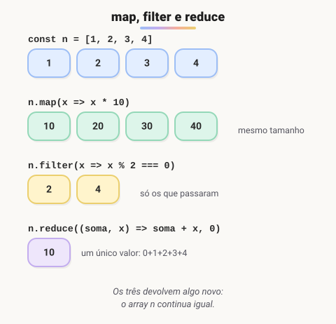

# Métodos de array

> 🗺️ **Nesta aula:** os métodos que transformam, filtram, buscam e resumem arrays (`map`, `filter`, `reduce`, `find`, `some`, `every`, `forEach`, `sort`) e como encadeá-los.

## De onde paramos

Na aula de arrays você percorreu listas com `for`. Funciona, mas o laço manual esconde a intenção. Os métodos de array deixam claro **o que** você quer fazer.

## Por que usar métodos em vez de `for`

**Os métodos de array recebem uma função (callback) que é chamada para cada item**, e cada método tem um propósito: transformar, filtrar, somar, buscar. O código fica mais curto e mais fácil de ler.

```jsx
const produtos = [
  { nome: "Café", preco: 39.9, categoria: "bebida", estoque: 10 },
  { nome: "Chá",  preco: 19.9, categoria: "bebida", estoque: 0 },
  { nome: "Bolo", preco: 25,   categoria: "comida", estoque: 4 },
];
```



## `map`: transformar cada item

Devolve um **novo array do mesmo tamanho**.

```jsx
const nomes = produtos.map(p => p.nome);
// ["Café", "Chá", "Bolo"]

const comDesconto = produtos.map(p => ({
  ...p,
  preco: p.preco * 0.9,
}));
```

## `filter`: ficar só com alguns

Devolve um novo array com os itens em que a função retornou `true`.

```jsx
const disponiveis = produtos.filter(p => p.estoque > 0);
// Café e Bolo
```

## `reduce`: juntar tudo em um valor

A função recebe o **acumulador** (o resultado até agora) e o item atual, e devolve o novo acumulador.

```jsx
const totalEstoque = produtos.reduce(
  (soma, p) => soma + p.preco * p.estoque,
  0
);
// 39.9*10 + 19.9*0 + 25*4 = 499

// agrupar por categoria
const porCategoria = produtos.reduce((grupos, p) => {
  (grupos[p.categoria] ??= []).push(p.nome);
  return grupos;
}, {});
// { bebida: ["Café", "Chá"], comida: ["Bolo"] }
```

O segundo argumento (`0`, `{}`) é o **valor inicial**. Sempre informe: sem ele, `reduce` em um array vazio lança erro.

## Buscar: `find`, `findIndex`, `some`, `every`

```jsx
// o objeto, ou undefined
produtos.find(p => p.nome === "Bolo");
// 2, ou -1
produtos.findIndex(p => p.nome === "Bolo");
// algum sem estoque? true
produtos.some(p => p.estoque === 0);
// todos acima de 10? true
produtos.every(p => p.preco > 10);
```

## `forEach`: só executar algo

```jsx
produtos.forEach(p => {
  console.log(`${p.nome}: R$ ${p.preco.toFixed(2)}`);
});
```

`forEach` **sempre retorna** `undefined` e não dá para interrompê-lo com `break`. Se precisar parar no meio, use `for...of`, `some` ou `find`.

## Ordenar: cuidado com `sort`

```jsx
// compara como TEXTO!
[10, 9, 1, 2].sort();  // [1, 10, 2, 9]
// crescente ✅
[10, 9, 1, 2].sort((a, b) => a - b);  // [1, 2, 9, 10]

// alfabética, respeitando acentos
produtos.sort((a, b) => a.nome.localeCompare(b.nome));
```

> ⚠️ `sort`, `reverse` e `splice` **alteram o array original**. Para não mexer nele, use as versões `toSorted`, `toReversed` e `toSpliced` (ES2023) ou copie antes: `[...lista].sort(...)`. Já `map`, `filter`, `slice` e `concat` sempre devolvem um array novo.

## Encadeando

```jsx
const relatorio = produtos
  .filter(p => p.estoque > 0)
  .map(p => `${p.nome} (${p.estoque})`)
  .join(", ");
// "Café (10), Bolo (4)"
```

## Outros úteis

| Método | Faz |
| --- | --- |
| `flat()` | achata um nível: `[[1,2],[3]]` vira `[1,2,3]` |
| `flatMap(fn)` | `map` seguido de `flat` |
| `Array.from({ length: 3 }, (_, i) => i)` | cria `[0, 1, 2]` |
| `[...new Set(lista)]` | remove repetidos |

## Exercício

Com o array `produtos` acima, use métodos de array para obter: (a) o preço médio dos produtos; (b) os nomes dos produtos da categoria "bebida" em maiúsculas.

<details>
<summary>Ver resposta</summary>

```jsx
const media = produtos.reduce(
  (s, p) => s + p.preco, 0
) / produtos.length;
// (39.9 + 19.9 + 25) / 3 ≈ 28.27

const bebidas = produtos
  .filter(p => p.categoria === "bebida")
  .map(p => p.nome.toUpperCase());
// ["CAFÉ", "CHÁ"]
```

</details>

## 🧠 Revisão rápida

**Qual método usar para obter um array com só uma propriedade de cada objeto?**

`map`.

**Qual a diferença entre `find` e `filter`?**

`find` devolve o primeiro item que casa (ou `undefined`); `filter` devolve um array com todos.

**Por que sempre passar o valor inicial ao `reduce`?**

Para o resultado ter o tipo certo e para não dar erro em array vazio.

> ➡️ **Próximo passo:** todos esses métodos recebem funções. Hora de entender bem as **Funções e arrow functions**.

## 📌 Resumo

| Método | Em uma frase |
| --- | --- |
| `map` | transforma cada item; mesmo tamanho |
| `filter` | mantém os itens que passam no teste |
| `reduce` | resume tudo em um único valor |
| `find` / `findIndex` | primeiro item que casa / sua posição |
| `some` / `every` | algum / todos passam no teste? |
| `forEach` | executa algo para cada item; não retorna |
| `sort` | ordena e altera o original |
