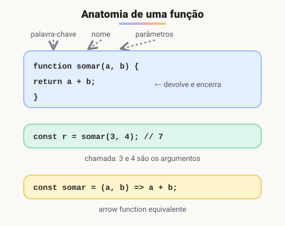

# Funções e arrow functions

> 🗺️ **Nesta aula:** o que é uma função, parâmetros, argumentos e `return`, as formas de criar funções (declaração, expressão e arrow), funções como valores (callbacks), parâmetros padrão e rest.

## De onde paramos

Os métodos de array recebiam funções como `p => p.nome`. Agora vamos entender funções por inteiro: como criar, chamar e reaproveitar blocos de código.

## O que é uma função

**Uma função é um bloco de código com nome, que pode ser reutilizado: recebe dados de entrada (parâmetros), executa instruções e pode devolver um resultado (**`return`**).**



```jsx
function somar(a, b) {
  return a + b;
}

const resultado = somar(3, 4);
console.log(resultado);  // 7
```

- Uma função sem `return` devolve `undefined`.
- O `return` **encerra** a função: nada depois dele é executado.
- Se faltar argumento, o parâmetro vale `undefined`. Use valores padrão:

```jsx
function saudar(nome = "visitante") {
  return `Olá, ${nome}!`;
}
saudar();  // "Olá, visitante!"
saudar("Ana");  // "Olá, Ana!"
```

## Formas de criar funções

```jsx
// 1. Declaração: pode ser chamada antes
// da linha em que foi escrita (hoisting)
function dobro(n) {
  return n * 2;
}

// 2. Expressão de função, guardada numa variável
const triplo = function (n) {
  return n * 3;
};

// 3. Arrow function (ES6)
const quadrado = (n) => {
  return n * n;
};

// arrow com retorno implícito: sem chaves
const quadrado2 = n => n * n;

// para retornar um objeto, use parênteses
const criarPonto = (x, y) => ({ x, y });
```

## Function × arrow function

|  | `function` | arrow `=>` |
| --- | --- | --- |
| Sintaxe | mais longa | curta, com retorno implícito |
| `this` | depende de **como** é chamada | herda de **onde** foi criada |
| `arguments` | disponível | não existe (use `...args`) |
| Usar com `new` | sim | não |
| Hoisting | sim (declarações) | não |

Na prática: use arrow functions para callbacks curtos (`map`, `filter`, eventos simples) e `function` ou métodos de classe quando precisar de um `this` próprio. O `this` é detalhado na aula **Escopo, closures e this**.

## Funções como valores

Em JavaScript, funções são valores: podem ser guardadas em variáveis, passadas como argumento (**callback**) e retornadas por outras funções.

```jsx
const numeros = [1, 2, 3, 4, 5];

function elevarAoQuadrado(numero) {
  return numero * numero;
}

// passamos a função, sem chamá-la (sem parênteses)
const quadrados = numeros.map(elevarAoQuadrado);
console.log(quadrados);  // [1, 4, 9, 16, 25]

// o mesmo com arrow function
const quadrados2 = numeros.map(n => n * n);
```

## Parâmetros rest

```jsx
function somarTodos(...valores) {
  return valores.reduce((t, v) => t + v, 0);
}
somarTodos(1, 2, 3, 4);  // 10
```

## Boas práticas

- Uma função deve fazer **uma coisa só** e ter um nome com verbo que diga o quê: `calcularFrete`, `validarEmail`.
- Prefira **devolver** valores a alterar variáveis de fora (funções "puras" são mais fáceis de testar).
- Poucos parâmetros. Se precisar de muitos, passe um objeto: `criarUsuario({ nome, email, idade })`.

> ⚠️ **Correção:** no exemplo original de `map`, a função e o resultado tinham o mesmo nome (`function quadrado` e `const quadrado`), o que gera **SyntaxError: Identifier 'quadrado' has already been declared**. Os nomes foram trocados para `elevarAoQuadrado` e `quadrados`.

## Exercício

Escreva uma arrow function `calcularDesconto(preco, percentual = 10)` que devolva o preço com desconto, arredondado para 2 casas. Depois use-a com `map` no array `[100, 59.9, 20]`.

<details>
<summary>Ver resposta</summary>

```jsx
const calcularDesconto = (preco, percentual = 10) =>
  Number((preco * (1 - percentual / 100)).toFixed(2));

calcularDesconto(100);  // 90
calcularDesconto(100, 25);  // 75

[100, 59.9, 20].map(p => calcularDesconto(p));
// [90, 53.91, 18]
```

Foi preciso envolver em `p => ...` porque o `map` passa também o índice como segundo argumento, que viraria o percentual.

</details>

## 🧠 Revisão rápida

**O que uma função sem `return` devolve?**

`undefined`.

**Qual a diferença entre parâmetro e argumento?**

Parâmetro é a variável na definição; argumento é o valor passado na chamada.

**Qual forma de função pode ser chamada antes de ser escrita?**

A declaração (`function nome() {}`), por causa do hoisting.

> ➡️ **Próximo passo:** funções criam escopos e "lembram" onde nasceram. Veja **Escopo, closures e this**.

## 📌 Resumo

| Item | Em uma frase |
| --- | --- |
| Função | bloco reutilizável com entrada e saída |
| `return` | devolve o valor e encerra a função |
| Parâmetro padrão | `nome = "visitante"` |
| Arrow function | `(a, b) => a + b`, sem this próprio |
| Callback | função passada como argumento |
| Rest `...args` | junta vários argumentos num array |
