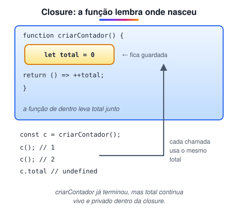

# Escopo, closures e this (Adicionado pelo aluno para melhorar o estudo)

> 🗺️ **Nesta aula:** como o escopo funciona em funções e blocos, o que é uma closure e para que serve, e como o valor de `this` é decidido em cada tipo de chamada.

## De onde paramos

Na aula de funções vimos que arrow functions e funções comuns tratam o `this` de forma diferente. Esta aula explica isso, junto com dois conceitos que causam boa parte dos bugs "misteriosos" de JavaScript: escopo e closures.

## Escopo: onde uma variável existe

**Escopo é a região do código em que uma variável pode ser usada.** Cada função cria um escopo, e cada par de chaves cria um escopo de bloco para `let` e `const`. Um escopo de dentro enxerga as variáveis dos escopos de fora, mas não o contrário.

```jsx
const global = "visível em todo lugar";

function exemplo() {
  const local = "só dentro da função";
  if (true) {
    let bloco = "só dentro do if";
    // var ignora blocos
    var antigo = "vaza do if";
  }
  console.log(antigo);  // funciona
  console.log(bloco);  // ReferenceError
}
```

|  | Escopo | Reatribuir | Antes da declaração |
| --- | --- | --- | --- |
| `var` | função | sim | `undefined` |
| `let` | bloco | sim | erro |
| `const` | bloco | não | erro |

Use `const` por padrão, `let` quando precisar reatribuir e evite `var`.

## Closure: a função que lembra

**Uma closure é uma função que continua tendo acesso às variáveis do lugar onde foi criada**, mesmo depois que esse lugar terminou de executar.



```jsx
function criarContador() {
  // "privada": ninguém de fora acessa
  let total = 0;
  return {
    somar: () => ++total,
    ver: () => total,
  };
}

const c = criarContador();
c.somar();
c.somar();
console.log(c.ver());  // 2
console.log(c.total);  // undefined
```

Usos comuns: dados privados, fábricas de funções e callbacks que lembram valores.

```jsx
// fábrica de funções
function multiplicador(fator) {
  return n => n * fator;
}
const dobrar = multiplicador(2);
dobrar(5);  // 10
```

### O clássico do `var` no laço

```jsx
for (var i = 0; i < 3; i++) {
  setTimeout(() => console.log(i));
}
// 3 3 3

for (let j = 0; j < 3; j++) {
  setTimeout(() => console.log(j));
}
// 0 1 2
```

Com `var`, existe **um** `i` compartilhado, que já vale 3 quando os callbacks rodam; com `let`, cada volta do laço tem o seu.

## `this`: depende de como a função é chamada

Em uma função comum, `this` **não é definido onde a função foi escrita, e sim no momento da chamada**:

```jsx
const pessoa = {
  nome: "Ana",
  ola() {
    return `Oi, ${this.nome}`;
  },
};

// this = pessoa (o que vem antes do ponto)
pessoa.ola();  // "Oi, Ana"

const solta = pessoa.ola;
// this perdido: undefined em módulos → erro
solta();
```

| Chamada | `this` |
| --- | --- |
| `obj.metodo()` | `obj` |
| `funcao()` solta | `undefined` (strict/módulos) ou o objeto global |
| `new Classe()` | o objeto novo |
| `fn.call(x)`, `apply`, `bind` | `x` |
| listener com `function` | o elemento do evento |
| **arrow function** | **herda** o `this` de onde foi criada |

### Arrow resolve o callback, mas não serve como método

```jsx
class Timer {
  segundos = 0;
  iniciar() {
    // ✅ arrow herda o this da instância
    setInterval(() => this.segundos++, 1000);
  }
}

const obj = {
  nome: "Ana",
  // ❌ arrow não tem this próprio
  ola: () => `Oi, ${this.nome}`,
};
```

## Exercício

Crie uma função `criarCofre(senha)` que guarde um saldo privado começando em 0 e devolva dois métodos: `depositar(valor)` e `ver(senhaInformada)`, que só mostra o saldo se a senha estiver certa.

<details>
<summary>Ver resposta</summary>

```jsx
function criarCofre(senha) {
  let saldo = 0;
  return {
    depositar(valor) {
      if (valor > 0) saldo += valor;
    },
    ver(senhaInformada) {
      return senhaInformada === senha
        ? saldo
        : "Senha incorreta";
    },
  };
}

const cofre = criarCofre("1234");
cofre.depositar(50);
cofre.ver("0000");  // "Senha incorreta"
cofre.ver("1234");  // 50
```

`saldo` e `senha` só existem dentro da closure: não há como alterá-los por fora.

</details>

## 🧠 Revisão rápida

**O que é uma closure?**

Uma função que mantém acesso às variáveis do escopo onde foi criada.

**Em `pessoa.ola()`, quanto vale `this`?**

`pessoa`, o objeto antes do ponto.

**Por que não usar arrow function como método de objeto?**

Porque ela não tem `this` próprio e não enxerga o objeto.

> ➡️ **Próximo passo:** objetos apareceram em vários exemplos. Hora de estudá-los a fundo em **Objetos**.

## 📌 Resumo

| Item | Em uma frase |
| --- | --- |
| Escopo | onde a variável pode ser usada |
| Escopo de bloco | `let`/`const` só existem nas chaves |
| Closure | função que lembra variáveis de onde nasceu |
| Dados privados | variáveis protegidas por uma closure |
| `this` | definido no momento da chamada |
| Arrow e this | herda o this do lugar onde foi criada |
| `bind` | fixa o this de uma função |
