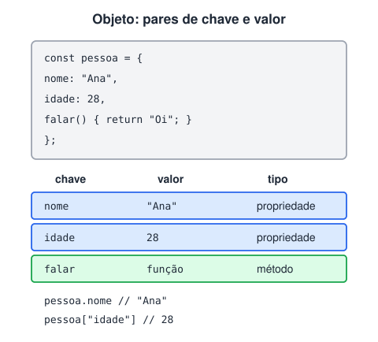

# Objetos

> 🗺️ **Nesta aula:** criar objetos literais, acessar e alterar propriedades, métodos, atalhos modernos (propriedades curtas, desestruturação, spread), percorrer objetos e uma primeira olhada em JSON.

## De onde paramos

Arrays guardam listas em ordem. Mas um produto tem nome, preço e estoque, e cada dado tem um significado diferente. Para agrupar dados com nome, usamos objetos.

## O que é um objeto

**Um objeto agrupa dados relacionados em pares de chave e valor.** Ele representa uma "coisa" (uma pessoa, um produto, um pedido) com suas características (**propriedades**) e ações (**métodos**).



## Criando (objeto literal)

```jsx
const pessoa = {
  nome: "João",
  idade: 25,
  cidade: "São Paulo",
  // chaves com espaço precisam de aspas
  "nome completo": "João da Silva",
};
```

## Acessando e alterando

```jsx
// notação de ponto
pessoa.nome;  // "João"
// notação de colchetes
pessoa["nome completo"];  // "João da Silva"

// chave vinda de uma variável
const campo = "cidade";
pessoa[campo];  // "São Paulo"

pessoa.idade = 30;  // altera
pessoa.email = "joao@exemplo.com";  // cria
delete pessoa.cidade;  // remove

pessoa.telefone;  // undefined
"nome" in pessoa;  // true
```

## Métodos e `this`

```jsx
const pessoa = {
  nome: "João",
  // forma curta de método
  saudacao() {
    console.log(`Olá, eu sou o ${this.nome}!`);
  },
};

pessoa.saudacao();  // "Olá, eu sou o João!"
```

Dentro de um método, `this` é o objeto que chamou o método. Por isso, **não use arrow function como método** quando precisar do `this` (veja a aula anterior).

## Atalhos modernos

```jsx
const nome = "Ana";
const idade = 28;

// propriedades curtas: chave = nome da variável
const usuario = { nome, idade };
// { nome: "Ana", idade: 28 }

// desestruturação, com renomeação e padrão
const { nome: n, cidade = "N/D" } = usuario;

// spread: copiar e mesclar
const atualizado = { ...usuario, idade: 29 };

// encadeamento opcional
usuario.endereco?.rua;  // undefined, sem erro
```

## Percorrendo

```jsx
for (const chave in pessoa) {
  console.log(`${chave}: ${pessoa[chave]}`);
}

Object.keys(pessoa);  // ["nome", "idade", ...]
Object.values(pessoa);  // ["João", 25, ...]
Object.entries(pessoa);  // [["nome", "João"], ...]

for (const [chave, valor] of Object.entries(pessoa)) {
  console.log(chave, valor);
}
```

## Vários objetos com a mesma estrutura

Para criar muitos objetos parecidos, use uma **classe**:

```jsx
class Pessoa {
  constructor(nome, idade) {
    this.nome = nome;
    this.idade = idade;
  }
}

const pessoa1 = new Pessoa("João", 25);
const pessoa2 = new Pessoa("Maria", 30);
```

Classes são o assunto do módulo de **POO em JavaScript**.

## JSON

JSON é um formato de texto baseado em objetos JS, usado para trocar dados com APIs:

```jsx
const texto = JSON.stringify({ nome: "Ana", idade: 28 });
// '{"nome":"Ana","idade":28}'

// de volta para objeto
const obj = JSON.parse(texto);
```

Ele é detalhado na aula **JSON e fetch**.

## Exercício

Crie um objeto `carrinho` com uma propriedade `itens` (array vazio) e dois métodos: `adicionar(nome, preco)` e `total()`, que soma os preços.

<details>
<summary>Ver resposta</summary>

```jsx
const carrinho = {
  itens: [],
  adicionar(nome, preco) {
    this.itens.push({ nome, preco });
  },
  total() {
    return this.itens.reduce((s, i) => s + i.preco, 0);
  },
};

carrinho.adicionar("Café", 39.9);
carrinho.adicionar("Bolo", 25);
carrinho.total();  // 64.9
```

</details>

## 🧠 Revisão rápida

**Quando usar colchetes em vez de ponto?**

Quando a chave tem espaço ou caractere especial, ou quando vem de uma variável.

**O que `{ ...usuario, idade: 29 }` faz?**

Cria um objeto novo com as propriedades de `usuario`, trocando a idade.

**Como percorrer chave e valor ao mesmo tempo?**

`for (const [k, v] of Object.entries(obj))`.

> ➡️ **Próximo passo:** o que fazer quando algo dá errado, como um JSON inválido? Veja **Tratamento de erros**.

## 📌 Resumo

| Item | Em uma frase |
| --- | --- |
| Objeto literal | `{ chave: valor }` |
| Propriedade / método | dado / função do objeto |
| Ponto ou colchetes | `obj.nome` ou `obj["nome"]` |
| `delete` / `in` | remove / testa uma chave |
| Desestruturação | tira propriedades para variáveis |
| Spread | copia e mescla objetos |
| `Object.entries` | lista pares chave e valor |
| JSON | texto para trocar dados |
