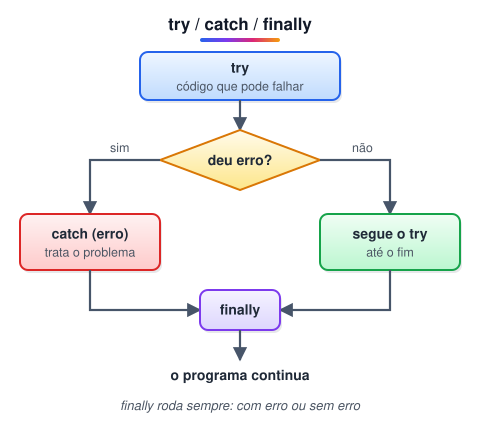

# Tratamento de erros (try/catch) (Adicionado pelo aluno para melhorar o estudo)

> 🗺️ **Nesta aula:** tratar erros com `try`, `catch` e `finally`, os tipos de erro mais comuns, lançar seus próprios erros com `throw` e tratar erros em código assíncrono.

## De onde paramos

Na aula de objetos você viu `JSON.parse`. Se o texto não for um JSON válido, ele lança um erro, e o script para. Programas reais precisam lidar com dados ruins, falhas de rede e entradas inesperadas.

## Por que tratar erros

**Sem tratamento, um erro interrompe o script, e o usuário fica olhando uma tela parada.** Tratar erros permite mostrar uma mensagem útil, tentar de novo ou registrar o problema.

## `try`, `catch` e `finally`



```jsx
try {
  // pode falhar
  const dados = JSON.parse(textoRecebido);
  mostrar(dados);
} catch (erro) {
  console.error("JSON inválido:", erro.message);
  mostrarAviso("Não foi possível carregar.");
} finally {
  // roda SEMPRE, com ou sem erro
  esconderCarregando();
}
```

Quando uma linha do `try` falha, as linhas seguintes do `try` são puladas e a execução vai direto para o `catch`. O objeto de erro tem `name` (ex.: `SyntaxError`), `message` e `stack` (onde aconteceu).

## Tipos de erro comuns

| Erro | Exemplo |
| --- | --- |
| `ReferenceError` | usar uma variável que não existe |
| `TypeError` | `undefined.nome`, chamar algo que não é função |
| `SyntaxError` | código mal escrito, `JSON.parse("{oi}")` |
| `RangeError` | `new Array(-1)`, recursão infinita |

## Lançando seus próprios erros

```jsx
class SaldoInsuficienteError extends Error {
  constructor(saldo, valor) {
    super(`Saldo de R$ ${saldo} é menor que R$ ${valor}`);
    this.name = "SaldoInsuficienteError";
  }
}

function sacar(conta, valor) {
  if (valor <= 0) {
    throw new Error("O valor deve ser positivo");
  }
  if (valor > conta.saldo) {
    throw new SaldoInsuficienteError(conta.saldo, valor);
  }
  conta.saldo -= valor;
}

try {
  sacar({ saldo: 50 }, 100);
} catch (e) {
  if (e instanceof SaldoInsuficienteError) {
    alert(e.message);
  } else {
    // erro inesperado: deixe subir
    throw e;
  }
}
```

Lance sempre um `Error` (ou subclasse), e não uma string: `throw "ops"` perde o `stack`.

## Erros em código assíncrono

`try/catch` só pega erros de Promises com `await`:

```jsx
async function carregar() {
  try {
    const resp = await fetch("/api/produtos");
    // fetch NÃO falha em 404/500!
    if (!resp.ok) throw new Error(`HTTP ${resp.status}`);
    return await resp.json();
  } catch (erro) {
    console.error("Falha ao carregar:", erro);
    return [];
  }
}

// com .then:
fetch("/api")
  .then(r => r.json())
  .catch(erro => console.error(erro));
```

> ⚠️ Um `try` em volta de um `setTimeout` **não pega** um erro lançado dentro do callback: quando o callback roda, o `try` já terminou. Coloque o `try` **dentro** do callback.

## Boas práticas

- Não "engula" erros com `catch {}` vazio: no mínimo, registre.
- Trate o erro **onde dá para fazer algo útil**; nos outros lugares, deixe subir.
- Mostre ao usuário uma mensagem **humana** e guarde os detalhes técnicos no console ou no log.
- Valide as entradas cedo, antes de executar, para evitar erros depois.

## Exercício

Escreva uma função `lerIdade(texto)` que converta o texto em número e lance um erro com mensagem clara se o resultado não for um número inteiro entre 0 e 130. Depois chame-a dentro de um `try/catch` com o valor `"abc"`.

<details>
<summary>Ver resposta</summary>

```jsx
function lerIdade(texto) {
  const idade = Number(texto);
  if (!Number.isInteger(idade) || idade < 0 || idade > 130) {
    throw new Error(`Idade inválida: "${texto}"`);
  }
  return idade;
}

try {
  lerIdade("abc");
} catch (e) {
  console.log(e.message);  // Idade inválida: "abc"
}
```

</details>

## 🧠 Revisão rápida

**Quando o bloco `finally` roda?**

Sempre: com erro ou sem erro.

**O `fetch` cai no `catch` quando a API responde 404?**

Não. Só em falha de rede. Confira `resp.ok` e lance o erro você mesmo.

**Por que lançar `new Error()` e não uma string?**

Para manter o `stack`, que mostra onde o erro aconteceu.

> ➡️ **Próximo passo:** com o código crescendo, é hora de dividi-lo em arquivos: **Módulos: import e export**.

## 📌 Resumo

| Item | Em uma frase |
| --- | --- |
| `try` | bloco que pode falhar |
| `catch (erro)` | trata a falha |
| `finally` | roda sempre |
| `throw new Error()` | lança um erro seu |
| Classe de erro | `extends Error` para erros específicos |
| Assíncrono | use `await` dentro do try, ou `.catch` |
| `resp.ok` | o fetch não falha em 404/500 |
