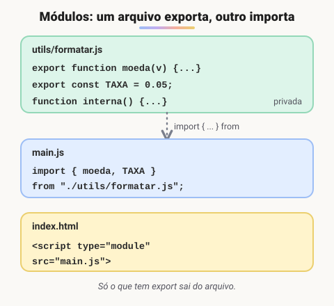

# Módulos: import e export (Adicionado pelo aluno para melhorar o estudo)

> 🗺️ **Nesta aula:** dividir o código em arquivos com `export` e `import`, exports nomeados e padrão, módulos no navegador e no Node.js, e import dinâmico.

## De onde paramos

Os exemplos até aqui cabiam num arquivo só. Projetos reais têm dezenas de funções, classes e utilitários. Colocar tudo num `main.js` gigante gera variáveis globais brigando entre si e código impossível de achar.

## Por que dividir em módulos

**Um módulo é um arquivo JavaScript com escopo próprio que escolhe o que mostrar aos outros arquivos.** O que não for exportado fica privado ao arquivo.



> 💡 **Analogia:** cada módulo é como uma loja num shopping. O que fica na vitrine (o `export`) qualquer um pode levar; o estoque nos fundos é só da loja. O `import` é ir até a loja certa (o caminho do arquivo) e pedir exatamente o item que você quer.

## Export nomeado

```jsx
// utils/formatar.js
export function moeda(valor) {
  return valor.toLocaleString("pt-BR", {
    style: "currency",
    currency: "BRL",
  });
}
export const TAXA = 0.05;
```

```jsx
// main.js
import { moeda, TAXA } from "./utils/formatar.js";

console.log(moeda(1234.5));  // "R$ 1.234,50"
```

```jsx
// renomeando na importação
import { moeda as formatarMoeda }
  from "./utils/formatar.js";
// importando tudo: fmt.moeda()
import * as fmt from "./utils/formatar.js";
```

## Export padrão (default)

Cada arquivo pode ter **um** export padrão, importado **sem chaves** e com o nome que você quiser:

```jsx
// Carrinho.js
export default class Carrinho {
  // ...
}

// main.js
import Carrinho from "./Carrinho.js";
```

Muitos times preferem **só exports nomeados**: o nome fica igual em todo o projeto e o editor completa automaticamente.

## No navegador

```html
<script type="module" src="js/main.js"></script>
```

- `type="module"` é obrigatório para usar `import`.
- No navegador, escreva o caminho **com** `./` **e com** `.js`.
- Módulos são carregados com `defer` automático e rodam em *strict mode*.

> ⚠️ Módulos **não funcionam abrindo o arquivo direto** (`file://`): o navegador bloqueia por CORS. Use a extensão Live Server do VS Code ou outro servidor local.

## No Node.js

O Node tem dois sistemas:

```jsx
// ES Modules (moderno): precisa de
// "type": "module" no package.json
// ou da extensão .mjs
import express from "express";
export function soma(a, b) {
  return a + b;
}
```

```jsx
// CommonJS (antigo, ainda muito comum)
const express = require("express");
module.exports = { soma };
```

Pacotes do npm são importados **pelo nome**, sem `./` (`import express from "express"`); arquivos seus, **pelo caminho** (`./rotas.js`).

## Import dinâmico

Carrega um módulo só quando precisar, o que deixa a página inicial mais leve:

```jsx
botaoGrafico.addEventListener("click", async () => {
  const { desenharGrafico } =
    await import("./grafico.js");
  desenharGrafico();
});
```

## Exercício

Crie um módulo `calculos.js` que exporte as funções `somar` e `media`, e um `main.js` que importe as duas e mostre a média de `[4, 8, 6]`.

<details>
<summary>Ver resposta</summary>

```jsx
// calculos.js
export const somar = (lista) =>
  lista.reduce((s, n) => s + n, 0);
export const media = (lista) =>
  somar(lista) / lista.length;
```

```jsx
// main.js
import { media } from "./calculos.js";
console.log(media([4, 8, 6]));  // 6
```

```html
<script type="module" src="main.js"></script>
```

O `main.js` só precisa importar `media`; ela usa `somar` internamente.

</details>

## 🧠 Revisão rápida

**Qual a diferença entre export nomeado e padrão?**

O nomeado é importado com chaves e com o mesmo nome; o padrão, sem chaves e com qualquer nome. Só pode haver um padrão por arquivo.

**Por que o `import` falha ao abrir o HTML com duplo clique?**

Porque módulos exigem um servidor (http://), não `file://`.

> ➡️ **Próximo passo:** agora vamos usar o JavaScript para mexer na página. Conheça o **DOM**.

## 📌 Resumo

| Item | Em uma frase |
| --- | --- |
| Módulo | arquivo com escopo próprio |
| `export` | torna algo visível para outros arquivos |
| `import { x }` | importa um export nomeado |
| `export default` | o export principal, importado sem chaves |
| `type="module"` | habilita módulos no navegador |
| CommonJS | `require` e `module.exports` do Node |
| `import()` | carrega um módulo sob demanda |
