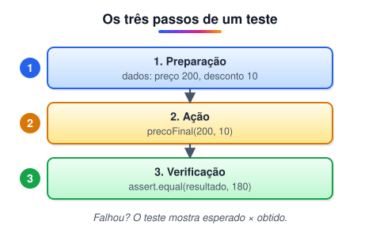

# Testes automatizados com node:test (Adicionado pelo aluno para melhorar o estudo)

> 🗺️ **Nesta aula:** o que é um teste automatizado, como escrever e rodar testes com o `node:test` (já incluso no Node), como ler uma falha, como testar erros e as boas práticas para testes que ajudam em vez de atrapalhar.

## De onde paramos

Na aula anterior você aprendeu a tratar erros com `try/catch`. Mas como ter certeza de que uma função continua certa depois de cada mudança no código? Conferir à mão toda vez não escala. É para isso que existem os testes automatizados.

## O que é um teste automatizado

Quando você muda uma linha de um programa, o risco não está só na linha alterada, e sim em tudo o que dependia dela. Conferir manualmente cada função depois de toda mudança é lento, e a pessoa acaba pulando a conferência. Um **teste automatizado é um pequeno código que chama outro código com uma entrada conhecida e confere se a saída é a esperada**. Você escreve o teste uma vez e o roda quantas vezes quiser, em segundos. Se algo quebrar, o teste avisa na hora e aponta o que falhou.

> 💡 **Analogia:** um teste é como o inspetor de qualidade de uma fábrica de lâmpadas: toda lâmpada que sai da linha passa pelo mesmo teste de acender. Se uma mudança no processo gerar lâmpadas defeituosas, o inspetor percebe antes de elas chegarem à loja.

## Seu primeiro teste

O Node já traz um executor de testes, o `node:test`, e uma biblioteca de verificações, o `node:assert`. Não é preciso instalar nada. Comece com a função que será testada, um cálculo de preço com desconto:

```jsx
// desconto.js
// calcula o preço final com desconto em porcentagem
export function precoFinal(preco, desconto) {
  if (preco < 0) throw new Error("preço inválido");
  if (desconto < 0 || desconto > 100) {
    throw new Error("desconto inválido");
  }
  return preco - (preco * desconto) / 100;
}
```

Agora o arquivo de teste. Por convenção, ele termina em `.test.js`:

```jsx
// desconto.test.js
import { test } from "node:test";
import assert from "node:assert/strict";
import { precoFinal } from "./desconto.js";

test("aplica 10% de desconto", () => {
  // 200 menos 10% deve dar 180
  assert.equal(precoFinal(200, 10), 180);
});

test("sem desconto, o preço não muda", () => {
  assert.equal(precoFinal(50, 0), 50);
});
```

Para rodar, use o comando abaixo (o projeto precisa ter `"type": "module"` no `package.json`):

```bash
# procura e executa todos os arquivos *.test.js
node --test
```

O resultado mostra um `ok` para cada teste que passou e um resumo no final, com a contagem de `pass` e `fail`.

## Os três passos de um bom teste

Todo teste legível segue a mesma sequência. Primeiro, a **preparação** (*arrange*): os dados de entrada. Depois, a **ação** (*act*): chamar a função. Por fim, a **verificação** (*assert*): comparar o resultado com o esperado. No exemplo, a preparação são os números 200 e 10, a ação é `precoFinal(200, 10)` e a verificação é `assert.equal(..., 180)`. Um teste deve verificar **uma única ideia**, e o nome dele precisa dizer qual é, porque é o nome que aparece quando ele falha.



> 💡 **Analogia:** é como provar uma receita: separar os ingredientes (preparação), assar (ação) e comparar o bolo com a foto do livro (verificação). Se o bolo não bate com a foto, você sabe que algo saiu do previsto.

## Lendo uma falha

Um teste que nunca falha não prova nada. Para ver como a falha aparece, troque o valor esperado de 180 por 170 e rode de novo:

```
not ok 1 - aplica 10% de desconto
  expected: 170
  actual: 180
```

A mensagem diz o que você esperava (`expected`) e o que a função devolveu (`actual`). Quando um teste falha, há duas possibilidades: o código está errado ou o teste está errado. Descobrir qual é o trabalho de quem programa.

## Testando erros

O caminho de erro também é um comportamento, e deve ser testado. A função `assert.throws` espera que o código lance uma exceção, e você pode conferir a mensagem:

```jsx
test("recusa desconto acima de 100%", () => {
  // a chamada precisa lançar o erro combinado
  assert.throws(() => precoFinal(100, 150), {
    message: "desconto inválido",
  });
});
```

Repare que a chamada vai dentro de uma função de seta. Se você escrevesse `assert.throws(precoFinal(100, 150))`, o erro seria lançado antes de o `assert` começar, e o teste quebraria de um jeito confuso.

## Boas práticas e armadilhas

> ⚠️ **Armadilha comum:** testar o que o código *faz por dentro* em vez do que ele *entrega*. Se o teste depende de detalhes internos, qualquer refatoração o quebra, mesmo com o programa funcionando. Teste a entrada e a saída.

- **Teste os limites:** o zero, o máximo (100%), o vazio e o valor inválido. É ali que os bugs se escondem.
- **Um teste, uma ideia:** se o teste falha, você já sabe qual regra quebrou.
- **Testes independentes:** um teste não pode depender do resultado de outro nem da ordem de execução.
- **Rode sempre:** um teste esquecido numa gaveta não protege nada. Rode antes de cada commit.

## Exercício

Crie a função `media(lista)`, que devolve a média dos números de uma lista e lança o erro "lista vazia" quando a lista não tem itens. Escreva três testes: a média de `[2, 4, 6]`, a lista vazia e a média de números decimais.

<details>
<summary>Ver resposta</summary>

```jsx
// media.js
// média aritmética de uma lista de números
export function media(lista) {
  if (lista.length === 0) {
    throw new Error("lista vazia");
  }
  const soma = lista.reduce((total, n) => total + n, 0);
  return soma / lista.length;
}
```

```jsx
// media.test.js
import { test } from "node:test";
import assert from "node:assert/strict";
import { media } from "./media.js";

test("média de 2, 4 e 6 é 4", () => {
  assert.equal(media([2, 4, 6]), 4);
});

test("lista vazia lança erro", () => {
  assert.throws(() => media([]), {
    message: "lista vazia",
  });
});

test("aceita decimais", () => {
  assert.equal(media([1.5, 2.5]), 2);
});
```

Teste: `node --test` deve mostrar 3 testes passando e 0 falhando.

</details>

## 🧠 Revisão rápida

**O que é um teste automatizado?**

Um código que chama outro código com uma entrada conhecida e confere se a saída é a esperada.

**Como rodar os testes no Node, sem instalar nada?**

Com o comando `node --test`, que executa os arquivos `*.test.js`.

**Por que a chamada vai dentro de uma função em `assert.throws`?**

Para que o `assert` consiga capturar o erro. Sem a função, o erro é lançado antes de a verificação começar.

> ➡️ **Próximo passo:** dividir o código em arquivos que se conversam: **Módulos: import e export**.

## 📌 Resumo

| Item | Em uma frase |
| --- | --- |
| Teste automatizado | código que confere se outro código devolve o esperado |
| `node --test` | executa os testes, sem instalar nada |
| `assert.equal` | compara o resultado com o valor esperado |
| `assert.throws` | confirma que o código lança um erro |
| Boa prática | uma ideia por teste, testes independentes |
