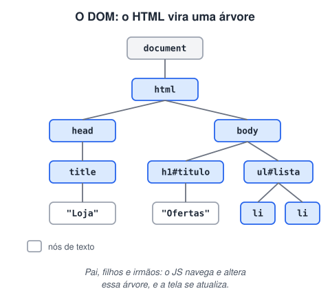

# DOM

> 🗺️ **Nesta aula:** o que é o DOM, o que dá para fazer com ele, um primeiro exemplo completo, quando o DOM está pronto para o script e a diferença entre o HTML original e o DOM.

## De onde paramos

Você já domina a linguagem: variáveis, funções, objetos, erros e módulos. Falta ligar tudo isso à página. A ponte entre o JavaScript e o HTML é o DOM.

## O que é o DOM

**O DOM (Document Object Model) é a representação da página que o navegador monta na memória: cada tag, texto e atributo do HTML vira um objeto, organizado em forma de árvore.** O JavaScript não altera o arquivo `.html`: ele altera essa árvore, e o navegador redesenha a tela na hora.



O ponto de entrada é o objeto global `document`.

## O que dá para fazer com o DOM

| Tarefa | Principais ferramentas |
| --- | --- |
| **Selecionar** elementos | `querySelector`, `querySelectorAll`, `getElementById` |
| **Ler e alterar conteúdo** | `textContent`, `innerHTML`, `value` |
| **Alterar atributos** | `setAttribute`, `el.href`, `el.src`, `dataset` |
| **Alterar estilos** | `classList` (preferível) ou `el.style` |
| **Criar e remover** | `createElement`, `append`, `remove` |
| **Navegar pela árvore** | `parentElement`, `children`, `closest` |
| **Reagir ao usuário** | `addEventListener` |

## Um exemplo completo

```html
<button id="contador">Cliques: 0</button>
```

```jsx
// 1. selecionar
const botao = document.querySelector("#contador");
let cliques = 0;

// 2. reagir ao clique
botao.addEventListener("click", () => {
  cliques++;
  // 3. alterar conteúdo e classe
  botao.textContent = `Cliques: ${cliques}`;
  botao.classList.toggle("par", cliques % 2 === 0);
});
```

Quase todo código de DOM segue esses três passos: **selecionar**, **escutar um evento** e **alterar** algo.

## Quando o DOM está pronto?

O script só encontra elementos que **já existem** na árvore. Se o `<script>` estiver no `<head>` sem `defer`, um `querySelector` devolve `null`, e a próxima linha dá `TypeError`. Use `defer` (recomendado), coloque o script no fim do `<body>` ou espere o evento `DOMContentLoaded`.

```jsx
document.addEventListener("DOMContentLoaded", () => {
  // aqui todos os elementos já existem
});
```

## DOM × HTML × "o que você vê"

- O **HTML** é o arquivo de texto que o servidor envia.
- O **DOM** é a árvore viva, que o JS pode ter alterado depois do carregamento.
- Na aba **Elements** do DevTools (F12), você vê o DOM atual, não o HTML original. Para ver o arquivo original, use "Exibir código-fonte" (Ctrl+U).

> 💡 **Dica do DevTools:** selecione um elemento na aba Elements e digite `$0` no Console. Ele passa a ser uma variável que você pode testar: `$0.textContent = "teste"`.

## Exercício

Crie um `<p id="saudacao">` vazio e um `<input id="nome">`. A cada letra digitada, o parágrafo deve mostrar "Olá, NOME!" (ou "Olá!" se o campo estiver vazio).

<details>
<summary>Ver resposta</summary>

```jsx
const campo = document.querySelector("#nome");
const saudacao = document.querySelector("#saudacao");

campo.addEventListener("input", () => {
  const nome = campo.value.trim();
  saudacao.textContent = nome ? `Olá, ${nome}!` : "Olá!";
});
```

O evento `input` dispara a cada alteração do campo.

</details>

## 🧠 Revisão rápida

**O JavaScript altera o arquivo HTML?**

Não. Ele altera o DOM, a árvore que o navegador montou na memória.

**Por que `querySelector` pode devolver `null`?**

Porque o elemento não existe ou o script rodou antes de ele ser criado.

**Quais são os três passos típicos de um código de DOM?**

Selecionar o elemento, escutar um evento e alterar algo.

> ➡️ **Próximo passo:** vamos detalhar conteúdo, estilos, classes, eventos e navegação em **Conceitos importantes de DOM com exemplos 1**.

## 📌 Resumo

| Item | Em uma frase |
| --- | --- |
| DOM | árvore de objetos que representa a página |
| `document` | ponto de entrada do DOM |
| Nó | cada elemento, texto ou atributo da árvore |
| `querySelector` | encontra um elemento pelo seletor CSS |
| `addEventListener` | reage a ações do usuário |
| `defer` / `DOMContentLoaded` | garante que o DOM já existe |
| Aba Elements | mostra o DOM atual, não o HTML original |
