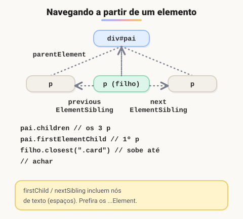

# Conceitos importantes de DOM com exemplos 1

> 🗺️ **Nesta aula:** alterar conteúdo, atributos, estilos e classes, os eventos mais comuns, navegar pela árvore e criar e remover elementos.

## De onde paramos

Na aula anterior você viu o que é o DOM e o padrão selecionar → escutar → alterar. Agora vamos conhecer as ferramentas de cada etapa.

## Conteúdo e atributos

```jsx
const titulo = document.querySelector("#titulo");
// troca o texto (seguro)
titulo.textContent = "Novo texto";

const link = document.querySelector("a");
link.setAttribute("href", "https://www.exemplo.com");
// equivalente, via propriedade
link.href = "https://www.exemplo.com";
link.target = "_blank";
```

## Estilos

```jsx
const caixa = document.querySelector("#caixa");
// propriedades CSS em camelCase
caixa.style.backgroundColor = "red";
caixa.style.color = "white";
// sempre com unidade, como texto
caixa.style.fontSize = "16px";
```

> 💡 `el.style` escreve estilos **inline**, que têm prioridade altíssima e espalham CSS pelo JavaScript. Prefira manter os estilos no CSS e só trocar classes.

## Classes

```jsx
caixa.classList.add("ativo");
caixa.classList.remove("oculto");
// põe se não tem, tira se tem
caixa.classList.toggle("destaque");
// põe se temErro for true, tira se for false
caixa.classList.toggle("erro", temErro);
caixa.classList.contains("ativo");  // true/false
caixa.classList.replace("azul", "verde");
```

## Eventos

```jsx
const botao = document.querySelector("#botao");
botao.addEventListener("click", () => {
  console.log("Botão clicado!");
});

const campo = document.querySelector("#campo");
campo.addEventListener("input", (event) => {
  console.log("Valor:", event.target.value);
});

const form = document.querySelector("form");
form.addEventListener("submit", (event) => {
  // impede o recarregamento da página
  event.preventDefault();
  // valida e envia os dados com JS
});
```

| Evento | Quando dispara |
| --- | --- |
| `click` | clique (ou Enter/Espaço em botões) |
| `input` | a cada alteração em um campo |
| `change` | ao sair do campo com valor alterado; na hora em select e checkbox |
| `submit` | envio do formulário |
| `keydown` | tecla pressionada (`event.key` diz qual) |
| `DOMContentLoaded` | o HTML foi todo carregado |

Para parar de escutar, use `removeEventListener` com a **mesma** função (por isso ela precisa ter nome).

## Navegando pela árvore



> 💡 **Analogia:** navegar pelo DOM é como andar por uma árvore genealógica. De qualquer pessoa você chega à mãe (`parentElement`), aos filhos (`children`) e aos irmãos do lado (`nextElementSibling`). O `closest` é perguntar "qual é o meu antepassado mais próximo que tem tal sobrenome?".

```jsx
const pai = document.querySelector("#pai");

// primeiro filho que é elemento
pai.firstElementChild;
// todos os filhos-elemento
pai.children;

const filho = pai.firstElementChild;
filho.nextElementSibling;  // próximo irmão
filho.previousElementSibling;  // irmão anterior
filho.parentElement;  // pai
// ancestral mais próximo que casa com o seletor
filho.closest(".card");
```

> ⚠️ **Correção:** o exemplo original usava `firstChild` e `nextSibling`, que incluem **nós de texto**, até as quebras de linha e espaços do HTML. Por isso `pai.firstChild` quase sempre devolve um texto vazio, e não o primeiro elemento. Use as versões com **Element** no nome.

## Criando e removendo elementos

```jsx
const novo = document.createElement("div");
novo.textContent = "Novo elemento";
novo.classList.add("card");

// adiciona no final (aceita vários nós e textos)
document.body.append(novo);
// ou no início
document.body.prepend(novo);

// remove direto, sem precisar do pai
document.querySelector("#filho").remove();
```

> 💡 O modelo antigo `pai.removeChild(filho)` ainda funciona, mas `filho.remove()` é mais simples.

## Consultas avançadas

```jsx
const el = document.querySelector(".minhaClasse");
const paragrafos = document.querySelectorAll("p");
// o elemento casa com o seletor?
el.matches(".minhaClasse");  // true/false
// sobe na árvore até achar
el.closest(".pai");
```

## Exercício

Crie uma lista de tarefas mínima: um `<input>`, um botão "Adicionar" e uma `<ul>`. Ao clicar, o texto do campo vira um novo `<li>` e o campo é limpo. Campos vazios devem ser ignorados.

<details>
<summary>Ver resposta</summary>

```jsx
const campo = document.querySelector("#tarefa");
const botao = document.querySelector("#adicionar");
const lista = document.querySelector("#lista");

botao.addEventListener("click", () => {
  const texto = campo.value.trim();
  if (!texto) return;

  const li = document.createElement("li");
  // textContent evita injeção de HTML
  li.textContent = texto;
  lista.append(li);

  campo.value = "";
  campo.focus();
});
```

</details>

## 🧠 Revisão rápida

**Por que preferir `classList` a `el.style`?**

Porque mantém os estilos no CSS e evita estilos inline de prioridade alta.

**Para que serve `event.preventDefault()` no submit?**

Para impedir que o formulário recarregue a página.

**Qual a diferença entre `firstChild` e `firstElementChild`?**

O primeiro pode devolver um nó de texto; o segundo só devolve elementos.

> ➡️ **Próximo passo:** delegação de eventos, atributos `data-*`, inserção em posições específicas e o perigo do `innerHTML`, em **Conceitos importantes de DOM com exemplos 2**.

## 📌 Resumo

| Item | Em uma frase |
| --- | --- |
| `textContent` | lê ou troca o texto |
| `setAttribute` | altera um atributo |
| `classList` | adiciona, remove e alterna classes |
| `addEventListener` | registra uma reação a um evento |
| `preventDefault` | cancela o comportamento padrão |
| `...ElementChild/Sibling` | navega só entre elementos |
| `createElement` e `append` | criam e inserem elementos |
| `remove()` | remove o elemento |
