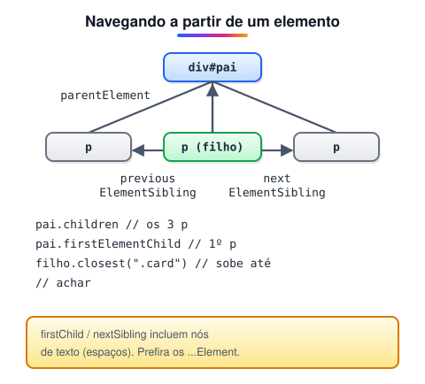

# Conceitos importantes de DOM com exemplos 1

> 🗺️ **Nesta aula:** alterar conteúdo, atributos, estilos e classes, os eventos mais comuns, navegar pela árvore e criar e remover elementos.

## De onde paramos

Na aula anterior você viu o que é o DOM e o padrão selecionar → escutar → alterar. Agora vamos conhecer as ferramentas de cada etapa.

## Conteúdo e atributos

A forma mais comum de mexer numa página é trocar o que está escrito nela. `textContent` troca o texto puro e é a escolha segura: se o valor vier de um usuário e contiver `<script>`, ele aparece como texto, sem rodar. Já `setAttribute` e a propriedade direta (`link.href`) fazem o mesmo trabalho com atributos como `href`, `src` e `alt`. Use a propriedade quando ela existir, porque é mais curta; use `setAttribute` para atributos personalizados, como `data-id`.

```jsx
const titulo = document.querySelector("#titulo");
// troca o texto (seguro)
titulo.textContent = "Novo texto";

const link = document.querySelector("a");
link.setAttribute("href", "https://www.exemplo.com");
// equivalente, via propriedade
link.href = "https://www.exemplo.com";
link.target = "_blank";
```

## Estilos

Cada propriedade CSS tem um correspondente em JavaScript, escrito em camelCase: `background-color` vira `backgroundColor`, `font-size` vira `fontSize`. O valor é sempre um texto, com a unidade junto (`"16px"`, não `16`). O problema é que `el.style` escreve **inline**, e estilo inline vence quase qualquer regra do arquivo CSS. Em projetos maiores isso vira uma bagunça difícil de achar. Por isso a próxima seção, `classList`, é o caminho preferido.

```jsx
const caixa = document.querySelector("#caixa");
// propriedades CSS em camelCase
caixa.style.backgroundColor = "red";
caixa.style.color = "white";
// sempre com unidade, como texto
caixa.style.fontSize = "16px";
```

> 💡 `el.style` escreve estilos **inline**, que têm prioridade altíssima e espalham CSS pelo JavaScript. Prefira manter os estilos no CSS e só trocar classes.

## Classes

A ideia é dividir o trabalho: o CSS descreve **como** cada estado se parece (`.ativo`, `.oculto`, `.erro`) e o JavaScript só decide **quando** aplicar cada classe. Num menu que abre e fecha, o CSS define `.aberto { display: block; }` e o JavaScript faz `menu.classList.toggle("aberto")` a cada clique. Se o designer quiser mudar a cor do estado aberto, ele mexe só no CSS. O `toggle` com segundo argumento é útil quando você já sabe o estado desejado: `toggle("erro", temErro)` liga a classe quando `temErro` é `true` e desliga quando é `false`, sem `if`.

```jsx
caixa.classList.add("ativo");
caixa.classList.remove("oculto");
// põe se não tem, tira se tem
caixa.classList.toggle("destaque");
// põe se temErro for true, tira se for false
caixa.classList.toggle("erro", temErro);
caixa.classList.contains("ativo");  // true/false
caixa.classList.replace("azul", "verde");
```

## Eventos

Um evento é um aviso do navegador de que algo aconteceu: um clique, uma tecla, o envio de um formulário. `addEventListener` registra uma função que o navegador chama quando o aviso chega. Essa função recebe o objeto `event`, que carrega os detalhes: `event.target` é o elemento que originou o evento, e `event.target.value` é o texto atual de um campo. No `submit`, o navegador recarrega a página por padrão; `event.preventDefault()` cancela isso, para você validar os dados com JavaScript antes de enviá-los. Esquecer essa linha é a causa mais comum de "minha página pisca e perde tudo".

```jsx
const botao = document.querySelector("#botao");
botao.addEventListener("click", () => {
  console.log("Botão clicado!");
});

const campo = document.querySelector("#campo");
campo.addEventListener("input", (event) => {
  console.log("Valor:", event.target.value);
});

const form = document.querySelector("form");
form.addEventListener("submit", (event) => {
  // impede o recarregamento da página
  event.preventDefault();
  // valida e envia os dados com JS
});
```

| Evento | Quando dispara |
| --- | --- |
| `click` | clique (ou Enter/Espaço em botões) |
| `input` | a cada alteração em um campo |
| `change` | ao sair do campo com valor alterado; na hora em select e checkbox |
| `submit` | envio do formulário |
| `keydown` | tecla pressionada (`event.key` diz qual) |
| `DOMContentLoaded` | o HTML foi todo carregado |

Para parar de escutar, use `removeEventListener` com a **mesma** função (por isso ela precisa ter nome).

## Navegando pela árvore



> 💡 **Analogia:** navegar pelo DOM é como andar por uma árvore genealógica. De qualquer pessoa você chega à mãe (`parentElement`), aos filhos (`children`) e aos irmãos do lado (`nextElementSibling`). O `closest` é perguntar "qual é o meu antepassado mais próximo que tem tal sobrenome?".

```jsx
const pai = document.querySelector("#pai");

// primeiro filho que é elemento
pai.firstElementChild;
// todos os filhos-elemento
pai.children;

const filho = pai.firstElementChild;
filho.nextElementSibling;  // próximo irmão
filho.previousElementSibling;  // irmão anterior
filho.parentElement;  // pai
// ancestral mais próximo que casa com o seletor
filho.closest(".card");
```

> ⚠️ **Correção:** o exemplo original usava `firstChild` e `nextSibling`, que incluem **nós de texto**, até as quebras de linha e espaços do HTML. Por isso `pai.firstChild` quase sempre devolve um texto vazio, e não o primeiro elemento. Use as versões com **Element** no nome.

## Criando e removendo elementos

O fluxo tem sempre três passos: criar o elemento na memória (`createElement`), configurá-lo (texto, classes) e só então encaixá-lo na página (`append` ou `prepend`). Enquanto você não encaixa, o elemento existe mas ninguém o vê. Isso permite montar um card inteiro antes de mostrá-lo, o que evita a página piscar. Para remover, `elemento.remove()` resolve em uma linha. É o mesmo mecanismo que sites como o de uma lista de tarefas usam para cada item que você adiciona ou apaga.

```jsx
const novo = document.createElement("div");
novo.textContent = "Novo elemento";
novo.classList.add("card");

// adiciona no final (aceita vários nós e textos)
document.body.append(novo);
// ou no início
document.body.prepend(novo);

// remove direto, sem precisar do pai
document.querySelector("#filho").remove();
```

> 💡 O modelo antigo `pai.removeChild(filho)` ainda funciona, mas `filho.remove()` é mais simples.

## Consultas avançadas

```jsx
const el = document.querySelector(".minhaClasse");
const paragrafos = document.querySelectorAll("p");
// o elemento casa com o seletor?
el.matches(".minhaClasse");  // true/false
// sobe na árvore até achar
el.closest(".pai");
```

## Exercício

Antes de olhar a resposta, separe o problema nos três passos de sempre: **selecionar** os três elementos, **escutar** o clique do botão e **alterar** a lista. Dentro do clique, a ordem importa: primeiro leia e limpe o texto com `trim()`, depois ignore se estiver vazio, só então crie o `<li>`. Teste com um campo vazio, com só espaços e com um texto normal. Os dois primeiros não devem criar nada.

Crie uma lista de tarefas mínima: um `<input>`, um botão "Adicionar" e uma `<ul>`. Ao clicar, o texto do campo vira um novo `<li>` e o campo é limpo. Campos vazios devem ser ignorados.

<details>
<summary>Ver resposta</summary>

```jsx
const campo = document.querySelector("#tarefa");
const botao = document.querySelector("#adicionar");
const lista = document.querySelector("#lista");

botao.addEventListener("click", () => {
  const texto = campo.value.trim();
  if (!texto) return;

  const li = document.createElement("li");
  // textContent evita injeção de HTML
  li.textContent = texto;
  lista.append(li);

  campo.value = "";
  campo.focus();
});
```

</details>

## 🧠 Revisão rápida

**Por que preferir `classList` a `el.style`?**

Porque mantém os estilos no CSS e evita estilos inline de prioridade alta.

**Para que serve `event.preventDefault()` no submit?**

Para impedir que o formulário recarregue a página.

**Qual a diferença entre `firstChild` e `firstElementChild`?**

O primeiro pode devolver um nó de texto; o segundo só devolve elementos.

> ➡️ **Próximo passo:** delegação de eventos, atributos `data-*`, inserção em posições específicas e o perigo do `innerHTML`, em **Conceitos importantes de DOM com exemplos 2**.

## 📌 Resumo

| Item | Em uma frase |
| --- | --- |
| `textContent` | lê ou troca o texto |
| `setAttribute` | altera um atributo |
| `classList` | adiciona, remove e alterna classes |
| `addEventListener` | registra uma reação a um evento |
| `preventDefault` | cancela o comportamento padrão |
| `...ElementChild/Sibling` | navega só entre elementos |
| `createElement` e `append` | criam e inserem elementos |
| `remove()` | remove o elemento |
