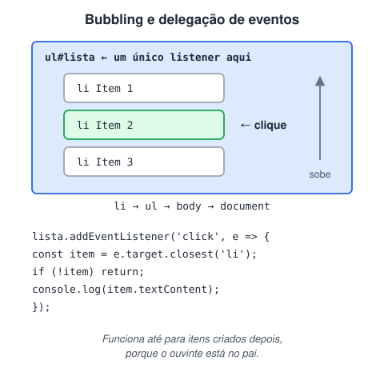

# Conceitos importantes de DOM com exemplos 2

> 🗺️ **Nesta aula:** propagação e delegação de eventos, classes com `classList` e `className`, atributos e `dataset`, inserir elementos em posições específicas, `innerHTML` × `textContent` × `innerText` e estilos computados.

## De onde paramos

No exercício anterior, cada tarefa nova virava um `<li>`. E se cada item precisar de um botão "remover"? Colocar um ouvinte em cada item é trabalhoso e não funciona para itens criados depois. A delegação resolve isso.

## Delegação de eventos

Quando um evento acontece em um elemento, ele **"sobe"** pela árvore (pai, avô… até o `document`): é o **bubbling**. A delegação aproveita isso: em vez de colocar um ouvinte em cada item, você coloca **um só no pai**.



> 💡 **Analogia:** a delegação é como a recepcionista de um prédio. Em vez de colocar um porteiro em cada apartamento, uma única pessoa na portaria recebe todas as entregas e olha a etiqueta (`event.target`) para saber de qual apartamento é. Quando um morador novo chega, ela já atende sem precisar contratar ninguém.

```html
<ul id="minhaLista">
  <li>Item 1</li>
  <li>Item 2</li>
  <li>Item 3 <strong>novo</strong></li>
</ul>
```

```jsx
const lista = document.querySelector("#minhaLista");

lista.addEventListener("click", (event) => {
  // sobe até o li mais próximo
  const item = event.target.closest("li");
  if (!item || !lista.contains(item)) return;
  console.log("Clicou no item:", item.textContent);
});
```

Vantagens: um ouvinte só (melhor desempenho) e funciona para itens **adicionados depois**.

- `event.target`: o elemento exato que foi clicado (pode ser um filho, como o `<strong>`).
- `event.currentTarget`: o elemento onde o ouvinte está (o `ul`).
- `event.stopPropagation()`: impede o evento de continuar subindo.

> ⚠️ **Correção:** o exemplo original testava `event.target.tagName === 'LI'`, que falha quando o clique acontece num filho do `li` (o `<strong>`, por exemplo). Use `closest("li")`.

## Classes CSS

```html
<div id="meuElemento" class="destaque"></div>
```

```jsx
const el = document.querySelector("#meuElemento");

el.classList.contains("destaque");  // true
el.classList.add("nova-classe");
el.classList.remove("destaque");
```

`className` substitui **todas** as classes de uma vez (é uma string); `classList` mexe em uma de cada vez, sem apagar as outras.

## Atributos e `data-*`

```html

```

```jsx
const img = document.querySelector("#foto");

img.id;  // "foto"
// como está escrito no HTML
img.getAttribute("src");  // "imagem.jpg"
// URL completa, resolvida pelo navegador
img.src;
img.setAttribute("alt", "Nova descrição");
// data-* vira dataset, em camelCase
img.dataset.produtoId;  // "42"
img.hasAttribute("alt");  // true
img.removeAttribute("alt");
```

Atributos `data-*` são o jeito padrão de guardar informações no HTML para o JS usar, como o id de um produto num botão "comprar".

## Inserindo em posições específicas

```html
<div id="container">
  <p>Texto 1</p>
  <p>Texto 3</p>
</div>
```

```jsx
const container = document.querySelector("#container");
const texto3 = container.querySelectorAll("p")[1];

const novo = document.createElement("p");
novo.textContent = "Texto 2";

// insere antes do "Texto 3"
texto3.before(novo);
// forma antiga equivalente:
// container.insertBefore(novo, texto3);
```

Outros métodos: `el.after(x)`, `el.append(x)` (dentro, no fim), `el.prepend(x)` (dentro, no início) e `el.replaceWith(x)`.

> ⚠️ **Correção:** o exemplo original adicionava o mesmo elemento com `appendChild` e depois com `insertBefore`. Um nó **não pode estar em dois lugares**: inserir um elemento que já está no DOM o **move**. O primeiro passo era inútil.

## Texto e conteúdo

```html
<div id="minhaDiv">
  <p>Texto original</p>
</div>
```

```jsx
const div = document.querySelector("#minhaDiv");

// HTML como texto
div.innerHTML;  // "<p>Texto original</p>"
// todo o texto, inclusive o escondido
div.textContent;  // "Texto original"
// só o texto VISÍVEL (respeita o CSS)
div.innerText;  // "Texto original"

// substitui tudo por texto puro
div.textContent = "Novo texto";
```

> ⚠️ **Cuidado com** `innerHTML` **e dados do usuário.** Se você fizer `div.innerHTML = textoDigitado`, alguém pode digitar uma tag com código malicioso e executá-lo na página (ataque **XSS**). Para texto, use `textContent`.

## Estilos computados

```jsx
const caixa = document.querySelector("#caixa");
const estilos = getComputedStyle(caixa);

estilos.width;  // "200px"
estilos.backgroundColor;  // "rgb(255, 0, 0)"
```

`el.style` só enxerga estilos **inline**. `getComputedStyle` devolve o valor **final**, vindo de qualquer CSS, e é somente leitura.

## Exercício

Na lista de tarefas, cada `<li>` tem um botão `<button class="remover">x</button>`. Usando **um único** ouvinte na `<ul>`, remova o item quando o botão for clicado.

<details>
<summary>Ver resposta</summary>

```jsx
const lista = document.querySelector("#lista");

lista.addEventListener("click", (e) => {
  const botao = e.target.closest(".remover");
  if (!botao) return;
  botao.closest("li").remove();
});
```

Funciona também para tarefas criadas depois, porque o ouvinte está na `ul`.

</details>

## 🧠 Revisão rápida

**O que é bubbling?**

O evento disparado num elemento sobe pelos ancestrais até o `document`.

**Qual a diferença entre `event.target` e `event.currentTarget`?**

`target` é onde o clique aconteceu; `currentTarget`, onde o ouvinte está.

**Por que evitar `innerHTML` com texto digitado pelo usuário?**

Porque permite injetar código na página (XSS).

> ➡️ **Próximo passo:** os métodos de seleção têm diferenças importantes no que devolvem. Veja **Seletores**.

## 📌 Resumo

| Item | Em uma frase |
| --- | --- |
| Bubbling | o evento sobe pela árvore |
| Delegação | um ouvinte no pai para vários filhos |
| `closest` | acha o ancestral certo do clique |
| `className` × `classList` | todas as classes × uma por vez |
| `dataset` | lê atributos `data-*` |
| `before` / `after` | inserem ao lado de um elemento |
| `textContent` | texto seguro; `innerHTML` interpreta HTML |
| `getComputedStyle` | estilo final aplicado |
