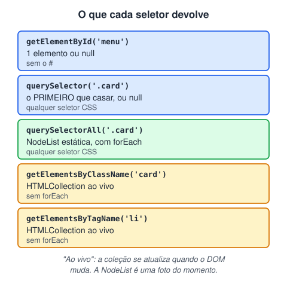

# Seletores

> 🗺️ **Nesta aula:** os métodos para encontrar elementos no DOM, o que cada um devolve (elemento, NodeList ou HTMLCollection), qual usar no dia a dia e como resolver o erro de elemento `null`.

## De onde paramos

Nas aulas de DOM, todo exemplo começava com `document.querySelector`. Esse é só um dos métodos de seleção, e cada um devolve um tipo diferente de resultado.

## Para que servem os seletores

Antes de alterar um elemento, o JavaScript precisa **encontrá-lo** no DOM. Os métodos de seleção recebem um id, uma classe, uma tag ou um seletor CSS e devolvem o elemento (ou uma lista deles).



> 💡 **Analogia:** pense numa escola. `getElementById` é chamar um aluno pela matrícula: só existe um. `querySelector` é pedir "o primeiro aluno de camiseta azul"; `querySelectorAll` tira uma foto de todos os de camiseta azul agora. Já a HTMLCollection é a lista de chamada da turma, que se atualiza sozinha quando chega aluno novo.

## Os métodos

```jsx
// 1. Por id: UM elemento (ou null). Sem o # !
const menu = document.getElementById("menu");

// 2. O primeiro que casar com um seletor CSS
const primeiroCard = document.querySelector(".card");
const campoEmail = document.querySelector(
  "form input[type='email']"
);

// 3. Todos que casarem (NodeList)
const cards = document.querySelectorAll(".card");
cards.forEach(card => card.classList.add("visivel"));

// 4. Por classe ou tag: HTMLCollection "ao vivo"
const itens = document.getElementsByClassName("item");
const lis = document.getElementsByTagName("li");
```

### HTMLCollection × NodeList

- **HTMLCollection** (`getElementsBy...`) é **ao vivo**: se um elemento com aquela classe for criado depois, ele aparece sozinho na coleção. Não tem `forEach`. Converta com `Array.from(itens)` ou `[...itens]`.
- **NodeList** do `querySelectorAll` é **estática** (uma foto do momento) e tem `forEach`.

## Qual usar?

Na prática, `querySelector` **e** `querySelectorAll` resolvem quase tudo, porque aceitam qualquer seletor CSS que você já conhece:

```jsx
// id
document.querySelector("#titulo");
// duas classes no mesmo elemento
document.querySelector(".botao.primario");
// descendente com pseudo-classe
document.querySelector("nav a:first-child");
// atributo
document.querySelectorAll("[data-categoria='livros']");
```

Também dá para buscar **dentro** de um elemento, e não na página inteira:

```jsx
const form = document.querySelector("#cadastro");
const campos = form.querySelectorAll("input");
```

## Erro comum: elemento `null`

```jsx
const botao = document.querySelector("#enviar");
// TypeError: Cannot read properties of null
botao.addEventListener("click", enviar);
```

Causas mais frequentes:

1. O seletor está errado (faltou o `#` ou o `.`, ou há erro de digitação).
2. O script rodou **antes** de o elemento existir. Use `<script defer>`.
3. Em `getElementById`, você colocou `#` no nome: o certo é `getElementById("enviar")`.

> 💡 Os exemplos originais usavam `var`; foram trocados por `const`, como recomendado na aula de variáveis.

## Exercício

Escreva o seletor para cada caso: (a) o elemento com id `carrinho`; (b) todos os botões dentro de `.card`; (c) o primeiro link do `<nav>`; (d) todos os `input` obrigatórios.

<details>
<summary>Ver resposta</summary>

```jsx
document.querySelector("#carrinho");
document.querySelectorAll(".card button");
document.querySelector("nav a");
document.querySelectorAll("input[required]");
```

</details>

## 🧠 Revisão rápida

**O que `querySelector` devolve se nada casar?**

`null`.

**Por que `getElementsByClassName(...).forEach` dá erro?**

Porque HTMLCollection não tem `forEach`. Converta com `Array.from`.

**Qual a diferença entre coleção "ao vivo" e estática?**

A ao vivo se atualiza quando o DOM muda; a estática é uma foto do momento da busca.

> ➡️ **Próximo passo:** até aqui os dados estavam no código. Agora vamos buscá-los de um servidor em **JSON e fetch: consumindo APIs**.

## 📌 Resumo

| Método | Em uma frase |
| --- | --- |
| `getElementById` | um elemento pelo id, sem `#` |
| `querySelector` | o primeiro que casar com o seletor CSS |
| `querySelectorAll` | todos, numa NodeList estática |
| `getElementsBy...` | HTMLCollection ao vivo, sem forEach |
| `el.querySelector` | busca só dentro de um elemento |
| `null` | seletor errado ou script cedo demais |
