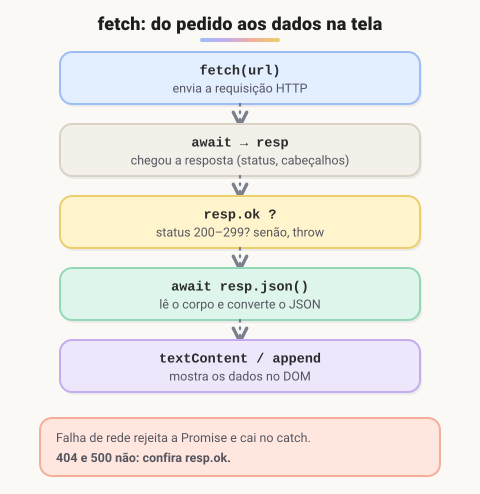

# JSON e fetch: consumindo APIs (Adicionado pelo aluno para melhorar o estudo)

> 🗺️ **Nesta aula:** o formato JSON e suas regras, `JSON.stringify` e `JSON.parse`, buscar e enviar dados com `fetch`, um exemplo completo com o DOM, os status HTTP e o erro de CORS.

## De onde paramos

Você já manipula o DOM e trata erros. Falta trazer dados de verdade: produtos de uma loja, usuários de um sistema, a previsão do tempo. Eles vêm de **APIs**, quase sempre em JSON.

## JSON

**JSON (JavaScript Object Notation) é o formato de texto mais usado para trocar dados entre sistemas.** Parece um objeto JavaScript, mas com regras mais rígidas:

```json
{
  "id": 7,
  "nome": "Café especial",
  "preco": 39.9,
  "disponivel": true,
  "tags": ["grão", "250g"],
  "fornecedor": null
}
```

- chaves e textos **sempre entre aspas duplas**;
- sem vírgula sobrando no final;
- sem comentários, funções, `undefined` ou datas (datas viram texto, como `"2024-05-10"`).

```jsx
// objeto → texto
const texto = JSON.stringify({ nome: "Ana", idade: 30 });
// texto → objeto
const objeto = JSON.parse('{"nome":"Ana","idade":30}');
// texto formatado, com 2 espaços
JSON.stringify(dados, null, 2);
```

Uso comum: guardar dados no `localStorage`, que só aceita texto.

```jsx
localStorage.setItem("carrinho", JSON.stringify(carrinho));
const salvo = JSON.parse(
  localStorage.getItem("carrinho") ?? "[]"
);
```

## `fetch`: buscando dados (GET)

`fetch` faz uma requisição HTTP e devolve uma **Promise** (um valor que chega depois). Com `await`, o código espera a resposta sem travar a página. Promises e `async/await` são detalhados no módulo de Node.js.



```jsx
const URL_USUARIOS =
  "https://jsonplaceholder.typicode.com/users";

async function buscarUsuarios() {
  const resp = await fetch(URL_USUARIOS);
  if (!resp.ok) throw new Error(`Erro HTTP ${resp.status}`);
  // lê o corpo e converte de JSON
  return await resp.json();
}
```

> ⚠️ `fetch` **só rejeita a Promise em falha de rede**. Uma resposta 404 ou 500 é considerada "sucesso", por isso sempre confira `resp.ok` (true para status 200–299).

## Enviando dados (POST, PUT, DELETE)

```jsx
const resp = await fetch(
  "https://jsonplaceholder.typicode.com/posts",
  {
    method: "POST",
    headers: { "Content-Type": "application/json" },
    body: JSON.stringify({
      title: "Olá",
      body: "Primeiro post",
      userId: 1,
    }),
  }
);
// { id: 101, ... }
const criado = await resp.json();
```

## Exemplo completo: lista na tela

```html
<ul id="lista"><li>Carregando...</li></ul>
<script type="module" src="usuarios.js"></script>
```

```jsx
// usuarios.js (módulos aceitam await no topo)
const lista = document.querySelector("#lista");

try {
  const resp = await fetch(
    "https://jsonplaceholder.typicode.com/users"
  );
  if (!resp.ok) throw new Error(resp.status);
  const usuarios = await resp.json();

  const itens = usuarios.map(u => {
    const li = document.createElement("li");
    // textContent evita injeção de HTML
    li.textContent = `${u.name} — ${u.email}`;
    return li;
  });
  lista.replaceChildren(...itens);
} catch (e) {
  lista.innerHTML = "<li>Não foi possível carregar.</li>";
}
```

## Status HTTP que você vai ver

| Faixa | Significa | Exemplos |
| --- | --- | --- |
| 2xx | sucesso | 200 OK, 201 Created, 204 No Content |
| 3xx | redirecionamento | 301, 304 Not Modified |
| 4xx | erro de quem pediu | 400, 401 sem login, 403 sem permissão, 404 |
| 5xx | erro do servidor | 500, 503 indisponível |

## CORS

Se o console mostrar *"blocked by CORS policy"*, o problema **não é o seu** `fetch`: o servidor da API não autorizou pedidos vindos do seu site. Quem resolve é o back-end, com o cabeçalho `Access-Control-Allow-Origin` (veja a aula **Criando uma API com Express**).

## Exercício

Usando a API `https://jsonplaceholder.typicode.com/todos?_limit=5`, escreva uma função que busque as tarefas e devolva só os títulos das que estão concluídas (`completed: true`).

<details>
<summary>Ver resposta</summary>

```jsx
async function titulosConcluidos() {
  const resp = await fetch(
    "https://jsonplaceholder.typicode.com/todos?_limit=5"
  );
  if (!resp.ok) throw new Error(`HTTP ${resp.status}`);
  const tarefas = await resp.json();
  return tarefas
    .filter(t => t.completed)
    .map(t => t.title);
}

titulosConcluidos().then(console.log);
```

</details>

## 🧠 Revisão rápida

**Qual a diferença entre `JSON.stringify` e `JSON.parse`?**

O primeiro transforma objeto em texto; o segundo, texto em objeto.

**Por que conferir `resp.ok`?**

Porque o `fetch` não lança erro em respostas 404 ou 500.

**Quem resolve um erro de CORS?**

O servidor da API, liberando a origem do seu site.

> ➡️ **Próximo passo:** hora de juntar tudo em pequenos projetos: **Alguns projetos teste**.

## 📌 Resumo

| Item | Em uma frase |
| --- | --- |
| JSON | texto para trocar dados, com aspas duplas |
| `JSON.stringify` | objeto vira texto |
| `JSON.parse` | texto vira objeto |
| `fetch(url)` | faz uma requisição HTTP |
| `resp.json()` | converte o corpo da resposta |
| `resp.ok` | true para status 2xx |
| `method`, `headers`, `body` | opções para enviar dados |
| CORS | bloqueio que o servidor precisa liberar |
