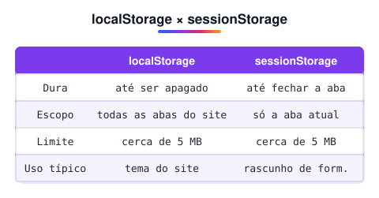

# Web Storage: localStorage e sessionStorage (Adicionado pelo aluno para melhorar o estudo)

> 🗺️ **Nesta aula:** como guardar dados no navegador com `localStorage` e `sessionStorage`, como salvar objetos com JSON, a diferença entre os dois e os cuidados de segurança.

## De onde paramos

Você já sabe selecionar elementos e reagir a eventos no DOM. Mas, ao recarregar a página, tudo o que o usuário escolheu (o tema escuro, uma lista de tarefas) se perde. O Web Storage resolve isso guardando dados no próprio navegador.

## O que é o Web Storage

**O Web Storage é um pequeno armazenamento de pares chave-valor dentro do navegador, que não precisa de servidor.** Os dois tipos têm a mesma interface e mudam só na duração, como mostra o quadro:



> 💡 **Analogia:** o `localStorage` é o armário com cadeado do seu quarto: o que você guarda ali continua no dia seguinte. O `sessionStorage` é o bloco de anotações da mesa de uma reunião: serve enquanto a reunião dura, e é jogado fora ao fim dela.

## Os quatro métodos

A interface é pequena. Os exemplos abaixo valem igualmente para `sessionStorage`:

```jsx
// guarda um valor associado a uma chave
localStorage.setItem("tema", "escuro");

// lê; devolve null se a chave não existe
const tema = localStorage.getItem("tema");
console.log(tema); // saida: escuro

// apaga uma chave
localStorage.removeItem("tema");

// apaga tudo deste site
localStorage.clear();
```

O valor lido de volta é sempre **texto**, mesmo que você tenha guardado um número.

## Guardando objetos com JSON

Como o Storage só guarda texto, objetos e listas precisam ser convertidos. Você já conhece o par `JSON.stringify` (objeto para texto) e `JSON.parse` (texto para objeto):

```jsx
const tarefas = [{ titulo: "Estudar", feita: false }];

// grava a lista como texto JSON
localStorage.setItem("tarefas", JSON.stringify(tarefas));

// lê de volta; se não existir, usa lista vazia
const texto = localStorage.getItem("tarefas");
const lista = texto ? JSON.parse(texto) : [];
console.log(lista[0].titulo); // saida: Estudar
```

> ⚠️ **Armadilha comum:** guardar um objeto direto, sem `JSON.stringify`. O navegador converte para o texto `"[object Object]"` e o dado original se perde.

## Exemplo prático: lembrar o tema

```jsx
const corpo = document.body;

// ao abrir a página, aplica o tema salvo
if (localStorage.getItem("tema") === "escuro") {
  corpo.classList.add("escuro");
}

// ao clicar, alterna e salva a escolha
document.querySelector("#botao-tema").addEventListener(
  "click",
  () => {
    const escuro = corpo.classList.toggle("escuro");
    const valor = escuro ? "escuro" : "claro";
    localStorage.setItem("tema", valor);
  }
);
```

## Cuidados

O Web Storage é útil, mas tem limites. O espaço é pequeno (cerca de 5 MB por site). Qualquer script da página pode ler os dados, e o usuário pode vê-los e alterá-los nas ferramentas do navegador. Por isso **nunca guarde senhas, tokens sensíveis ou dados pessoais** ali, e nunca confie em um valor do Storage como se fosse verdade: valide no servidor.

## Exercício

Crie um contador de visitas: ao carregar a página, leia o número de visitas guardado, some 1, grave de volta e mostre "Você já visitou esta página N vezes" em um elemento `#visitas`.

<details>
<summary>Ver resposta</summary>

```html
<p id="visitas"></p>
```

```jsx
// o valor guardado é texto; converte para número
const antes = Number(localStorage.getItem("visitas")) || 0;
const agora = antes + 1;
localStorage.setItem("visitas", agora);

document.querySelector("#visitas").textContent =
  `Você já visitou esta página ${agora} vezes`;
```

Teste: recarregue a página três vezes e veja o número subir de 1 a 3. Com `sessionStorage`, o contador recomeça ao fechar a aba.

</details>

## 🧠 Revisão rápida

**Qual a diferença entre localStorage e sessionStorage?**

O `localStorage` dura até ser apagado; o `sessionStorage` dura só enquanto a aba estiver aberta.

**Por que usar JSON.stringify ao guardar uma lista?**

Porque o Storage só guarda texto. Sem a conversão, o objeto vira "[object Object]".

**Pode guardar uma senha no localStorage?**

Não. Qualquer script da página e o próprio usuário conseguem ler os dados.

> ➡️ **Próximo passo:** buscar dados de fora do navegador: **JSON e fetch: consumindo APIs**.

## 📌 Resumo

| Item | Em uma frase |
| --- | --- |
| `setItem` / `getItem` | grava e lê um valor pela chave |
| `localStorage` | fica até ser apagado |
| `sessionStorage` | some ao fechar a aba |
| JSON | converte objetos para texto e de volta |
| Segurança | nunca guarde dados sensíveis |
