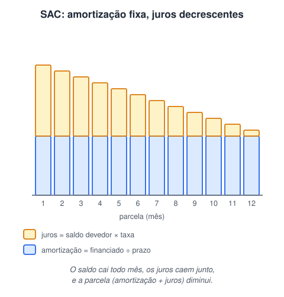

# Projeto: simulador de financiamento com HTML, CSS e JS

> 🗺️ **Nesta aula:** um projeto completo com HTML, CSS e JavaScript: um simulador de financiamento pelo SAC, com carência, validação dos campos e tabela de parcelas gerada pelo DOM.

## De onde paramos

Os mini projetos anteriores praticaram eventos e DOM. Este junta tudo com uma lógica de negócio real: cálculos financeiros mês a mês, validação de dados e uma tabela montada pelo JavaScript.

## O projeto

Um simulador de financiamento pelo **Sistema de Amortização Constante (SAC)**, com opção de carência. O usuário informa o valor do bem, a entrada, a taxa de juros anual e o prazo, e o simulador monta a tabela de parcelas.

## Como funciona o SAC



> 💡 **Analogia:** imagine uma pizza de 12 fatias que você deve ao banco. No SAC, você devolve sempre **uma fatia por mês** (a amortização), mais um "aluguel" proporcional às fatias que ainda estão com você (os juros). Como a pilha de fatias diminui, o aluguel cai, e cada parcela fica menor que a anterior.

1. **Valor financiado** = valor do bem − entrada.
2. **Taxa mensal** equivalente à anual: `i = (1 + taxaAnual)^(1/12) − 1`.
3. **Amortização** (fixa) = valor financiado ÷ número de parcelas que amortizam.
4. A cada mês:
  - **juros** = saldo devedor × taxa mensal;
  - **parcela** = amortização + juros;
  - **novo saldo** = saldo − amortização.
5. **Carência**: nos primeiros meses o cliente paga só os juros e o saldo não diminui. A amortização é feita nos meses restantes.

### Exemplo em números

R$ 12.000 financiados em 12 meses, sem carência, com taxa mensal de 1%: a amortização é R$ 1.000 por mês. No 1º mês, os juros são 1% de 12.000 = R$ 120 e a parcela, R$ 1.120. No 2º mês, o saldo é 11.000, os juros caem para R$ 110 e a parcela, para R$ 1.110. A última parcela é 1.000 + 10 = R$ 1.010.

**Código revisado**

```html
<!DOCTYPE html>
<html lang="pt-BR">
<head>
  <meta charset="UTF-8">
  <meta name="viewport"
        content="width=device-width, initial-scale=1.0">
  <title>Simulador de financiamento</title>
  <link rel="stylesheet" href="style.css">
  <script src="script.js" defer></script>
</head>
<body>
  <main class="container">
    <h1>Simulador de financiamento (SAC)</h1>

    <form id="formSimulador">
      <div class="form-group">
        <label for="textoValor">Valor do bem (R$)</label>
        <input type="number" id="textoValor"
               min="0" step="0.01" required>
      </div>
      <div class="form-group">
        <label for="textoEntrada">Entrada (R$)</label>
        <input type="number" id="textoEntrada"
               min="0" step="0.01" value="0" required>
      </div>
      <div class="form-group">
        <label for="textoTaxaJuros">Juros ao ano (%)</label>
        <input type="number" id="textoTaxaJuros"
               min="0" step="0.01" required>
      </div>
      <div class="form-group">
        <label for="textoPrazo">Prazo (meses)</label>
        <input type="number" id="textoPrazo"
               min="1" step="1" required>
      </div>

      <div class="select-group">
        <input type="checkbox" id="comCarencia">
        <label for="comCarencia">Com carência?</label>
        <select id="listaSuspensa" hidden
                aria-label="Meses de carência">
          <option value="2">2 meses</option>
          <option value="3">3 meses</option>
          <option value="4">4 meses</option>
        </select>
      </div>

      <div class="button-group">
        <button type="submit">Calcular</button>
      </div>
    </form>

    <p id="erro" class="erro" role="alert"></p>

    <table class="table">
      <thead>
        <tr>
          <th>Nº</th>
          <th>Parcela</th>
          <th>Amortização</th>
          <th>Juros</th>
          <th>Saldo devedor</th>
        </tr>
      </thead>
      <tbody id="corpoTabela"></tbody>
      <tfoot id="totais"></tfoot>
    </table>
  </main>

  <footer>
    <p>&copy; Simulador de financiamento</p>
  </footer>
</body>
</html>
```

```css
body {
  font-family: Arial, sans-serif;
  margin: 0;
  /* espaço para o footer fixo */
  padding: 20px 20px 100px;
  background-color: #f7a7a7;
}

.container {
  max-width: 700px;
  margin: 0 auto;
  background-color: #f2f2f2;
  padding: 20px;
  border-radius: 5px;
}

h1 {
  text-align: center;
  margin-bottom: 20px;
}

.form-group { margin-bottom: 16px; }
.form-group label {
  display: block;
  font-weight: bold;
  margin-bottom: 5px;
}
.form-group input {
  width: 100%;
  box-sizing: border-box;
  padding: 12px;
  border: 1px solid #ccc;
  border-radius: 5px;
  font-size: 16px;
}

.select-group {
  display: flex;
  align-items: center;
  gap: 10px;
  margin-bottom: 20px;
}
.select-group select {
  padding: 8px;
  border-radius: 5px;
  font-size: 16px;
}

.button-group {
  text-align: center;
  margin-bottom: 20px;
}
.button-group button {
  padding: 12px 24px;
  background-color: #4caf50;
  color: #fff;
  border: none;
  border-radius: 5px;
  cursor: pointer;
  font-size: 16px;
}

.erro { color: #b91c1c; font-weight: bold; }

.table { width: 100%; border-collapse: collapse; }
.table th,
.table td {
  padding: 10px;
  text-align: right;
  border-bottom: 1px solid #ddd;
}
.table th {
  background-color: #4caf50;
  color: #fff;
  text-align: center;
}
.table td:first-child {
  font-weight: bold;
  text-align: center;
}
.table tfoot td {
  font-weight: bold;
  background: #e5e7eb;
}

footer {
  position: fixed;
  left: 0;
  bottom: 0;
  width: 100%;
  background-color: #333;
  color: #fff;
  text-align: center;
}
```

```jsx
const $ = (id) => document.getElementById(id);

const form = $("formSimulador");
const comCarencia = $("comCarencia");
const listaSuspensa = $("listaSuspensa");
const corpoTabela = $("corpoTabela");
const totais = $("totais");
const erro = $("erro");

const moeda = (v) => v.toLocaleString("pt-BR", {
  style: "currency",
  currency: "BRL",
});

comCarencia.addEventListener("change", () => {
  listaSuspensa.hidden = !comCarencia.checked;
});

// cria uma linha de tabela com os valores dados
function addLinha(secao, valores) {
  const linha = secao.insertRow();
  for (const v of valores) {
    linha.insertCell().textContent = v;
  }
}

form.addEventListener("submit", (event) => {
  event.preventDefault();
  erro.textContent = "";
  corpoTabela.replaceChildren();
  totais.replaceChildren();

  const valorBem = Number($("textoValor").value);
  const entrada = Number($("textoEntrada").value);
  const taxaAnual = Number($("textoTaxaJuros").value) / 100;
  const prazo = Number($("textoPrazo").value);
  const carencia = comCarencia.checked
    ? Number(listaSuspensa.value)
    : 0;

  const financiado = valorBem - entrada;
  if (financiado <= 0) {
    erro.textContent =
      "A entrada precisa ser menor que o valor do bem.";
    return;
  }
  if (carencia >= prazo) {
    erro.textContent =
      "O prazo precisa ser maior que a carência.";
    return;
  }

  // taxa mensal equivalente à anual
  const taxaMensal = Math.pow(1 + taxaAnual, 1 / 12) - 1;
  const amortizacaoFixa = financiado / (prazo - carencia);

  let saldo = financiado;
  let totalPago = 0;
  let totalJuros = 0;

  for (let mes = 1; mes <= prazo; mes++) {
    // juros sobre o saldo ATUAL
    const juros = saldo * taxaMensal;
    const amortizacao =
      mes <= carencia ? 0 : amortizacaoFixa;
    // na carência, paga só os juros
    const parcela = amortizacao + juros;
    // evita -0,00 por arredondamento
    saldo = Math.max(saldo - amortizacao, 0);

    totalPago += parcela;
    totalJuros += juros;

    addLinha(corpoTabela, [
      mes, moeda(parcela), moeda(amortizacao),
      moeda(juros), moeda(saldo),
    ]);
  }

  addLinha(totais, [
    "Total", moeda(totalPago), moeda(financiado),
    moeda(totalJuros), "",
  ]);
});
```

> ⚠️ **Correções no cálculo (importantes):**
>
> - **Os juros eram calculados uma vez só, sobre o valor inicial**, e repetidos em todas as parcelas. Isso **não é SAC**: no SAC, os juros incidem sobre o **saldo devedor atual** e diminuem a cada mês. Agora são recalculados mês a mês.
> - A taxa anual era convertida com `÷ 12` (taxa nominal). O código usa a **taxa mensal equivalente**, `(1 + a)^(1/12) − 1`, que corresponde à taxa efetiva. Se o seu caso usar taxa nominal, troque por `taxaAnual / 12`.
> - **Carência:** as parcelas ficavam zeradas (sem juros) e a amortização continuava dividida pelo prazo inteiro, então o saldo **nunca chegava a zero**. Agora, durante a carência, paga-se só os juros e a amortização é dividida pelos meses restantes.
> - O CSS usava classes (`.container`, `.form-group`, `.table`) que **não existiam no HTML**, por isso o visual não era aplicado. O HTML foi reestruturado com essas classes e com `<label>` nos campos.

## Desafio extra

Acrescente ao simulador uma opção para escolher o sistema **Price** (parcelas iguais). Na Price, a parcela fixa é `P = financiado × i / (1 − (1 + i)^−n)`; os juros de cada mês continuam sendo saldo × taxa, e a amortização é a diferença `P − juros`.

<details>
<summary>Ver resposta (trecho do laço)</summary>

```jsx
const parcelaPrice = financiado * taxaMensal /
  (1 - Math.pow(1 + taxaMensal, -prazo));

for (let mes = 1; mes <= prazo; mes++) {
  const juros = saldo * taxaMensal;
  const amortizacao = parcelaPrice - juros;
  saldo = Math.max(saldo - amortizacao, 0);
  // ... soma os totais e adiciona a linha
}
```

Na Price a parcela é constante e a amortização cresce; no SAC a amortização é constante e a parcela cai.

</details>

## 🧠 Revisão rápida

**No SAC, o que é fixo e o que diminui?**

A amortização é fixa; os juros e a parcela diminuem.

**O que acontece durante a carência neste simulador?**

Paga-se só os juros, e o saldo não diminui.

**Por que o código usa `Math.max(saldo - amortizacao, 0)`?**

Para evitar um saldo negativo minúsculo causado por arredondamento.

> ➡️ **Próximo passo:** fim do módulo de JavaScript. O próximo módulo volta ao HTML e CSS para estruturar páginas: **HTML semântico e container**.

## 📌 Resumo

| Item | Em uma frase |
| --- | --- |
| SAC | amortização constante, parcelas decrescentes |
| Juros do mês | saldo devedor × taxa mensal |
| Taxa equivalente | `(1 + anual)^(1/12) − 1` |
| Carência | meses pagando só os juros |
| Validação | entrada menor que o bem e prazo maior que a carência |
| `insertRow` / `insertCell` | montam a tabela pelo JS |
