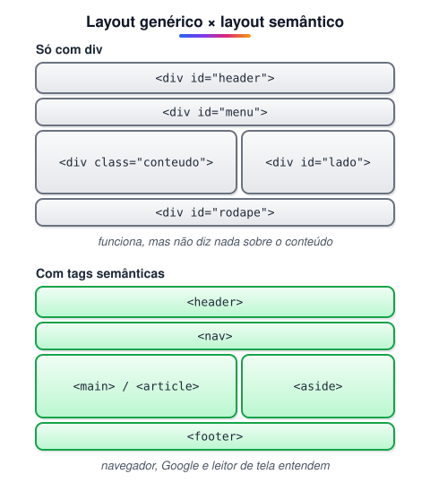

# Principais benefícios de uso de tags semânticas

> 🗺️ **Nesta aula:** o que são tags semânticas e por que usá-las: legibilidade, acessibilidade, SEO, recursos nativos do navegador e CSS mais simples, com regras práticas de uso.

## De onde paramos

No módulo III você montou páginas com `<header>`, `<nav>` e `<footer>`. Este módulo aprofunda esse uso e mostra por que ele importa tanto quanto a aparência.

## O que são tags semânticas

**Tags semânticas descrevem o significado do conteúdo, e não só a aparência.** Um `<div>` é uma caixa genérica; um `<nav>` diz "isto é a navegação", e um `<article>`, "isto é um conteúdo independente". Visualmente podem ser idênticos: a diferença está em quem **lê** o código, seja pessoa, navegador, buscador ou leitor de tela.



## Benefícios

### 1. Código mais organizado e legível

`<header>`, `<nav>`, `<main>`, `<article>`, `<section>`, `<aside>` e `<footer>` mostram a estrutura da página só de bater o olho, sem depender de comentários ou de nomes de classes. Isso facilita a manutenção e o trabalho em equipe.

### 2. Acessibilidade

Leitores de tela usam essas tags como **pontos de referência** (*landmarks*). Um usuário cego pode pular direto para o `<main>` ou listar as regiões de navegação, em vez de ouvir a página inteira, linha por linha. Tags como `<button>` e `<label>` também já vêm com comportamento acessível de teclado e foco.

### 3. SEO

Mecanismos de busca entendem melhor o que é conteúdo principal, o que é menu e o que é rodapé. A semântica não garante a primeira posição no Google, mas ajuda o buscador a interpretar e indexar corretamente a página. Uma hierarquia de títulos coerente (`h1` → `h2` → `h3`) é parte disso.

### 4. Recursos "de graça" do navegador

- O **modo leitura** do Safari, do Firefox e do Edge usa `<article>` e `<main>` para extrair o texto.
- `<details>`/`<summary>` criam um acordeão sem JavaScript.
- `<nav>`, `<main>` e afins aparecem no painel de acessibilidade do DevTools.

### 5. CSS e JS mais simples

Seletores como `header nav a` ou `article > h2` funcionam sem criar classes para tudo.

## Regras práticas

- Use `<div>` (e `<span>`) só quando **nenhuma** tag semântica fizer sentido, por exemplo como um wrapper só para layout.
- Não escolha a tag pela aparência: estilo é papel do CSS.
- Um único `<main>` visível por página.
- Não pule níveis de título só para ter uma fonte menor.

> ⚠️ **Correção:** o item "compatibilidade com navegadores e dispositivos" exagerava: tags semânticas não mudam a compatibilidade. O ganho real é em acessibilidade, SEO e recursos nativos (modo leitura, `<details>`).

## Exercício

Reescreva com tags semânticas:

```html
<div class="topo"><div class="menu">...</div></div>
<div class="conteudo">
  <div class="post">...</div>
</div>
<div class="rodape">...</div>
```

<details>
<summary>Ver resposta</summary>

```html
<header>
  <nav>...</nav>
</header>
<main>
  <article>...</article>
</main>
<footer>...</footer>
```

O post vira `<article>` porque faria sentido sozinho; o menu fica dentro do `<header>` porque faz parte do cabeçalho do site.

</details>

## 🧠 Revisão rápida

**Tags semânticas mudam a aparência da página?**

Não por si só. Elas mudam o significado; a aparência é papel do CSS.

**Como leitores de tela usam as tags semânticas?**

Como pontos de referência para pular direto para cada região.

**Quando usar `<div>`?**

Quando nenhuma tag semântica fizer sentido, como em um wrapper só para layout.

> ➡️ **Próximo passo:** conheça cada tag e quando usá-la em **Principais tags semânticas do HTML**.

## 📌 Resumo

| Benefício | Em uma frase |
| --- | --- |
| Legibilidade | a estrutura aparece no próprio código |
| Acessibilidade | landmarks para leitores de tela |
| SEO | o buscador entende cada parte |
| Recursos nativos | modo leitura e `<details>` sem JS |
| CSS/JS | seletores mais simples |
| Regra de ouro | `<div>` só quando nada mais servir |
