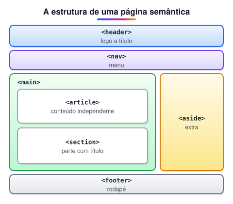

# Principais tags semânticas do HTML

> 🗺️ **Nesta aula:** a estrutura de uma página semântica, as tags estruturais (`header`, `nav`, `main`, `article`, `section`, `aside`, `footer`), tags de conteúdo e elementos interativos nativos.

## De onde paramos

Você viu por que a semântica importa. Agora vamos conhecer as tags uma a uma e decidir qual usar em cada situação.

## A estrutura de uma página semântica



```html
<!DOCTYPE html>
<html lang="pt-BR">
<head>
  <meta charset="UTF-8">
  <title>Meu site</title>
</head>
<body>
  <header>
    <h1>Meu site</h1>
    <nav>
      <ul>
        <li><a href="#">Início</a></li>
        <li><a href="#">Sobre</a></li>
        <li><a href="#">Contato</a></li>
      </ul>
    </nav>
  </header>

  <main>
    <article>
      <h2>Título do artigo</h2>
      <p>Conteúdo...</p>
    </article>

    <aside>
      <h2>Relacionados</h2>
    </aside>
  </main>

  <footer>
    <p>&copy; Meu site</p>
  </footer>
</body>
</html>
```

## Tags estruturais

| Tag | Representa | Pode repetir? |
| --- | --- | --- |
| `<header>` | cabeçalho da página ou de uma seção/artigo | ✅ (um por seção) |
| `<nav>` | bloco de **links de navegação principais** | ✅ (menu, rodapé, sumário) |
| `<main>` | o **conteúdo principal** da página | ❌ só um visível |
| `<article>` | conteúdo **independente** (post, notícia, card, comentário) | ✅ |
| `<section>` | **grupo temático**, normalmente com título próprio | ✅ |
| `<aside>` | conteúdo **complementar** (barra lateral, "leia também") | ✅ |
| `<footer>` | rodapé da página ou de uma seção | ✅ |

### `<article>` × `<section>` × `<div>`

- Faria sentido **compartilhar sozinho**, em outro site? → `<article>`.
- É uma **parte temática** de algo maior, com título? → `<section>`.
- Só precisa de uma caixa para estilizar? → `<div>`.

```html
<main>
  <section>
    <h2>Produtos</h2>
    <article>
      <h3>Café especial</h3>
      <p>R$ 39,90</p>
    </article>
    <article>
      <h3>Chá verde</h3>
      <p>R$ 19,90</p>
    </article>
  </section>
</main>
```

## Tags de conteúdo

### `<figure>` e `<figcaption>`

```html
<figure>
  
  <figcaption>Vendas do 1º trimestre</figcaption>
</figure>
```

### `<time>`, `<mark>` e `<address>`

```html
<p>Publicado em
  <time datetime="2023-08-15">15 de agosto</time>.
</p>
<p>O resultado foi <mark>acima do esperado</mark>.</p>
<address>
  Fale conosco:
  <a href="mailto:contato@exemplo.com">contato@exemplo.com</a>
</address>
```

`<time datetime>` dá a data num formato que máquinas entendem. `<address>` é para **informações de contato** do autor ou da página, e não para qualquer endereço postal no texto.

## Elementos interativos nativos

### `<details>` e `<summary>`: acordeão sem JavaScript

```html
<details>
  <summary>Informações adicionais</summary>
  <p>Fabricado com materiais sustentáveis.</p>
</details>
```

O `<summary>` é o título clicável; o restante fica oculto até o clique. Use o atributo `open` para começar aberto.

### `<datalist>`: sugestões em um campo

```html
<label for="fruta">Escolha uma fruta:</label>
<input id="fruta" list="lista-frutas">
<datalist id="lista-frutas">
  <option value="Maçã">
  <option value="Banana">
  <option value="Laranja">
</datalist>
```

Diferente do `<select>`, o usuário pode digitar um valor que não está na lista.

### `<progress>` e `<meter>`

```html
<label for="download">Download:</label>
<progress id="download" value="50" max="100">50%</progress>

<label for="disco">Uso do disco:</label>
<meter id="disco" value="0.7" low="0.5" high="0.85">70%</meter>
```

- `<progress>`: andamento de uma **tarefa** (download, envio). Sem `value`, mostra uma barra indefinida.
- `<meter>`: uma **medida** num intervalo conhecido (bateria, disco, nota).

```jsx
// atualizar via JS
document.querySelector("#download").value = 75;
```

> ⚠️ **Correções:** a tag se chama `<details>`, não `<detail>`, e "Secttion" é `section`. `<header>` e `<footer>` não são só da página: cada `<article>` ou `<section>` pode ter os seus, enquanto o `<main>` deve existir **uma vez**. `<datalist>` e `<progress>` são elementos interativos, e não de estrutura.

## Exercício

Monte a estrutura semântica de um card de receita com: título, data de publicação, foto com legenda, lista de ingredientes e um bloco "Dicas do chef" que começa fechado.

<details>
<summary>Ver resposta</summary>

```html
<article>
  <header>
    <h2>Bolo de cenoura</h2>
    <p>
      <time datetime="2024-03-10">10 de março</time>
    </p>
  </header>
  <figure>
    
    <figcaption>Bolo com cobertura de chocolate</figcaption>
  </figure>
  <section>
    <h3>Ingredientes</h3>
    <ul>
      <li>3 cenouras</li>
      <li>2 xícaras de farinha</li>
    </ul>
  </section>
  <details>
    <summary>Dicas do chef</summary>
    <p>Bata as cenouras com o óleo.</p>
  </details>
</article>
```

</details>

## 🧠 Revisão rápida

**Quantos `<main>` uma página pode ter visíveis?**

Um.

**Um comentário de blog deve ser `<article>` ou `<section>`?**

`<article>`: é um conteúdo independente.

**Qual a diferença entre `<progress>` e `<meter>`?**

`progress` mostra o andamento de uma tarefa; `meter`, uma medida num intervalo.

> ➡️ **Próximo passo:** com a estrutura pronta, vamos organizar o layout. Revisão completa do **Flexbox**.

## 📌 Resumo

| Tag | Em uma frase |
| --- | --- |
| `header` / `footer` | cabeçalho e rodapé (da página ou seção) |
| `nav` | links de navegação principais |
| `main` | conteúdo principal, um por página |
| `article` | conteúdo independente |
| `section` | grupo temático com título |
| `aside` | conteúdo complementar |
| `figure` | imagem com legenda |
| `details` | acordeão nativo |
