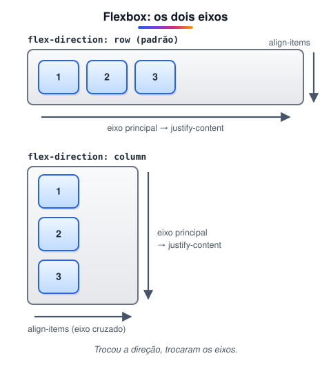
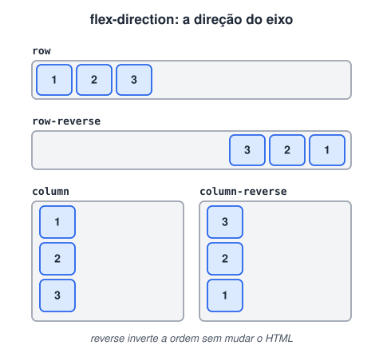
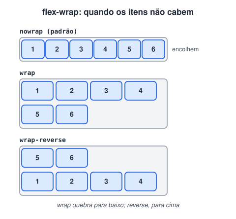
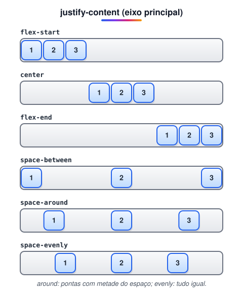
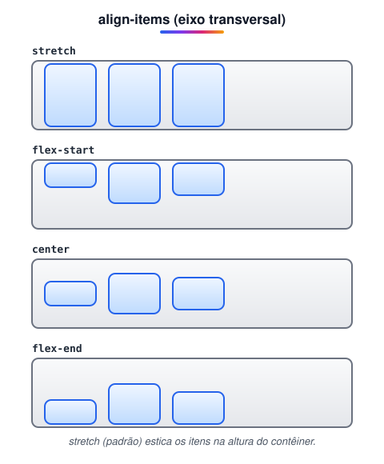
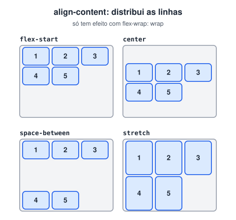
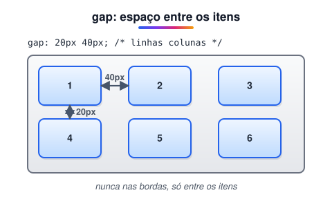
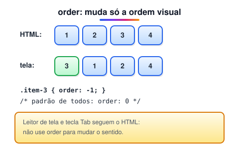
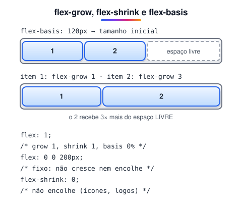
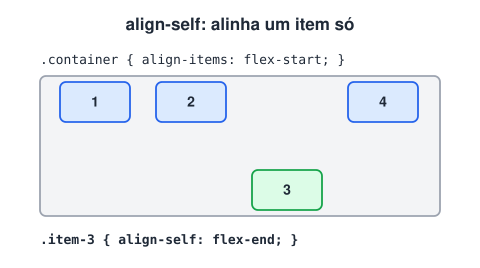

# Flexbox

> 🗺️ **Nesta aula:** referência completa do Flexbox: os dois eixos, as propriedades do contêiner (`flex-direction`, `flex-wrap`, `justify-content`, `align-items`, `align-content`, `gap`) e dos itens (`order`, `flex`, `align-self`).

## De onde paramos

O módulo V apresentou o Flexbox com um layout de página. Agora, com a estrutura semântica pronta, vamos revisar cada propriedade com um diagrama, como referência para consultar sempre que precisar.

## O que é um contêiner flex

**Um contêiner flex é um elemento com** `display: flex` **(ou** `inline-flex`**). Seus filhos diretos viram itens flex, organizados em uma única direção, que pode ser uma linha ou uma coluna.**

```css
.container {
  /* inline-flex: o contêiner se comporta como inline */
  display: flex;
}
```

O que o Flexbox controla:

1. **Direção** dos itens (linha ou coluna).
2. **Distribuição** do espaço no eixo principal.
3. **Alinhamento** no eixo transversal.
4. **Tamanho** dos itens: crescer, encolher ou ficar fixo.
5. **Ordem visual** dos itens.

Flexbox é **unidimensional** (uma linha ou uma coluna por vez); Grid é **bidimensional**.

## Os eixos



> 💡 **Analogia:** o contêiner flex é um varal e os itens são as roupas penduradas. O eixo principal é a corda: `justify-content` decide se as roupas ficam juntas numa ponta, no meio ou espalhadas. O eixo transversal é a altura: `align-items` decide se as peças ficam presas pelo topo, centralizadas ou esticadas até o chão. Girar o varal na vertical (`column`) troca os papéis.

## Propriedades do contêiner

### `flex-direction`



```css
.container {
  /* padrão; também: row-reverse,
     column, column-reverse */
  flex-direction: row;
}
```

### `flex-wrap`



```css
.container {
  /* padrão; também: wrap, wrap-reverse */
  flex-wrap: nowrap;
}

/* atalho para direção e quebra */
.container { flex-flow: row wrap; }
```

### `justify-content`: eixo principal



```css
.container {
  /* também: flex-start, flex-end, space-between,
     space-around, space-evenly */
  justify-content: center;
}
```

### `align-items`: eixo transversal



```css
.container {
  /* também: stretch (padrão), flex-start,
     flex-end, baseline */
  align-items: center;
}
```

> 💡 **Centralizar qualquer coisa:** `display: flex; justify-content: center; align-items: center;` no contêiner centraliza os filhos nos dois eixos. Lembre que o contêiner precisa ter altura (ex.: `min-height: 100vh`) para a centralização vertical aparecer.

### `align-content`: as linhas



```css
.container {
  /* obrigatório para ter várias linhas */
  flex-wrap: wrap;
  /* também: flex-start, flex-end, center,
     space-between, space-around, space-evenly */
  align-content: stretch;
}
```

### `gap`



```css
.container {
  /* 1º valor: entre linhas; 2º: entre colunas */
  gap: 20px 40px;
  row-gap: 20px;
  column-gap: 40px;
}
```

## Propriedades dos itens

### `order`



```css
.container .item-3 { order: -1; }
```

### `flex-grow`, `flex-shrink` e `flex-basis`



```css
.item {
  /* tamanho inicial (auto = width ou conteúdo) */
  flex-basis: 200px;
  /* parte do espaço livre que recebe (0 = não cresce) */
  flex-grow: 1;
  /* como encolhe quando falta espaço (0 = não encolhe) */
  flex-shrink: 1;
}

/* na prática, use o atalho */
.item { flex: 1; }  /* cresce igual aos irmãos */
.item { flex: 0 0 200px; }  /* fixo em 200px */
```

`flex-grow: 4` **não** quer dizer "4 vezes maior que os outros". O item recebe 4 partes do espaço que **sobra**, depois de cada um ocupar o seu `flex-basis`.

### `align-self`



```css
.container .item-3 { align-self: flex-end; }
```

> ⚠️ **Correções:** nos exemplos originais o seletor era `container` (sem o ponto), o que procuraria uma tag `<container>` inexistente; o certo é `.container`. `row-gap: 10;` estava sem unidade e seria ignorado (`10px`). Também havia erros de digitação: `flex-star` → `flex-start` e "Justfy" → `justify`.

## Exercício

Faça uma barra de navegação com o logo à esquerda e os links à direita, todos centralizados na vertical, e que quebre os links para baixo em telas estreitas.

<details>
<summary>Ver resposta</summary>

```html
<header class="barra">
  <a class="logo" href="/">Loja</a>
  <nav class="links">
    <a href="#">Início</a>
    <a href="#">Produtos</a>
    <a href="#">Contato</a>
  </nav>
</header>
```

```css
.barra {
  display: flex;
  justify-content: space-between;
  align-items: center;
  flex-wrap: wrap;
  gap: 12px;
  padding: 12px 20px;
}
.links {
  display: flex;
  gap: 16px;
}
```

O `space-between` empurra o logo e o `nav` para as pontas; o `nav` também é flex para espaçar os links.

</details>

## 🧠 Revisão rápida

**Com `flex-direction: column`, qual propriedade alinha na horizontal?**

`align-items`, porque o eixo cruzado passou a ser o horizontal.

**Quando `align-content` faz efeito?**

Só com `flex-wrap: wrap` e mais de uma linha.

**O que `flex: 1` faz?**

Faz o item crescer para ocupar o espaço livre, dividido igualmente com os irmãos que também têm `flex: 1`.

> ➡️ **Próximo passo:** para layouts em duas dimensões, revise o **Grid**.

## 📌 Resumo

| Propriedade | Em uma frase |
| --- | --- |
| `display: flex` | transforma os filhos em itens flex |
| `flex-direction` | direção do eixo principal |
| `flex-wrap` | permite quebrar em várias linhas |
| `justify-content` | distribui no eixo principal |
| `align-items` | alinha no eixo cruzado |
| `align-content` | distribui as linhas (com wrap) |
| `gap` | espaço entre itens |
| `flex` | crescer, encolher e tamanho inicial |
| `order` / `align-self` | ordem visual / alinhamento de um item |
