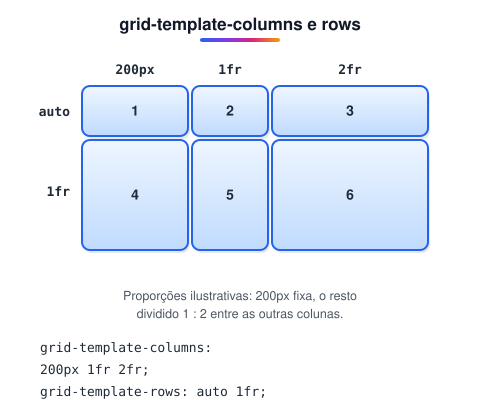
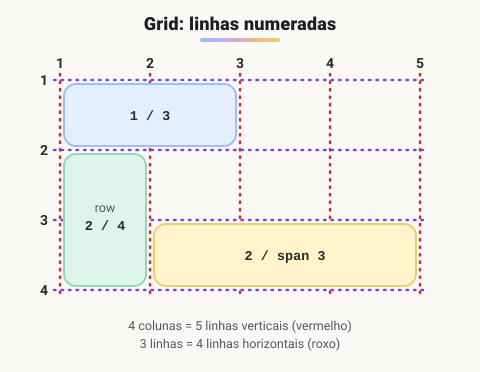

# Grid

> 🗺️ **Nesta aula:** referência do CSS Grid: colunas e linhas com `fr`, `repeat()` e `minmax()`, posicionamento pelas linhas da grade, áreas nomeadas e quando usar Grid ou Flexbox.

## De onde paramos

O Flexbox organiza itens em uma direção. Para o esqueleto de uma página, com cabeçalho, conteúdo, barra lateral e rodapé, é mais natural controlar linhas **e** colunas ao mesmo tempo.

## O que é CSS Grid

**CSS Grid é um sistema de layout bidimensional: você divide o contêiner em linhas e colunas e posiciona os itens nessa grade.**

```css
.container {
  /* ou inline-grid */
  display: grid;
}
```

## Principais propriedades

| Propriedade | Onde | Para que serve |
| --- | --- | --- |
| `grid-template-columns` | contêiner | quantidade e largura das colunas |
| `grid-template-rows` | contêiner | quantidade e altura das linhas |
| `gap` | contêiner | espaço entre as células |
| `grid-template-areas` | contêiner | "desenhar" o layout com nomes |
| `justify-items` / `align-items` | contêiner | alinhar o conteúdo nas células |
| `grid-column` / `grid-row` | item | linhas onde o item começa e termina |
| `grid-area` | item | área nomeada onde o item fica |

## Colunas e linhas



```css
.container {
  display: grid;
  grid-template-columns: 200px 1fr 2fr;
  grid-template-rows: auto 1fr;
  gap: 16px;
}
```

A unidade `fr` ("fração") divide o espaço **livre**. Num contêiner de 800px com `200px 1fr 2fr`, sobram 600px: a 2ª coluna fica com 200px e a 3ª com 400px (sem contar o gap).

```css
/* 4 colunas iguais */
grid-template-columns: repeat(4, 1fr);
/* responsivo sem media query: quantas
   colunas de no mínimo 220px couberem */
grid-template-columns:
  repeat(auto-fit, minmax(220px, 1fr));
```

## Posicionando itens



```css
/* da linha 1 à 3 = 2 colunas */
.destaque { grid-column: 1 / 3; }
/* 2 linhas */
.lateral { grid-row: 1 / 3; }
/* largura total */
.banner { grid-column: 1 / -1; }
/* 2 colunas a partir de onde estiver */
.card { grid-column: span 2; }
```

## Áreas nomeadas

```css
.pagina {
  display: grid;
  grid-template-columns: 3fr 1fr;
  grid-template-areas:
    "header   header"
    "conteudo lateral"
    "footer   footer";
  gap: 10px;
}
header { grid-area: header; }
main   { grid-area: conteudo; }
aside  { grid-area: lateral; }
footer { grid-area: footer; }
```

Para o celular, basta redesenhar as áreas numa media query:

```css
@media (max-width: 600px) {
  .pagina {
    grid-template-columns: 1fr;
    grid-template-areas:
      "header" "conteudo" "lateral" "footer";
  }
}
```

## Flexbox ou Grid?

- **Grid** para o esqueleto da página e para galerias e dashboards, ou seja, tudo que tem linhas **e** colunas.
- **Flexbox** para componentes em uma direção: menus, barras de botões, alinhar ícone e texto.
- Eles se combinam muito bem: Grid na página e Flexbox dentro de cada bloco.

> 💡 No DevTools (Chrome/Firefox), clique no selo **grid** ao lado do elemento na aba Elements: o navegador desenha as linhas e os números da grade por cima da página.

> ⚠️ **Correções:** `grid-gap` é o nome antigo; hoje a propriedade se chama `gap`. No exemplo original, o seletor `container` estava sem o ponto (`.container`).

## Exercício

Crie uma galeria de fotos que mostre quantas colunas couberem (cada uma com no mínimo 150px), com 8px de espaço, e faça a primeira foto ocupar 2 colunas e 2 linhas.

<details>
<summary>Ver resposta</summary>

```css
.galeria {
  display: grid;
  grid-template-columns:
    repeat(auto-fill, minmax(150px, 1fr));
  grid-auto-rows: 150px;
  gap: 8px;
}
.galeria img {
  width: 100%;
  height: 100%;
  object-fit: cover;
}
.galeria img:first-child {
  grid-column: span 2;
  grid-row: span 2;
}
```

`grid-auto-rows` define a altura das linhas criadas automaticamente; `object-fit: cover` evita fotos distorcidas.

</details>

## 🧠 Revisão rápida

**O que `1fr` significa?**

Uma fração do espaço livre do contêiner.

**Como fazer um item ocupar a largura toda?**

`grid-column: 1 / -1`.

**Quando preferir Grid a Flexbox?**

Quando o layout tem linhas e colunas ao mesmo tempo.

> ➡️ **Próximo passo:** e se o grid e os componentes já viessem prontos? Conheça o **Bootstrap**.

## 📌 Resumo

| Item | Em uma frase |
| --- | --- |
| `display: grid` | cria a grade |
| `grid-template-columns` | define as colunas |
| `fr` | fração do espaço livre |
| `repeat(auto-fit, minmax())` | colunas responsivas sem media query |
| `grid-column: 1 / 3` | posiciona pelas linhas da grade |
| `span` | ocupa N trilhas |
| `grid-template-areas` | desenha o layout com nomes |
