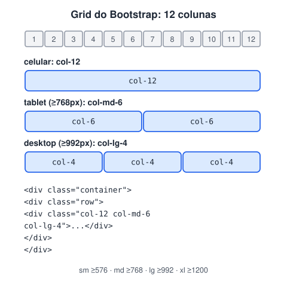

# Bootstrap

> 🗺️ **Nesta aula:** o que é o Bootstrap, como incluí-lo no projeto, o grid responsivo de 12 colunas, componentes prontos, classes utilitárias, personalização, vantagens e cuidados.

**Documentação do Bootstrap**

🔗 [Get started with Bootstrap](https://getbootstrap.com/docs/5.3/getting-started/introduction/)

**Página do Bootstrap**

🔗 [Bootstrap](https://getbootstrap.com/)

## De onde paramos

Você já sabe montar layouts com Flexbox e Grid na mão. Em muitos projetos, porém, o time usa um framework que traz grid e componentes prontos, para ganhar velocidade.

## O que é o Bootstrap

**Bootstrap é um framework de front-end: um pacote pronto de CSS e JavaScript com grid responsivo, componentes (botões, menus, cards, modais) e classes utilitárias.** Você monta a interface combinando classes no HTML, quase sem escrever CSS.

- Criado por Mark Otto e Jacob Thornton no Twitter, lançado como código aberto em 2011.
- A versão atual é a **5**, que **não depende mais do jQuery**.
- É gratuito, com licença MIT.

## Como incluir no projeto

O jeito mais rápido é pelo CDN, colando no HTML:

```html
<head>
  <meta charset="UTF-8">
  <meta name="viewport"
        content="width=device-width, initial-scale=1.0">
  <title>Bootstrap</title>
  <link rel="stylesheet"
    href="https://cdn.jsdelivr.net/npm/bootstrap@5.3.3/dist/css/bootstrap.min.css">
</head>
<body>
  <!-- conteúdo -->
  <script
    src="https://cdn.jsdelivr.net/npm/bootstrap@5.3.3/dist/js/bootstrap.bundle.min.js">
  </script>
</body>
```

Em projetos com Node, instale com `npm install bootstrap`.

> 💡 A meta `viewport` é obrigatória: sem ela, o celular finge ter uma tela larga e o grid responsivo não funciona.

## O grid responsivo



> 💡 **Analogia:** o Bootstrap é como montar móveis planejados com módulos de tamanho padrão. Cada parede (linha) comporta 12 módulos; você decide quantos módulos cada armário ocupa (`col-4`, `col-6`) e, conforme o tamanho do cômodo (a tela), os armários se reorganizam sozinhos.

A estrutura é sempre `container` → `row` → `col`. Cada linha tem **12 colunas**, e o sufixo diz a partir de qual largura a regra vale (mobile first): `col-md-6` significa "6 de 12 colunas a partir de 768px".

```html
<div class="container">
  <!-- g-3 = espaço entre colunas -->
  <div class="row g-3">
    <div class="col-12 col-md-6 col-lg-4">Card 1</div>
    <div class="col-12 col-md-6 col-lg-4">Card 2</div>
    <div class="col-12 col-lg-4">Card 3</div>
  </div>
</div>
```

| Prefixo | A partir de |
| --- | --- |
| (nenhum) | 0px (todas as telas) |
| `sm` | 576px |
| `md` | 768px |
| `lg` | 992px |
| `xl` | 1200px |
| `xxl` | 1400px |

## Componentes

```html
<button class="btn btn-primary">Salvar</button>
<button class="btn btn-outline-danger">Excluir</button>

<div class="alert alert-success">Cadastro realizado!</div>

<div class="card" style="width: 18rem;">
  
  <div class="card-body">
    <h5 class="card-title">Café especial</h5>
    <p class="card-text">Torra média, 250 g.</p>
    <a href="#" class="btn btn-primary">Comprar</a>
  </div>
</div>
```

Outros componentes muito usados: `navbar`, `modal`, `dropdown`, `carousel`, `accordion`, `toast` e `form-control`. Copie o exemplo na documentação e adapte.

## Classes utilitárias

| Classe | Efeito |
| --- | --- |
| `m-3`, `mt-2`, `px-4` | margem/padding (escala 0 a 5; t, b, s, e, x, y = lados) |
| `d-flex`, `justify-content-between` | Flexbox direto no HTML |
| `d-none d-md-block` | esconde no celular, mostra a partir do tablet |
| `text-center`, `fw-bold` | texto |
| `bg-dark text-white`, `rounded`, `shadow` | cores, bordas, sombra |
| `w-100`, `h-50` | largura/altura em % |

## Personalização

- Sobrescreva com o **seu CSS** carregado **depois** do Bootstrap.
- Use as **variáveis CSS** (`--bs-primary`, `--bs-body-font-family`) ou, com Sass, as variáveis `$primary` e afins, para mudar cores e fontes do tema inteiro.

## Vantagens e cuidados

| ✅ Vantagens | ⚠️ Cuidados |
| --- | --- |
| protótipos e painéis muito rápidos | sites ficam com "cara de Bootstrap" se não personalizar |
| responsivo e acessível por padrão | carrega CSS/JS que você talvez não use |
| documentação excelente | não substitui saber CSS |

Alternativas populares: **Tailwind CSS** (só utilitários), Bulma e Foundation.

## Exercício

Monte com Bootstrap uma seção com 4 cards que fiquem 1 por linha no celular, 2 no tablet e 4 no desktop, com espaço entre eles.

<details>
<summary>Ver resposta</summary>

```html
<section class="container py-4">
  <div class="row g-3">
    <div class="col-12 col-md-6 col-lg-3">
      <div class="card h-100">
        <div class="card-body">Card 1</div>
      </div>
    </div>
    <!-- repita para os cards 2, 3 e 4 -->
  </div>
</section>
```

12 ÷ 3 = 4 cards por linha no `lg`; 12 ÷ 6 = 2 no `md`. O `h-100` deixa os cards da mesma linha com a mesma altura.

</details>

## 🧠 Revisão rápida

**Quantas colunas tem cada linha do grid do Bootstrap?**

12.

**O que `col-md-6` significa?**

Ocupar 6 das 12 colunas em telas a partir de 768px.

**Como mudar a cor principal do tema?**

Sobrescrevendo `--bs-primary` (ou `$primary` no Sass).

> ➡️ **Próximo passo:** pratique tudo do módulo em **Alguns projetos teste**.

## 📌 Resumo

| Item | Em uma frase |
| --- | --- |
| Bootstrap | framework com grid, componentes e utilitários |
| CDN | link para incluir sem instalar nada |
| `container → row → col` | estrutura do grid |
| 12 colunas | a soma dos `col-*` numa linha |
| Breakpoints | `sm`, `md`, `lg`, `xl`, `xxl` |
| Utilitários | margens, flex, texto e cores por classe |
| Personalização | CSS próprio depois ou variáveis `--bs-*` |
