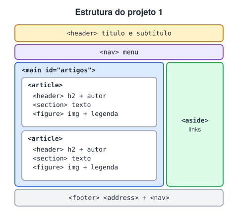

# Alguns projetos teste

> 🗺️ **Nesta aula:** três projetos para praticar o módulo: uma página com tags semânticas, uma grade de caixas com Flexbox e um layout com `grid-template-areas` que se adapta ao celular.

## De onde paramos

Você estudou semântica, Flexbox, Grid e Bootstrap. Agora vamos aplicar. Tente montar cada projeto pela descrição antes de abrir o código revisado.

## Projeto 1: layout com tags semânticas

Uma página com cabeçalho, menu, dois artigos (cada um com autor, texto e figura), barra lateral de links e rodapé com contato.



> 💡 **Analogia:** estes três projetos são como os treinos de uma autoescola: primeiro você aprende onde fica cada peça do carro (as tags semânticas), depois a fazer curvas numa direção (Flexbox) e por fim a estacionar numa vaga marcada no chão (Grid). Tente dirigir sozinho antes de olhar o código.

**Código revisado**

```html
<!DOCTYPE html>
<html lang="pt-BR">
<head>
  <meta charset="UTF-8">
  <meta name="viewport"
        content="width=device-width, initial-scale=1.0">
  <title>Layout com tags semânticas</title>
</head>
<body>
  <header>
    <h1>Página teste</h1>
    <p>Subtítulo</p>
  </header>

  <nav id="header-nav" aria-label="Menu principal">
    <ul>
      <li><a href="#artigos">Artigos</a></li>
      <li><a href="#rodape">Rodapé</a></li>
    </ul>
  </nav>

  <main id="artigos">
    <h2>Artigos</h2>

    <article>
      <header>
        <h3>Artigo 1</h3>
        <p>Escrito por: <mark>Carl Sagan</mark></p>
      </header>
      <section>
        <p>Esta é uma seção do artigo...</p>
      </section>
      <figure>
        
        <figcaption>Carl Sagan em palestra</figcaption>
      </figure>
    </article>

    <article>
      <header>
        <h3>Artigo 2</h3>
        <p>Escrito por: <mark>Isaac Newton</mark></p>
      </header>
      <section>
        <p>Esta é uma seção do artigo...</p>
      </section>
      <figure>
        
        <figcaption>Isaac Newton</figcaption>
      </figure>
    </article>
  </main>

  <aside>
    <h2>Links externos</h2>
    <ul>
      <li>
        <a href="https://pt.wikipedia.org/wiki/Isaac_Newton">
          Isaac Newton</a>
      </li>
      <li>
        <a href="https://pt.wikipedia.org/wiki/Carl_Sagan">
          Carl Sagan</a>
      </li>
    </ul>
  </aside>

  <footer id="rodape">
    <address>Teste criado por: Seu Nome</address>
    <nav aria-label="Navegação do rodapé">
      <h2>Voltar para a seção</h2>
      <ul>
        <li><a href="#artigos">Artigos</a></li>
        <li><a href="#rodape">Rodapé</a></li>
      </ul>
    </nav>
  </footer>
</body>
</html>
```

## Projeto 2: testando o Flexbox

Dez caixas que quebram de linha automaticamente e ficam centralizadas.

**Código revisado**

```html
<!DOCTYPE html>
<html lang="pt-BR">
<head>
  <meta charset="UTF-8">
  <meta name="viewport"
        content="width=device-width, initial-scale=1.0">
  <title>Testando Flexbox</title>
  <link rel="stylesheet" href="style.css">
</head>
<body>
  <h1>Testando o Flexbox</h1>

  <div class="flex-container">
    <div>01</div><div>02</div><div>03</div>
    <div>04</div><div>05</div><div>06</div>
    <div>07</div><div>08</div><div>09</div>
    <div>10</div>
  </div>
</body>
</html>
```

```css
.flex-container {
  display: flex;
  /* quebra para a próxima linha quando não cabe */
  flex-wrap: wrap;
  justify-content: center;
  /* espaço entre itens, sem margens somando */
  gap: 20px;
  padding: 20px;
  background-color: rgb(45, 128, 175);
}

.flex-container > div {
  /* largura fixa de 110px */
  flex: 0 0 110px;
  padding: 30px 0;
  text-align: center;
  font-size: 20px;
  background-color: rgb(168, 94, 238);
}
```

**Experimente:** troque `justify-content` por `space-between`, `flex: 0 0 110px` por `flex: 1 1 110px` e redimensione a janela.

## Projeto 3: testando o Grid

Layout com `grid-template-areas` e um rodapé em Flexbox dentro do grid.

**Código revisado**

```html
<!DOCTYPE html>
<html lang="pt-BR">
<head>
  <meta charset="UTF-8">
  <meta name="viewport"
        content="width=device-width, initial-scale=1.0">
  <title>Testando Grid</title>
  <link rel="stylesheet" href="style.css">
</head>
<body>
  <div class="grid-container">
    <header>Header</header>
    <main><p>Conteúdo</p></main>
    <aside>Sidebar</aside>
    <footer>
      <div class="caixa1"><p>Caixa 1</p></div>
      <div class="caixa2"><p>Caixa 2</p></div>
      <div class="caixa3"><p>Caixa 3</p></div>
    </footer>
  </div>
</body>
</html>
```

```css
body, p {
  margin: 0;
  padding: 0;
  font-size: 1.5rem;
  font-style: italic;
  color: dimgray;
  text-align: center;
}

.grid-container {
  width: 80%;
  margin: 0 auto;
  display: grid;
  grid-template-columns: 3fr 1fr;
  grid-template-rows: 100px 450px 150px;
  grid-template-areas:
    "header header"
    "main   sidebar"
    "footer footer";
}

header {
  grid-area: header;
  background-color: dodgerblue;
}
main {
  grid-area: main;
  background-color: aquamarine;
}
aside {
  grid-area: sidebar;
  background-color: pink;
}

/* rodapé: flexbox dentro do grid */
footer {
  grid-area: footer;
  display: flex;
  gap: 4px;
}
.caixa1, .caixa3 {
  flex: 1;
  background-color: rgb(197, 238, 238);
}
/* o dobro das outras */
.caixa2 {
  flex: 2;
  background-color: bisque;
}

/* celular: uma coluna só */
@media (max-width: 600px) {
  .grid-container {
    width: 100%;
    grid-template-columns: 1fr;
    grid-template-rows: auto;
    grid-template-areas:
      "header" "main" "sidebar" "footer";
  }
}
```

> ⚠️ **Correções:**
>
> - **Projeto 1:** havia vários `<h1>` (página, "Artigos", cada artigo); agora a hierarquia é `h1` → `h2` → `h3`. As imagens não tinham `alt` e foram trocadas por placeholders com `width` e `height`. "Isac" → "Isaac".
> - **Projeto 2:** `margin` nos itens foi trocado por `gap`, e `width` por `flex: 0 0 110px` (no flex, o `width` pode ser encolhido).
> - **Projeto 3:** `font-size: 3,5rem` é inválido (vírgula) e era descartado pelo navegador. `border-collapse` não faz nada em um grid e foi removido. As caixas do rodapé somavam 25% + 50% + 25% **mais** margens, estourando a largura; agora usam `flex` 1, 2 e 1 com `gap`.

## Desafio extra

Refaça o Projeto 2 com Bootstrap, sem escrever CSS próprio para o layout: 2 caixas por linha no celular, 5 a partir do `lg`.

<details>
<summary>Ver resposta</summary>

```html
<div class="container py-3">
  <div class="row g-3 row-cols-2 row-cols-lg-5">
    <div class="col">
      <div class="p-4 text-center bg-primary text-white">
        01
      </div>
    </div>
    <!-- repita até 10 -->
  </div>
</div>
```

`row-cols-2` define quantas colunas por linha sem precisar de `col-6` em cada item.

</details>

## 🧠 Revisão rápida

**Por que trocar `margin` por `gap` no Projeto 2?**

Porque o `gap` só cria espaço entre os itens, sem somar margens nas bordas.

**No Projeto 3, por que a caixa 2 fica com o dobro da largura?**

Porque tem `flex: 2` e as outras `flex: 1`.

> ➡️ **Próximo passo:** o próximo módulo volta ao JavaScript para organizar o código em objetos e classes: **POO em JavaScript**.

## 📌 Resumo

| Projeto | O que pratica |
| --- | --- |
| Layout semântico | `header`, `nav`, `main`, `article`, `aside`, `footer`, hierarquia de títulos |
| Flexbox | `flex-wrap`, `justify-content`, `gap`, `flex` |
| Grid | `grid-template-areas`, flex dentro do grid, media query |
