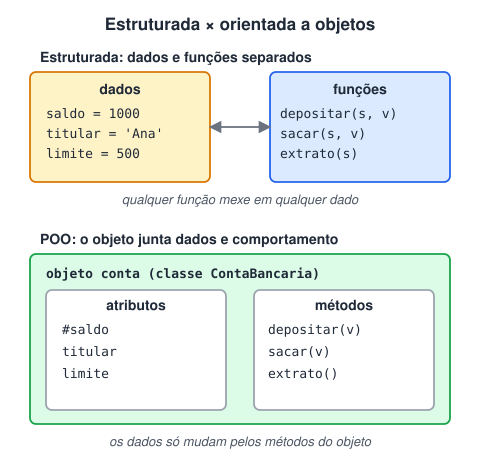

# Paradigma estrutural (PE) vs POO

> 🗺️ **Nesta aula:** o que é um paradigma de programação, como funcionam a programação estruturada e a orientada a objetos, o mesmo exemplo nos dois estilos e quando usar cada um.

## De onde paramos

No módulo de JavaScript você escreveu funções e objetos literais, e viu uma primeira classe. Este módulo organiza isso em uma forma de pensar: a **programação orientada a objetos**. Primeiro, vamos compará-la com o estilo que você já usa.

## Dois jeitos de organizar um programa

A pergunta de fundo é simples: num programa, quem manda no quê? No estilo estruturado, as funções mandam: elas recebem os dados de fora, mexem e devolvem. No estilo orientado a objetos, os objetos mandam: cada um guarda os seus dados e sabe o que pode fazer com eles. Nenhum é o certo, e a maioria dos sistemas reais mistura os dois. A diferença aparece quando o programa cresce: com centenas de funções mexendo em dados soltos, fica difícil saber quem alterou o quê.

Um **paradigma** é um estilo de organizar o código. Os dois mais comuns no início da carreira são o **estruturado** (ou procedural) e o **orientado a objetos** (POO). O JavaScript permite os dois e ainda o funcional.



> 💡 **Analogia:** o estilo estruturado é como uma cozinha comunitária: os ingredientes ficam na despensa geral e qualquer cozinheiro pega e mexe neles seguindo uma receita. A POO é como uma praça de alimentação: cada quiosque (objeto) guarda seus próprios ingredientes e só os funcionários dele (os métodos) podem usá-los; os outros apenas fazem pedidos no balcão.

## Programação estruturada

O exemplo abaixo mostra o estilo em ação: o saldo é uma variável solta, e `depositar` e `sacar` recebem o saldo, calculam e devolvem um valor novo. É direto e fácil de seguir, e para um script pequeno é ótimo. O risco está no que a linguagem não impede: qualquer parte do programa pode fazer `saldo = -500` sem passar por nenhuma regra, e você só percebe quando algo dá errado.

- O código é dividido em **funções** que recebem dados, processam e devolvem resultados.
- A ênfase está na **sequência de passos** (sequência, decisão e repetição).
- Os dados ficam em variáveis ou estruturas separadas e são passados para as funções.
- Simples e direta para scripts, automações e problemas pequenos.

```jsx
// estrutural: dados soltos e funções separadas
let saldo = 1000;

function depositar(saldo, valor) {
  return saldo + valor;
}
function sacar(saldo, valor) {
  return valor <= saldo ? saldo - valor : saldo;
}

saldo = depositar(saldo, 500);
saldo = sacar(saldo, 200);
```

## Programação orientada a objetos

Na versão com classe, o saldo passa a ser privado (`#saldo`) e só muda por meio de `depositar` e `sacar`. Essas duas funções podem recusar um valor negativo ou um saque maior que o saldo, e como só elas têm acesso, a regra vale sempre. Os dados e as regras ficam juntos, num lugar só. Se amanhã surgir uma conta poupança com regras próprias, você cria uma nova classe sem tocar no código que já funciona.

- O código é organizado em **objetos** que juntam **dados** (atributos) e **comportamentos** (métodos).
- **Classes** são os moldes; objetos são as **instâncias**.
- Objetos colaboram chamando métodos uns dos outros.
- Apoia-se em quatro pilares: **encapsulamento, abstração, herança e polimorfismo**.

```jsx
class ContaBancaria {
  // privado: só a classe acessa
  #saldo = 0;

  depositar(valor) {
    this.#saldo += valor;
  }
  sacar(valor) {
    if (valor <= this.#saldo) this.#saldo -= valor;
  }
  get saldo() {
    return this.#saldo;
  }
}

const conta = new ContaBancaria();
conta.depositar(1000);
conta.sacar(200);
conta.saldo;  // 800
```

## Comparação

Use a tabela como um mapa de decisão. Para uma automação de 50 linhas, um script estruturado é mais rápido de escrever e mais fácil de ler. Para um sistema com clientes, pedidos, produtos e regras que se cruzam, as classes dão organização e protegem os dados. Perceba também que cada estilo tem o seu risco: a estruturada pode virar um "espaguete" ao crescer, e a POO pode virar um excesso de classes quando o problema era simples.

|  | Estruturada | Orientada a objetos |
| --- | --- | --- |
| Unidade principal | função | objeto (classe) |
| Dados e comportamento | separados | juntos |
| Proteção dos dados | qualquer função altera | só os métodos do objeto |
| Reuso | funções | classes, herança e composição |
| Melhor para | scripts e problemas pequenos | sistemas com muitas entidades e regras |
| Risco | código "espaguete" ao crescer | complexidade desnecessária |

> 💡 Um paradigma não é "melhor" que o outro: cada um encaixa em um tipo de problema. No dia a dia do JavaScript é comum misturar: classes para modelar entidades e funções puras (estilo funcional) para transformar dados.

> ⚠️ **Ajuste:** a tabela original dizia que a POO tem, por definição, "mais reutilização" e "mais facilidade de modificar". Isso depende de um bom design: POO mal aplicada também fica difícil de manter.

## Exercício

Um sistema de biblioteca precisa registrar livros e empréstimos. Liste quais seriam as classes, com dois atributos e dois métodos cada.

<details>
<summary>Ver resposta (uma possibilidade)</summary>

```jsx
// POO: cada classe junta dados e ações
class Livro {
  constructor(titulo, autor) {
    this.titulo = titulo;
    this.autor = autor;
    this.disponivel = true;
  }
  emprestar() { this.disponivel = false; }
  devolver() { this.disponivel = true; }
}

class Leitor {
  constructor(nome) {
    this.nome = nome;
    this.livros = [];
  }
  pegar(livro) {
    if (!livro.disponivel) return false;
    livro.emprestar();
    this.livros.push(livro);
    return true;
  }
  devolver(livro) {
    livro.devolver();
    this.livros = this.livros.filter(l => l !== livro);
  }
}
```

Os substantivos do problema (livro, leitor) costumam virar classes; os verbos (emprestar, devolver), métodos.

</details>

## 🧠 Revisão rápida

**O que caracteriza a programação estruturada?**

Funções que recebem dados separados, processam e devolvem resultados.

**O que um objeto junta na POO?**

Dados (atributos) e comportamentos (métodos).

**O JavaScript é estruturado ou orientado a objetos?**

Multiparadigma: permite os dois, além do funcional.

> ➡️ **Próximo passo:** conheça os **Principais pilares de programação orientada a objetos em JavaScript**.

## 📌 Resumo

| Item | Em uma frase |
| --- | --- |
| Paradigma | estilo de organizar o código |
| Estruturada | funções e dados separados |
| POO | objetos com dados e métodos |
| Classe | molde dos objetos |
| Instância | objeto criado com `new` |
| Multiparadigma | JS combina estilos |
