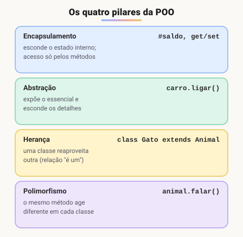

# Principais pilares de programação orientada a objetos em JavaScript

> 🗺️ **Nesta aula:** os quatro pilares da POO (encapsulamento, abstração, herança e polimorfismo) com exemplos em JavaScript, por que não existe sobrecarga, encadeamento de métodos e composição.

## De onde paramos

Você viu que a POO junta dados e comportamento em objetos. Quatro ideias, os **pilares**, orientam como desenhar essas classes.



## Classes e objetos (a base)

Uma **classe** descreve um tipo de objeto: quais dados ele tem e o que sabe fazer. Um **objeto** é uma instância criada com `new`.

```jsx
class Pessoa {
  constructor(nome, idade) {
    this.nome = nome;
    this.idade = idade;
  }

  saudacao() {
    console.log(`Olá, sou ${this.nome}, ${this.idade} anos.`);
  }
}

const pessoa1 = new Pessoa("João", 25);
pessoa1.saudacao();  // Olá, sou João, 25 anos.
```

## 1. Encapsulamento

**Esconder o estado interno e permitir mudanças só pelos métodos**, que podem validar as regras. Em JavaScript, campos com `#` são **realmente privados**.

```jsx
class ContaBancaria {
  // privado: só existe dentro da classe
  #saldo;

  constructor(numero, saldoInicial = 0) {
    this.numero = numero;  // público
    this.#saldo = saldoInicial;
  }

  depositar(valor) {
    if (valor <= 0) throw new Error("Depósito inválido");
    this.#saldo += valor;
  }

  sacar(valor) {
    if (valor > this.#saldo) {
      console.log("Saldo insuficiente.");
      return;
    }
    this.#saldo -= valor;
  }

  // leitura permitida; escrita, não
  get saldo() {
    return this.#saldo;
  }
}

const conta = new ContaBancaria("123456", 1000);
conta.depositar(500);
conta.sacar(200);
console.log(conta.saldo);  // 1300
// conta.#saldo = 999999;  → SyntaxError
```

## 2. Abstração

**Expor só o que importa e esconder como é feito.** Quem chama `forma.calcularArea()` não precisa saber a fórmula. Uma classe "modelo" define o contrato, e cada subclasse implementa o seu.

```jsx
class Forma {
  calcularArea() {
    throw new Error("Implemente calcularArea() na subclasse");
  }
}

class Retangulo extends Forma {
  constructor(largura, altura) {
    super();
    this.largura = largura;
    this.altura = altura;
  }
  calcularArea() {
    return this.largura * this.altura;
  }
}

new Retangulo(5, 3).calcularArea();  // 15
```

JavaScript não tem `abstract` nem `interface` como Java ou TypeScript. O `throw` no método da classe base é a forma comum de simular isso.

## 3. Herança

**Uma classe filha (**`extends`**) reaproveita atributos e métodos da classe pai** e pode acrescentar ou sobrescrever comportamentos. Representa uma relação "é um": um cachorro **é um** animal.

```jsx
class Animal {
  constructor(nome) { this.nome = nome; }
  falar() { console.log(`${this.nome} faz barulho.`); }
}

class Cachorro extends Animal {
  // sobrescreve
  falar() { console.log(`${this.nome} late.`); }
}

new Cachorro("Bobby").falar();  // Bobby late.
```

Veja `super` e quando **não** usar herança na aula **Herança, extends e super**.

## 4. Polimorfismo

**Objetos de classes diferentes respondem à mesma chamada, cada um à sua maneira.** O código que chama não precisa saber o tipo exato.

```jsx
class Animal { falar() { return "..."; } }
class Cachorro extends Animal { falar() { return "Au au!"; } }
class Gato extends Animal { falar() { return "Miau!"; } }

const animais = [new Cachorro(), new Gato(), new Animal()];
animais.forEach(a => console.log(a.falar()));
// Au au! · Miau! · ...
```

### E a sobrecarga?

Em Java ou C#, uma classe pode ter **vários métodos com o mesmo nome e parâmetros diferentes** (sobrecarga). **JavaScript não tem sobrecarga**: se você declarar dois métodos com o mesmo nome, o segundo **substitui** o primeiro.

```jsx
// ❌ NÃO funciona como sobrecarga
class Calculadora {
  somar(a, b) { return a + b; }
  // apaga o anterior
  somar(a, b, c) { return a + b + c; }
}
// NaN (2 + 3 + undefined)
new Calculadora().somar(2, 3);

// ✅ em JS, use parâmetros rest
class Calculadora2 {
  somar(...numeros) {
    return numeros.reduce((t, n) => t + n, 0);
  }
}
new Calculadora2().somar(2, 3);  // 5
new Calculadora2().somar(2, 3, 4);  // 9
```

> ⚠️ **Correção:** no exemplo original de sobrecarga, `somar(2, 3)` era apresentado como 5, mas retorna **NaN**, porque o segundo `somar` substitui o primeiro. No encapsulamento, o original usava `this.saldo` público, que qualquer código podia alterar; agora usa `#saldo` com getter.

## Extras muito usados

### Encadeamento de métodos (chaining)

Se cada método **retorna** `this`, dá para chamar um atrás do outro.

```jsx
class CarrinhoDeCompras {
  constructor() { this.itens = []; }

  adicionarItem(item) {
    this.itens.push(item);
    return this;
  }

  removerItem(item) {
    const i = this.itens.indexOf(item);
    if (i !== -1) this.itens.splice(i, 1);
    return this;
  }

  calcularTotal() {
    return this.itens.reduce((t, item) => t + item.preco, 0);
  }
}

const camiseta = { nome: "Camiseta", preco: 29.99 };
const calca = { nome: "Calça", preco: 49.99 };

const total = new CarrinhoDeCompras()
  .adicionarItem(camiseta)
  .adicionarItem(calca)
  .calcularTotal();

// toFixed evita resíduos de ponto flutuante
console.log(total.toFixed(2));  // "79.98"
```

### Composição: "tem um" em vez de "é um"

Em vez de herdar, um objeto **contém** outros e delega a eles parte do trabalho. Isso traz menos acoplamento e mais flexibilidade. A regra clássica é **"prefira composição à herança"**.

```jsx
const circulo = {
  raio: 5,
  calcularArea() { return Math.PI * this.raio ** 2; },
};

const retangulo = {
  largura: 10,
  altura: 8,
  calcularArea() { return this.largura * this.altura; },
};

const figura = {
  partes: [circulo, retangulo],
  calcularAreaTotal() {
    return this.partes.reduce(
      (soma, p) => soma + p.calcularArea(), 0
    );
  },
};

// 78.54 + 80
console.log(figura.calcularAreaTotal().toFixed(2));  // "158.54"
```

> ⚠️ **Correção:** a soma das áreas da composição (círculo 78,54 + retângulo 80) é **158,54**, e não 240,68 como no original.

## Exercício

Crie as classes `Funcionario` (com `nome` e `salario` e o método `bonus()`, que devolve 10% do salário) e `Gerente`, que herda de `Funcionario` e cujo bônus é 20%. Depois calcule o total de bônus de uma lista com os dois tipos.

<details>
<summary>Ver resposta</summary>

```jsx
class Funcionario {
  constructor(nome, salario) {
    this.nome = nome;
    this.salario = salario;
  }
  bonus() { return this.salario * 0.1; }
}

class Gerente extends Funcionario {
  bonus() { return this.salario * 0.2; }
}

const equipe = [
  new Funcionario("Ana", 3000),
  new Gerente("Beto", 8000),
];
const total = equipe.reduce((t, f) => t + f.bonus(), 0);
console.log(total);  // 300 + 1600 = 1900
```

Isto usa herança (Gerente é um Funcionario) e polimorfismo (cada um calcula o bônus à sua maneira, e o `reduce` não precisa saber qual é qual).

</details>

## 🧠 Revisão rápida

**Como criar um atributo realmente privado em JavaScript?**

Com `#` no nome, como `#saldo`.

**O que é polimorfismo?**

A mesma chamada de método se comportar de forma diferente em cada classe.

**JavaScript tem sobrecarga de métodos?**

Não. O último método com o mesmo nome substitui os anteriores.

> ➡️ **Próximo passo:** classes e módulos rodam em um modo especial da linguagem. Entenda o **Modo estrito no JavaScript**.

## 📌 Resumo

| Pilar | Em uma frase |
| --- | --- |
| Encapsulamento | estado interno escondido; acesso pelos métodos |
| Abstração | expõe o essencial, esconde os detalhes |
| Herança | `extends` reaproveita outra classe |
| Polimorfismo | mesma chamada, comportamentos diferentes |
| Sobrecarga | não existe em JS; use rest ou padrões |
| Chaining | métodos que retornam `this` |
| Composição | "tem um": objetos que contêm outros |
