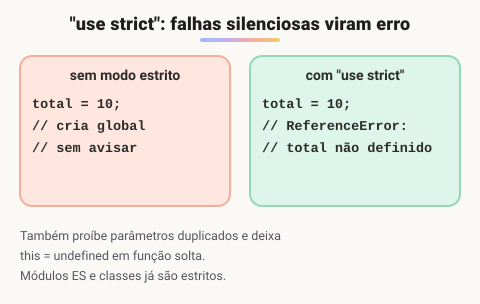

# Modo estrito no JavaScript

> 🗺️ **Nesta aula:** o que é o modo estrito (`"use strict"`), como ativá-lo, o que ele muda no comportamento da linguagem e por que classes e módulos já o usam automaticamente.

## De onde paramos

Nas aulas de escopo e de POO apareceu a frase "em modo estrito, o `this` vira `undefined`". Vamos entender o que é esse modo e por que ele existe.

## O que é o modo estrito

**O modo estrito (**`"use strict"`**), criado no ES5, transforma em erros vários comportamentos que o JavaScript antes aceitava em silêncio.** Isso ajuda a achar bugs mais cedo e deixa o código mais seguro e previsível.

## Como ativar

```jsx
// na PRIMEIRA instrução do arquivo:
// vale para o arquivo todo
"use strict";

function teste() {
  // ou na primeira linha de uma função:
  // vale só dentro dela
  "use strict";
}
```

> 💡 **Na prática, você quase não precisa escrever isso:** o corpo de uma `class` e os **módulos ES** (`<script type="module">`, arquivos com `import`/`export`) **já são estritos automaticamente**.

## O que muda



> 💡 **Analogia:** o modo normal é um professor bonzinho que deixa passar erros de ortografia sem dizer nada; o aluno só descobre na prova final. O modo estrito é o professor exigente que marca de vermelho na hora: dá mais trabalho no começo, mas o erro aparece cedo, quando é fácil de corrigir.

| Situação | Modo normal | Modo estrito |
| --- | --- | --- |
| Atribuir a variável **não declarada** (`x = 10`) | cria uma global sem avisar | `ReferenceError` |
| Parâmetros **duplicados** (`function f(a, a)`) | aceito, o último vence | `SyntaxError` |
| `this` em função chamada "solta" | `window` | `undefined` |
| Atribuir a propriedade somente leitura | ignorado em silêncio | `TypeError` |
| `delete` em uma variável | ignorado | `SyntaxError` |
| Octais antigos (`010`) | vale 8 | `SyntaxError` |
| Usar `with` | permitido | `SyntaxError` |
| Nomes como `let`, `static`, `package` | permitido | `SyntaxError` |

### Exemplo: variável não declarada

```jsx
function calcular() {
  // erro de digitação: deveria ser "total"
  totl = 100;
}
calcular();
// sem strict: cria a global "totl" e o bug passa
// com strict: ReferenceError: totl is not defined
```

### Exemplo: parâmetros duplicados

```jsx
// Sem modo estrito
function soma(a, a) {
  return a + a;
}
// o segundo "a" (3) sobrescreve o primeiro
console.log(soma(2, 3));  // 6
```

```jsx
"use strict";

// SyntaxError: Duplicate parameter name
function soma(a, a) {
  return a + a;
}
```

O erro acontece **antes** de qualquer linha rodar, porque o arquivo nem chega a ser executado.

### Exemplo: `this` em função solta

```jsx
"use strict";
function mostrarThis() {
  console.log(this);
}
mostrarThis();  // undefined (sem strict: window)
```

> ⚠️ **Correções:** atribuir valor a uma `const` gera erro **com ou sem** modo estrito, então não é uma mudança do strict. `class` já era palavra reservada antes; as que passam a ser reservadas são `let`, `static`, `yield`, `implements`, `interface`, `package`, `private`, `protected` e `public`. E no nível superior de um **script**, `this` continua sendo `window` mesmo em modo estrito; o que muda é o `this` de funções chamadas sem objeto.

## Exercício

O que acontece ao rodar cada trecho em um módulo (`type="module"`)?

```jsx
// a)
contador = 1;

// b)
const obj = Object.freeze({ x: 1 });
obj.x = 2;
```

<details>
<summary>Ver resposta</summary>

Módulos são estritos. Em (a), `ReferenceError`, porque `contador` não foi declarado. Em (b), `TypeError`, porque o objeto está congelado; fora do modo estrito, a atribuição seria ignorada em silêncio e `obj.x` continuaria 1.

</details>

## 🧠 Revisão rápida

**Onde escrever `"use strict"`?**

Na primeira instrução do arquivo ou da função.

**Preciso escrever `"use strict"` dentro de uma classe?**

Não. O corpo de classes e os módulos já são estritos.

**Qual o maior benefício do modo estrito?**

Transformar erros silenciosos, como variáveis não declaradas, em erros visíveis.

> ➡️ **Próximo passo:** vamos detalhar a sintaxe das **Classes**.

## 📌 Resumo

| Item | Em uma frase |
| --- | --- |
| `"use strict"` | ativa o modo estrito |
| Variável não declarada | vira `ReferenceError` |
| `this` solto | vira `undefined` |
| Escrita proibida | vira `TypeError` |
| Classes e módulos | já são estritos automaticamente |
