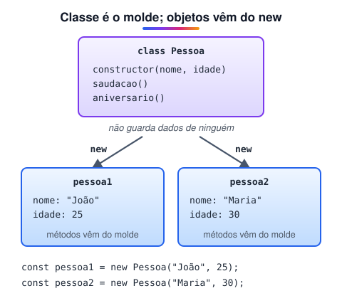

# Classes

> 🗺️ **Nesta aula:** o que é uma classe, a anatomia (campos, construtor e métodos), instâncias com `new`, regras e convenções, e um panorama dos recursos modernos que o módulo detalha a seguir.

## De onde paramos

Os pilares da POO já usaram classes em vários exemplos. Agora vamos olhar a sintaxe com calma, parte por parte.

## O que é uma classe

**Uma classe é um molde para criar objetos com a mesma estrutura: os mesmos atributos e os mesmos métodos.** Cada objeto criado a partir dela é uma **instância**, com seus próprios valores.



> 💡 **Analogia:** a classe é a forma de biscoito; as instâncias são os biscoitos. Todos saem com o mesmo formato (os mesmos atributos e métodos), mas cada um pode ter uma cobertura diferente (os valores). Ter a forma não enche o pote: só o `new` assa um biscoito de verdade.

## Anatomia de uma classe

```jsx
class Pessoa {
  // 1. campos com valor inicial (opcional)
  pais = "Brasil";

  // 2. construtor: roda no new
  constructor(nome, idade) {
    this.nome = nome;
    this.idade = idade;
  }

  // 3. métodos (sem a palavra function)
  saudacao() {
    console.log(
      `Olá, sou ${this.nome}, ${this.idade} anos.`
    );
  }

  aniversario() {
    this.idade++;
    console.log(
      `Feliz aniversário! ${this.idade} anos.`
    );
  }
}

// 4. instanciação
const pessoa1 = new Pessoa("João", 25);
const pessoa2 = new Pessoa("Maria", 30);

pessoa1.saudacao();  // Olá, sou João, 25 anos.
pessoa2.aniversario();  // Feliz aniversário! 31 anos.
// cada instância tem os próprios dados
pessoa1.idade;  // 25
```

## Conceitos

| Conceito | O que é |
| --- | --- |
| **Construtor** | `constructor()`, executado no `new`; se não existir, a classe ganha um vazio |
| **Atributos** | os dados de cada instância (`this.nome`) |
| **Métodos** | as ações; ficam no *prototype* e são compartilhados |
| `this` | dentro da classe, a instância em uso |
| **Instância** | objeto criado com `new NomeDaClasse(...)` |

## Regras e convenções

- Nome de classe em **PascalCase** (`ContaBancaria`, `CarrinhoDeCompras`).
- Classes **precisam** de `new`: `Pessoa("João")` sem `new` gera `TypeError`.
- Diferente das funções, classes **não têm hoisting** útil: declare antes de usar.
- O corpo da classe roda em **modo estrito** automaticamente.
- Não coloque vírgulas entre os métodos (não é um objeto literal).

## Recursos modernos

```jsx
class Produto {
  // campo privado
  #estoque = 0;
  // pertence à classe
  static totalCriados = 0;

  constructor(nome, preco) {
    this.nome = nome;
    this.preco = preco;
    Produto.totalCriados++;
  }

  // getter: lido como propriedade
  get disponivel() {
    return this.#estoque > 0;
  }

  repor(qtd) {
    this.#estoque += qtd;
    return this;
  }
}
```

Cada um desses recursos tem a sua aula neste módulo: **atributo estático**, **construtor**, **getters e setters** e **herança**.

## Exercício

Crie a classe `Retangulo` com `largura` e `altura` no construtor e os métodos `area()` e `perimetro()`. Crie duas instâncias e mostre a área de cada uma.

<details>
<summary>Ver resposta</summary>

```jsx
class Retangulo {
  constructor(largura, altura) {
    this.largura = largura;
    this.altura = altura;
  }
  area() {
    return this.largura * this.altura;
  }
  perimetro() {
    return 2 * (this.largura + this.altura);
  }
}

const r1 = new Retangulo(4, 5);
const r2 = new Retangulo(10, 2);
console.log(r1.area(), r2.area());  // 20 20
console.log(r1.perimetro());  // 18
```

</details>

## 🧠 Revisão rápida

**Qual a diferença entre classe e instância?**

A classe é o molde; a instância é um objeto criado a partir dele.

**O que acontece se chamar uma classe sem `new`?**

`TypeError`.

**Os métodos são copiados para cada instância?**

Não. Ficam no prototype e são compartilhados.

> ➡️ **Próximo passo:** e quando um dado pertence à classe, e não a cada objeto? Veja **Atributo estático da classe**.

## 📌 Resumo

| Item | Em uma frase |
| --- | --- |
| `class` | molde de objetos |
| `constructor` | prepara cada instância no `new` |
| Método | função da classe, compartilhada |
| `this` | a instância atual |
| `#campo` | atributo privado |
| PascalCase | convenção para nomes de classe |
