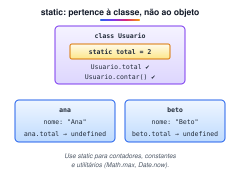

# Atributo estático da classe

> 🗺️ **Nesta aula:** atributos e métodos `static`, que pertencem à classe e não às instâncias, um contador de objetos criados e os usos mais comuns: constantes, utilitários e métodos fábrica.

## De onde paramos

Na aula de classes, cada instância tinha seus próprios dados. Às vezes, porém, um dado é **da classe inteira**: quantos usuários já foram criados, uma taxa fixa, uma função de conversão.

## O que é um membro estático

**Um atributo ou método** `static` **pertence à própria classe, e não a cada objeto.** Existe uma cópia só, acessada pelo nome da classe: `Classe.membro`.



> 💡 **Analogia:** numa escola, cada aluno tem sua própria mochila (atributos de instância), mas o mural de avisos do corredor é um só, da escola inteira (atributo estático). Para ler o mural você vai ao corredor (`Escola.mural`), e não abre a mochila de um aluno.

## Exemplo

```jsx
class Exemplo {
  static atributoEstatico = "Valor estático";

  metodo() {
    // dentro da classe, também pelo nome da classe
    console.log(Exemplo.atributoEstatico);
  }
}

// "Valor estático"
console.log(Exemplo.atributoEstatico);

const instancia = new Exemplo();
instancia.metodo();  // "Valor estático"
// a instância NÃO tem esse atributo
console.log(instancia.atributoEstatico);  // undefined
```

> ⚠️ **Correção:** a aula dizia que, ao acessar o atributo estático pela instância, "ele será acessado da mesma forma como se fosse chamado diretamente na classe". Não é verdade: `instancia.atributoEstatico` retorna `undefined`.

## Contador de instâncias

```jsx
class Usuario {
  static total = 0;

  constructor(nome) {
    this.nome = nome;
    // atualiza o valor compartilhado
    Usuario.total++;
  }

  // método estático
  static contar() {
    return `${Usuario.total} usuários criados`;
  }
}

new Usuario("Ana");
new Usuario("Beto");
Usuario.contar();  // "2 usuários criados"
```

Dentro de um método **estático**, `this` é a própria classe: `this.total` funcionaria no lugar de `Usuario.total`.

## Quando usar

- **Contadores e caches** compartilhados entre todas as instâncias.
- **Constantes** da classe: `static TAXA_JUROS = 0.02`.
- **Funções utilitárias** que não dependem de uma instância. A linguagem usa muito: `Math.max()`, `Number.isInteger()`, `Array.from()`, `Date.now()`, `Object.keys()`.
- **Métodos fábrica**, que criam instâncias de um jeito específico:

```jsx
class Data {
  constructor(dia, mes, ano) {
    Object.assign(this, { dia, mes, ano });
  }

  // recebe "25/12/2023"
  static deTexto(texto) {
    const [d, m, a] = texto.split("/").map(Number);
    return new Data(d, m, a);
  }
}

const natal = Data.deTexto("25/12/2023");
```

Também existe `static #privado` (estático e privado) e o bloco `static { ... }`, que roda uma vez quando a classe é definida.

## Exercício

Crie a classe `Conversor` com a constante estática `COTACAO_DOLAR = 5` e o método estático `paraReais(dolares)`. Use-a sem criar nenhuma instância.

<details>
<summary>Ver resposta</summary>

```jsx
class Conversor {
  static COTACAO_DOLAR = 5;

  static paraReais(dolares) {
    return dolares * this.COTACAO_DOLAR;
  }
}

Conversor.paraReais(20);  // 100
```

Como nada depende de uma instância, tudo pode ser estático.

</details>

## 🧠 Revisão rápida

**O que `instancia.atributoEstatico` devolve?**

`undefined`.

**Dentro de um método estático, o que é `this`?**

A própria classe.

**Cite um método estático nativo do JavaScript.**

`Math.max`, `Array.from`, `Number.isInteger`, `Date.now`...

> ➡️ **Próximo passo:** detalhes do método que roda em cada `new`: o **Construtor**.

## 📌 Resumo

| Item | Em uma frase |
| --- | --- |
| `static` | membro da classe, não da instância |
| Acesso | `Classe.membro` |
| Pela instância | `undefined` |
| Usos | contadores, constantes, utilitários |
| Método fábrica | estático que devolve uma instância nova |
