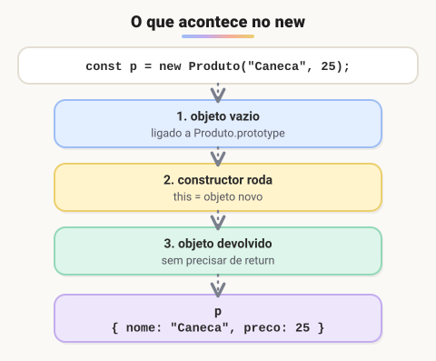

# Construtor

> 🗺️ **Nesta aula:** o que é o `constructor`, o que acontece passo a passo no `new`, suas regras, valores padrão e validação, objeto de opções e alternativas à sobrecarga de construtores.

## De onde paramos

Todas as classes até aqui tinham um `constructor`. Vamos entender o que ele faz e as boas práticas para escrevê-lo.

## O que é o construtor

**O** `constructor()` **é um método especial que roda automaticamente no** `new` **e prepara o estado inicial do objeto.**

```jsx
class Pessoa {
  constructor(nome, idade) {
    this.nome = nome;
    this.idade = idade;
  }
}

const pessoa1 = new Pessoa("João", 25);
console.log(pessoa1.nome);  // João
console.log(pessoa1.idade);  // 25
```

## O que acontece no `new`



1. Um objeto vazio é criado, ligado ao `prototype` da classe.
2. O `constructor` é executado com `this` apontando para esse objeto novo.
3. O objeto é devolvido automaticamente (não é preciso `return`).

## Regras

- **Só pode existir um** `constructor` por classe. Dois geram `SyntaxError`.
- Se você não escrever um, a classe ganha um **construtor vazio** implícito.
- Ele pode ter qualquer quantidade de parâmetros, valores padrão e validações.
- Em uma classe filha (`extends`), é **obrigatório chamar** `super(...)` antes de usar `this`.

## Valores padrão e validação

```jsx
class Produto {
  constructor(nome, preco = 0, quantidade = 1) {
    if (!nome) {
      throw new Error("Nome é obrigatório");
    }
    if (preco < 0) {
      throw new Error("Preço não pode ser negativo");
    }

    this.nome = nome;
    this.preco = preco;
    this.quantidade = quantidade;
    // valor calculado, não vem de parâmetro
    this.criadoEm = new Date();
  }
}

new Produto("Caneta");  // preco 0, quantidade 1
new Produto("Livro", 59.9, 2);
new Produto("", 10);  // Error: Nome é obrigatório
```

Validar no construtor garante que nunca exista um objeto em estado inválido.

## Muitos parâmetros? Use um objeto

Com muitos parâmetros, a ordem vira um problema (`new Usuario("Ana", null, true, 3)`: o que era cada um?). Receba um objeto com desestruturação:

```jsx
class Usuario {
  constructor({ nome, email, ativo = true, nivel = 1 }) {
    this.nome = nome;
    this.email = email;
    this.ativo = ativo;
    this.nivel = nivel;
  }
}

const u = new Usuario({
  nome: "Ana",
  email: "ana@exemplo.com",
  nivel: 3,
});
```

## Sem sobrecarga de construtor

Em Java, uma classe pode ter vários construtores com parâmetros diferentes. Em JavaScript, não. Para várias formas de criar o objeto, use **valores padrão**, **um objeto de opções** ou **métodos estáticos fábrica** (`Data.deTexto("25/12/2023")`, visto na aula anterior).

> ⚠️ **Ajuste:** a frase "você pode definir um construtor sem parâmetros se não for necessário inicializar propriedades" foi substituída pela regra real: sem `constructor`, a classe ganha um vazio implícito.

## Exercício

Crie a classe `Temperatura` cujo construtor recebe graus Celsius e lança erro se o valor for menor que −273,15 (zero absoluto). Acrescente o método `emFahrenheit()`.

<details>
<summary>Ver resposta</summary>

```jsx
class Temperatura {
  constructor(celsius) {
    if (celsius < -273.15) {
      throw new Error("Abaixo do zero absoluto");
    }
    this.celsius = celsius;
  }
  emFahrenheit() {
    return this.celsius * 9 / 5 + 32;
  }
}

new Temperatura(100).emFahrenheit();  // 212
new Temperatura(-300);  // Error
```

</details>

## 🧠 Revisão rápida

**Quantos construtores uma classe pode ter?**

Um.

**O que o construtor precisa fazer numa subclasse antes de usar `this`?**

Chamar `super(...)`.

**Qual a vantagem de receber um objeto de opções?**

A ordem deixa de importar e cada valor fica nomeado na chamada.

> ➡️ **Próximo passo:** propriedades que executam lógica ao serem lidas ou alteradas: **Getters e setters**.

## 📌 Resumo

| Item | Em uma frase |
| --- | --- |
| `constructor` | prepara o objeto no `new` |
| `new` | cria, executa o construtor e devolve o objeto |
| Um só | dois construtores dão `SyntaxError` |
| Padrões e validação | evitam objetos inválidos |
| Objeto de opções | parâmetros nomeados |
| `super()` | obrigatório em subclasses antes do `this` |
