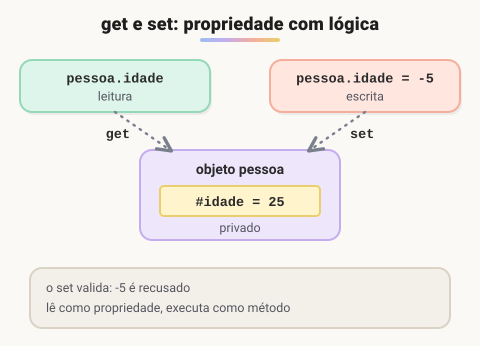

# Getters e setters

> 🗺️ **Nesta aula:** criar propriedades com `get` e `set` para validar e proteger dados, a diferença entre `_campo` e `#campo`, propriedades calculadas e somente leitura, e os cuidados ao usar getters.

## De onde paramos

No construtor você validou os dados iniciais. Mas e se alguém alterar um atributo depois, como `pessoa.idade = -5`? Getters e setters permitem validar também essas mudanças.

## O que são getters e setters

`get` **e** `set` **criam propriedades que, por fora, parecem atributos comuns, mas, por dentro, executam uma função.** Com eles você valida valores, calcula dados na hora e protege o estado interno.



> 💡 **Analogia:** o campo privado é o cofre de um banco; o `get` é o caixa que consulta o saldo para você, e o `set` é o caixa que recebe um depósito e confere se a nota é verdadeira antes de guardar. Você nunca entra no cofre: tudo passa pelo balcão, que pode recusar o que não estiver certo.

## Exemplo com campos privados

```jsx
class Pessoa {
  #nome;
  #idade;

  constructor(nome, idade) {
    this.#nome = nome;
    // já passa pela validação do setter
    this.idade = idade;
  }

  get nome() {
    return this.#nome;
  }
  set nome(novoNome) {
    if (!novoNome.trim()) {
      throw new Error("Nome não pode ser vazio");
    }
    this.#nome = novoNome.trim();
  }

  get idade() {
    return this.#idade;
  }
  set idade(novaIdade) {
    if (!Number.isInteger(novaIdade) || novaIdade < 0) {
      console.log("Idade inválida.");
      return;
    }
    this.#idade = novaIdade;
  }
}

const pessoa1 = new Pessoa("João", 25);
// sem parênteses: parece um atributo
console.log(pessoa1.nome);  // João

// chama o set
pessoa1.nome = "Maria";
console.log(pessoa1.nome);  // Maria

pessoa1.idade = -5;  // Idade inválida.
// o valor antigo foi mantido
console.log(pessoa1.idade);  // 25
```

## `_nome` × `#nome`

O exemplo original usava `this._nome`. O sublinhado é só uma **convenção** ("não mexa nisso"), sem proteção nenhuma: `pessoa1._idade = -5` funciona e passa por cima da validação. O `#` cria um campo **realmente privado**, inacessível fora da classe.

> ⚠️ **Correção:** com `_nome` e `_idade`, qualquer código podia burlar a validação. O exemplo agora usa campos `#privados`, e o construtor passa pelo setter para validar a idade inicial.

## Propriedades calculadas

Um getter não precisa ter um campo correspondente: ele pode **calcular** o valor.

```jsx
class Retangulo {
  constructor(largura, altura) {
    this.largura = largura;
    this.altura = altura;
  }
  get area() {
    return this.largura * this.altura;
  }
}

const r = new Retangulo(4, 5);
r.area;  // 20
r.largura = 10;
// sempre atualizado
r.area;  // 50
```

## Somente leitura

Um `get` **sem** `set` cria uma propriedade só de leitura. Tentar atribuir é ignorado em silêncio em scripts comuns e, em modo estrito ou módulos, gera `TypeError`.

```jsx
class Conta {
  #saldo = 100;
  get saldo() {
    return this.#saldo;
  }
}
const c = new Conta();
// ignorado (em modo estrito: TypeError)
c.saldo = 1_000_000;
c.saldo;  // 100
```

## Cuidados

- O getter e o campo **não podem ter o mesmo nome** sem `#` ou `_`: `get nome() { return this.nome; }` chama a si mesmo infinitamente (*stack overflow*).
- Getters devem ser **rápidos e sem efeitos colaterais**. Quem lê `obj.total` não espera que isso grave algo no banco.

## Exercício

Crie a classe `Produto` com um campo privado `#preco`, um getter `preco`, um setter que recuse valores negativos e um getter calculado `precoComImposto` (preço + 10%).

<details>
<summary>Ver resposta</summary>

```jsx
class Produto {
  #preco = 0;

  constructor(nome, preco) {
    this.nome = nome;
    this.preco = preco;
  }

  get preco() {
    return this.#preco;
  }
  set preco(valor) {
    if (valor < 0) {
      throw new Error("Preço negativo");
    }
    this.#preco = valor;
  }

  get precoComImposto() {
    return this.#preco * 1.1;
  }
}

const p = new Produto("Caneca", 40);
p.precoComImposto;  // 44 (aprox., ponto flutuante)
p.preco = -1;  // Error: Preço negativo
```

</details>

## 🧠 Revisão rápida

**Como se lê um getter?**

Como propriedade, sem parênteses: `obj.area`.

**Qual a diferença entre `_idade` e `#idade`?**

`_` é só convenção; `#` torna o campo realmente privado.

**Por que `get nome() { return this.nome; }` trava?**

Porque o getter chama a si mesmo infinitamente.

> ➡️ **Próximo passo:** reaproveitar uma classe inteira em outra: **Herança, extends e super**.

## 📌 Resumo

| Item | Em uma frase |
| --- | --- |
| `get` | executa ao ler a propriedade |
| `set` | executa ao atribuir; pode validar |
| `#campo` | guarda o valor de forma privada |
| Calculada | getter que deriva o valor de outros dados |
| Somente leitura | `get` sem `set` |
| Recursão | getter não pode ler a si mesmo |
