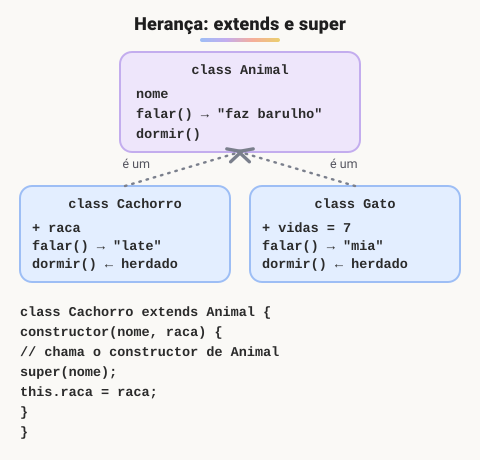

# Herança, extends e super (Adicionado pelo aluno para melhorar o estudo)

> 🗺️ **Nesta aula:** herança com `extends`, sobrescrita de métodos, os dois usos de `super`, um exemplo com contas bancárias e quando preferir composição.

## De onde paramos

Os pilares da POO apresentaram a herança em poucas linhas. Agora vamos ver os detalhes: como a filha inicializa a parte herdada, como reaproveitar o método do pai e quando a herança não é a melhor ideia.

## O que é herança

**Herança é quando uma classe (filha) é criada a partir de outra (pai), recebendo automaticamente os atributos e métodos dela.** A filha pode **acrescentar** coisas novas e **sobrescrever** comportamentos. A relação é sempre "é um": um `Cachorro` **é um** `Animal`.



> 💡 **Analogia:** herança é como uma receita de família adaptada. A filha recebe a receita do bolo da avó inteira (o que herda), pode acrescentar cobertura (métodos novos) ou trocar o açúcar por mel (sobrescrever). O `super` é ligar para a avó e perguntar "como você fazia essa parte?" antes de dar o seu toque.

## `extends`

```jsx
class Animal {
  constructor(nome) {
    this.nome = nome;
  }
  falar() {
    return `${this.nome} faz barulho.`;
  }
  dormir() {
    return `${this.nome} está dormindo. Zzz`;
  }
}

class Gato extends Animal {
  // sobrescreve o método do pai
  falar() {
    return `${this.nome} mia.`;
  }
}

const mimi = new Gato("Mimi");
mimi.falar();  // "Mimi mia." (versão da filha)
mimi.dormir();  // herdado do pai
mimi instanceof Gato;  // true
mimi instanceof Animal;  // true
```

## `super`

`super` acessa a classe pai. Ele tem dois usos.

### 1. `super(...)` no construtor

Se a filha tem `constructor`, ela **precisa** chamar `super(...)` **antes** de usar `this`. É o construtor do pai que inicializa a parte herdada.

```jsx
class Cachorro extends Animal {
  constructor(nome, raca) {
    // inicializa this.nome no construtor de Animal
    super(nome);
    // só depois do super dá para usar this
    this.raca = raca;
  }
}

new Cachorro("Bobby", "vira-lata");
```

Sem o `super(nome)`, o JS lança `ReferenceError: Must call super constructor in derived class before accessing 'this'`.

### 2. `super.metodo()` para reaproveitar o método do pai

```jsx
class Cachorro extends Animal {
  constructor(nome, raca) {
    super(nome);
    this.raca = raca;
  }

  falar() {
    // "Bobby faz barulho."
    const base = super.falar();
    return `${base} Na verdade, late! (${this.raca})`;
  }
}

new Cachorro("Bobby", "vira-lata").falar();
// "Bobby faz barulho. Na verdade, late! (vira-lata)"
```

## Exemplo prático: contas bancárias

```jsx
class Conta {
  #saldo = 0;
  constructor(titular) {
    this.titular = titular;
  }

  get saldo() {
    return this.#saldo;
  }
  depositar(v) {
    this.#saldo += v;
  }
  sacar(v) {
    if (v > this.limiteDisponivel()) {
      throw new Error("Saldo insuficiente");
    }
    this.#saldo -= v;
  }
  limiteDisponivel() {
    return this.#saldo;
  }
}

class ContaEspecial extends Conta {
  constructor(titular, chequeEspecial) {
    super(titular);
    this.chequeEspecial = chequeEspecial;
  }
  // polimorfismo: muda só a regra do limite
  limiteDisponivel() {
    return super.limiteDisponivel() + this.chequeEspecial;
  }
}

const c = new ContaEspecial("Ana", 500);
c.depositar(100);
// permitido: 100 de saldo + 500 de cheque especial
c.sacar(400);
c.saldo;  // -300
```

Observe que a filha **não acessa** `#saldo` diretamente: campos privados não são visíveis na subclasse. Ela usa os métodos públicos do pai.

## Quando NÃO usar herança

- Quando a relação não é "é um", e sim "tem um". Um `Carro` **tem um** `Motor`, então use **composição** (um atributo `this.motor`).
- Para reaproveitar uma função só. Uma função utilitária ou um módulo resolve melhor.
- Em cadeias muito profundas (A → B → C → D...), uma mudança no topo quebra tudo embaixo.

A regra clássica: **prefira composição à herança**, e use herança quando a hierarquia for natural e estável.

```jsx
// composição: Carro TEM um Motor
class Motor {
  ligar() { return "Vrum!"; }
}
class Carro {
  constructor() { this.motor = new Motor(); }
  ligar() { return this.motor.ligar(); }
}
```

## Exercício

Crie a classe `Veiculo` (com `marca` e o método `descrever()`) e a classe `Moto`, que herda de `Veiculo`, recebe também `cilindradas` e cujo `descrever()` reaproveita o do pai acrescentando as cilindradas.

<details>
<summary>Ver resposta</summary>

```jsx
class Veiculo {
  constructor(marca) {
    this.marca = marca;
  }
  descrever() {
    return `Veículo da marca ${this.marca}`;
  }
}

class Moto extends Veiculo {
  constructor(marca, cilindradas) {
    super(marca);
    this.cilindradas = cilindradas;
  }
  descrever() {
    return `${super.descrever()}, ${this.cilindradas} cc`;
  }
}

new Moto("Honda", 160).descrever();
// "Veículo da marca Honda, 160 cc"
```

</details>

## 🧠 Revisão rápida

**O que acontece se a filha usar `this` antes de `super()`?**

`ReferenceError`.

**Para que serve `super.metodo()`?**

Para chamar a versão do pai de um método sobrescrito.

**Um Pedido "tem" itens. Herança ou composição?**

Composição: a relação é "tem um", não "é um".

> ➡️ **Próximo passo:** como o JavaScript realmente encontra os métodos herdados: **Objeto** e a cadeia de protótipos.

## 📌 Resumo

| Recurso | Para que serve |
| --- | --- |
| `class B extends A` | B herda de A |
| `super(...)` | chama o construtor do pai (antes do `this`) |
| `super.metodo()` | chama a versão do pai de um método |
| Sobrescrever | declarar na filha um método com o mesmo nome |
| `instanceof` | testa se o objeto é da classe (ou ancestrais) |
| Composição | "tem um": preferível quando não há "é um" |
