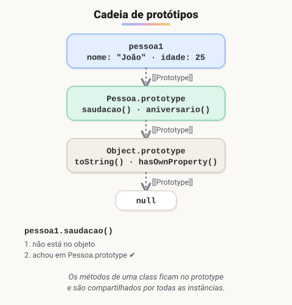

# Objeto

> 🗺️ **Nesta aula:** as três formas de criar objetos (literal, função construtora e classe), a cadeia de protótipos que explica a herança em JavaScript e ferramentas como `Object.create`, `structuredClone` e `Object.freeze`.

## De onde paramos

Você aprendeu classes, herança e `super`. Para fechar o módulo, vamos ver o que existe por baixo das classes: objetos ligados uns aos outros por **protótipos**.

## Objetos em POO

**Em POO, um objeto é uma entidade com estado (propriedades) e comportamento (métodos).** Em JavaScript, há três formas principais de criá-los.

## 1. Objeto literal: um objeto único

```jsx
const pessoa2 = {
  nome: "Maria",
  idade: 30,
  saudacao() {
    console.log(`Olá, sou ${this.nome}, ${this.idade} anos.`);
  },
};

pessoa2.saudacao();  // Olá, sou Maria, 30 anos.
```

Ideal para configurações, dados vindos de uma API (JSON) e objetos que só existem uma vez.

## 2. Função construtora: a forma antiga (antes do ES6)

```jsx
function Pessoa(nome, idade) {
  this.nome = nome;
  this.idade = idade;
}

// métodos no prototype: UMA cópia
// compartilhada por todas as instâncias
Pessoa.prototype.saudacao = function () {
  console.log(`Olá, sou ${this.nome}, ${this.idade} anos.`);
};

const pessoa1 = new Pessoa("João", 25);
pessoa1.saudacao();  // Olá, sou João, 25 anos.
```

> ⚠️ **Correção:** no exemplo original, o método era criado **dentro** do construtor (`this.saudacao = function() {...}`). Funciona, mas cria **uma cópia nova da função para cada objeto**: mil pessoas, mil funções iguais na memória. O correto é colocar os métodos no `prototype` ou, melhor ainda, usar `class`.

## 3. Classe: a forma moderna (recomendada)

```jsx
class Pessoa {
  constructor(nome, idade) {
    this.nome = nome;
    this.idade = idade;
  }
  saudacao() {
    console.log(`Olá, sou ${this.nome}, ${this.idade} anos.`);
  }
}
```

Por baixo dos panos, a classe faz **exatamente o que a função construtora com prototype faz**: é uma sintaxe mais clara para o mesmo mecanismo.

## Como o JavaScript encontra os métodos



Ao acessar `pessoa1.saudacao`, o JS procura no próprio objeto; se não achar, procura no protótipo dele, depois no protótipo do protótipo, até chegar em `null`. É assim que `extends` funciona: o protótipo de `Cachorro.prototype` é `Animal.prototype`.

```jsx
// está no próprio objeto
pessoa1.hasOwnProperty("nome");  // true
// vem do protótipo
pessoa1.hasOwnProperty("saudacao");  // false
pessoa1 instanceof Pessoa;  // true
Object.getPrototypeOf(pessoa1) === Pessoa.prototype;  // true
```

## Outras ferramentas úteis

```jsx
const base = { tipo: "animal" };
// cria um objeto com base como protótipo
const gato = Object.create(base);
gato.tipo;  // "animal" (herdado)

// cópia profunda de DADOS (objetos, arrays, datas)
const dados = { nome: "Ana", tags: ["a", "b"] };
const copia = structuredClone(dados);

// impede qualquer alteração
Object.freeze(pessoa2);
```

> ⚠️ `structuredClone` não copia funções: aplicado a um objeto com métodos, como `pessoa2`, ele lança `DataCloneError`. Use-o em objetos só com dados. E `Object.freeze` é raso: objetos aninhados continuam alteráveis.

## Exercício

Sem rodar, diga o resultado de cada linha:

```jsx
class A { ola() { return "A"; } }
class B extends A {}
const b = new B();

b.ola();
b.hasOwnProperty("ola");
b instanceof A;
Object.getPrototypeOf(B.prototype) === A.prototype;
```

<details>
<summary>Ver resposta</summary>

```
b.ola()  → "A"
b.hasOwnProperty("ola")  → false
b instanceof A  → true
Object.getPrototypeOf(B.prototype)
  === A.prototype  → true
```

`ola` não está em `b` nem em `B.prototype`; o JS o encontra subindo até `A.prototype`.

</details>

## 🧠 Revisão rápida

**O que é a cadeia de protótipos?**

A sequência de objetos em que o JS procura uma propriedade que não está no próprio objeto.

**Por que colocar métodos no `prototype` e não no construtor?**

Para haver uma só cópia da função, compartilhada por todas as instâncias.

**`class` criou um novo mecanismo de herança?**

Não. É uma sintaxe mais clara para os protótipos.

> ➡️ **Próximo passo:** fim do módulo de POO. Agora o JavaScript sai do navegador e vai para o servidor: **Node JS**.

## 📌 Resumo

| Item | Em uma frase |
| --- | --- |
| Objeto literal | objeto único, criado com `{ }` |
| Função construtora | forma antiga, com métodos no `prototype` |
| `class` | forma moderna, mesmo mecanismo |
| Protótipo | objeto de onde vêm os métodos herdados |
| `hasOwnProperty` | a propriedade é do próprio objeto? |
| `Object.create` | cria objeto com um protótipo escolhido |
| `structuredClone` | cópia profunda de dados, sem funções |
