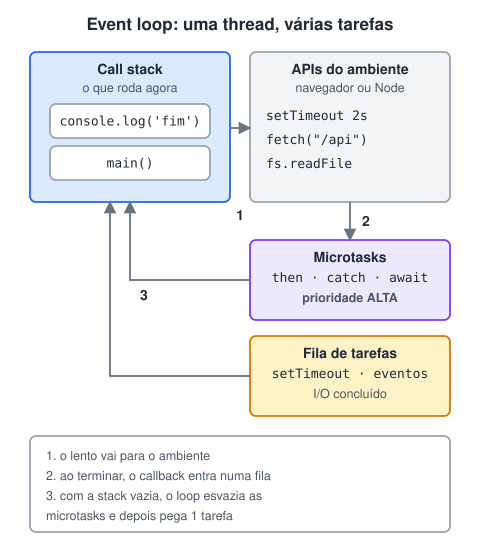

# Entendendo a arquitetura do javascript

> 🗺️ **Nesta aula:** como o JavaScript faz várias coisas com uma thread só: call stack, APIs do ambiente, filas de microtasks e de tarefas, o event loop e as formas de escrever código assíncrono.

## De onde paramos

No módulo de JavaScript, o `fetch` usava `await` e "esperava" a resposta sem travar a página. Antes de levar o JavaScript para o servidor com o Node, vamos entender como isso funciona por dentro.

## Single thread e não bloqueante

**O JavaScript executa uma coisa de cada vez (single thread), mas não fica parado esperando operações lentas: ele as delega ao ambiente e continua trabalhando (non-blocking).** Quem coordena isso é o **event loop**.



> 💡 **Analogia:** o JavaScript é um garçom sozinho num restaurante. Ele não fica parado na cozinha esperando o prato ficar pronto: anota o pedido, entrega à cozinha (as APIs do ambiente) e vai atender outra mesa. Quando a cozinha toca a campainha, o prato entra na fila do balcão, e o garçom o leva assim que fica com as mãos livres (o event loop).

## As peças

### 1. Call stack (pilha de chamadas)

É onde o código **está rodando agora**. Cada chamada de função entra no topo da pilha e sai quando termina. Só existe **uma** pilha: se algo demorar muito nela (um laço gigante, por exemplo), a página trava.

### 2. APIs do ambiente

Temporizadores, requisições de rede, leitura de arquivos e eventos do DOM **não são do JavaScript**: são fornecidos pelo **navegador** (Web APIs) ou pelo **Node** (libuv). O JS pede ("me avise daqui a 2 s") e segue em frente.

### 3. Filas

Quando a operação termina, o callback vai para uma fila:

| Fila | O que entra | Prioridade |
| --- | --- | --- |
| **Microtasks** | `.then`/`.catch`/`.finally`, o que vem depois de um `await`, `queueMicrotask` | alta: esvaziada **inteira** antes da próxima tarefa |
| **Tarefas (macrotasks)** | `setTimeout`, `setInterval`, eventos (clique), I/O concluído | uma por volta do loop |

### 4. Event loop

Um laço contínuo: **se a call stack está vazia**, executa todas as microtasks pendentes e depois pega a próxima tarefa da fila.

## Teste a ordem de execução

```jsx
console.log("1. início");

setTimeout(() => {
  console.log("4. setTimeout (macrotask)");
}, 0);

Promise.resolve().then(() => {
  console.log("3. then (microtask)");
});

console.log("2. fim do código síncrono");
```

Saída:

```
1. início
2. fim do código síncrono
3. then (microtask)
4. setTimeout (macrotask)
```

Mesmo com `0 ms`, o `setTimeout` roda **por último**: primeiro termina todo o código síncrono, depois as microtasks e só então a próxima tarefa.

## Formas de fazer operações assíncronas

- **Callbacks**: passar uma função para ser chamada depois. Muitos aninhados viram o **callback hell**.
- **Promises** (ES2015): objeto que representa um resultado futuro, com `.then()` e `.catch()`.
- **async/await** (ES2017): a mesma Promise, escrita como código sequencial.

As três têm aulas próprias neste módulo.

## Eventos e listeners

Cliques, teclas e carregamentos geram **eventos**. Um `addEventListener` registra um callback, e o event loop o executa quando o evento chega à fila.

## Web Workers

Para cálculos realmente pesados, os **Web Workers** (no navegador) e os **Worker Threads** (no Node) rodam JavaScript em **outra thread**, sem travar a principal. Eles se comunicam por mensagens e não acessam o DOM.

> ⚠️ **Correções:** microtasks e macrotasks não ficam "na pilha de eventos": são **filas** separadas, e a call stack é outra estrutura. Timers, rede e DOM são fornecidos pelo **ambiente** (navegador ou Node), e não pela linguagem. E o `async/await` chegou no **ES2017**, não junto com as Promises (ES2015).

## Exercício

Qual a ordem de saída?

```jsx
console.log("A");
setTimeout(() => console.log("B"), 0);
Promise.resolve()
  .then(() => console.log("C"))
  .then(() => console.log("D"));
console.log("E");
```

<details>
<summary>Ver resposta</summary>

```
A
E
C
D
B
```

Primeiro o síncrono (A, E). Depois todas as microtasks, inclusive a que o primeiro `then` gerou (C, D). Só então a macrotask do `setTimeout` (B).

</details>

## 🧠 Revisão rápida

**O que acontece se um laço demorado rodar na call stack?**

A página (ou o servidor) trava até ele terminar.

**Quem roda primeiro: um `.then` ou um `setTimeout(..., 0)`?**

O `.then`, porque microtasks têm prioridade.

**`setTimeout` faz parte da linguagem JavaScript?**

Não. É uma API do ambiente (navegador ou Node).

> ➡️ **Próximo passo:** o ambiente que leva esse modelo para o servidor: **Entendendo o Node Js**.

## 📌 Resumo

| Peça | Em uma frase |
| --- | --- |
| Single thread | uma coisa de cada vez |
| Call stack | o que está rodando agora |
| APIs do ambiente | timers, rede e arquivos fora do JS |
| Microtasks | then/await; prioridade alta |
| Tarefas | setTimeout e eventos; uma por volta |
| Event loop | leva callbacks das filas para a stack |
| Workers | outra thread para cálculo pesado |
