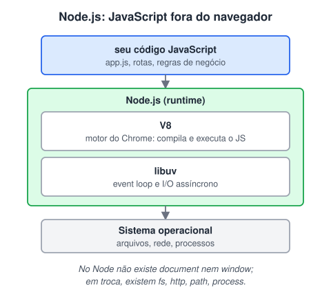

# Entendendo o Node Js

> 🗺️ **Nesta aula:** o que é o Node.js, sua arquitetura (V8 e libuv), por que é eficiente, vantagens, diferenças em relação ao navegador, módulos, instalação e comandos básicos.

## De onde paramos

Você entendeu o event loop. O Node.js usa esse mesmo modelo para rodar JavaScript no servidor, atendendo muitas requisições ao mesmo tempo.

## O que é o Node.js

**Node.js é um ambiente de execução (runtime) que roda JavaScript fora do navegador, no servidor ou no seu computador.** Ele foi criado em 2009 por Ryan Dahl e usa o motor **V8**, o mesmo do Chrome.



> 💡 **Analogia:** se o JavaScript é um motor de carro, o navegador é o carro de passeio onde ele veio montado. O Node.js tira esse mesmo motor (o V8) e o instala num caminhão de entregas: ele perde o painel e o rádio (o DOM), mas ganha carroceria e ferramentas para carregar arquivos, falar com bancos de dados e atender clientes pela rede.

O Node **não é uma linguagem nem um framework**: é a plataforma. A linguagem continua sendo JavaScript, e frameworks como o **Express** rodam em cima dele.

## Por que ele é eficiente

Em vez de criar uma thread por requisição, o Node usa **uma thread principal com I/O não bloqueante**. Enquanto espera o banco de dados responder, ele atende outras requisições. Isso o torna ótimo para aplicações com **muita entrada e saída** (APIs, chats, streaming) e menos indicado para **cálculo pesado de CPU** (processar vídeo, por exemplo), que travaria a thread.

## Vantagens

1. **JavaScript no front e no back**: uma linguagem só em todo o projeto.
2. **npm**: o maior repositório de pacotes do mundo.
3. **Ótimo para APIs e tempo real**: REST, WebSockets, Socket.IO.
4. **Comunidade enorme** e muitos frameworks: Express, Fastify, NestJS, Next.js.

## O que muda em relação ao navegador

| Navegador | Node.js |
| --- | --- |
| `window`, `document`, DOM | não existem |
| `fetch`, `setTimeout`, `console` | também existem |
| sem acesso a arquivos do PC | `fs` lê e grava arquivos |
| — | `http` cria servidores, `path` lida com caminhos, `process` dá acesso ao ambiente |

## Módulos

```jsx
// ES Modules (moderno): exige "type": "module"
// no package.json ou a extensão .mjs
import { readFile } from "node:fs/promises";
export function somar(a, b) {
  return a + b;
}
```

```jsx
// CommonJS (formato antigo, ainda muito comum)
const fs = require("fs");
module.exports = { somar };
```

## Links

Download do Node.js (escolha a versão **LTS**, a de suporte longo e mais estável)

🔗 [https://nodejs.org/](https://nodejs.org/)

Pacotes do npm

🔗 [https://www.npmjs.com/](https://www.npmjs.com/)

## Comandos úteis

```bash
# versões instaladas
node --version  # ou node -v
npm --version  # ou npm -v

# executa um arquivo
node arquivo.js

# abre o REPL: digite JS e veja o resultado
# (Ctrl+C duas vezes para sair)
node

# atualiza o npm
npm install -g npm
```

Para ter várias versões do Node na mesma máquina, use o **nvm** (Linux/macOS) ou o **nvm-windows**.

> ⚠️ **Correções:** `node --version /*ou*/ node -v` misturava comentário de JavaScript num bloco de terminal; no bash, comentários usam `#`. E "Node é uma plataforma construída sobre o JavaScript" foi trocado pela definição correta: um runtime que usa o V8.

## Exercício

Crie um arquivo `info.js` que mostre no terminal a versão do Node, o sistema operacional e a pasta atual. Dica: use o objeto `process`.

<details>
<summary>Ver resposta</summary>

```jsx
// info.js
console.log("Node:", process.version);
console.log("Sistema:", process.platform);
console.log("Pasta:", process.cwd());
```

```bash
node info.js
# Node: v22.x.x
# Sistema: linux (ou win32, darwin)
# Pasta: /home/ana/projetos
```

</details>

## 🧠 Revisão rápida

**Node.js é uma linguagem?**

Não. É um runtime que executa JavaScript fora do navegador.

**Para que tipo de aplicação o Node é menos indicado?**

Para cálculo pesado de CPU, que trava a thread principal.

**Existe `document` no Node?**

Não. Não há DOM no servidor.

> ➡️ **Próximo passo:** todo projeto Node começa com um gerenciador de pacotes. Veja **npm e package.json**.

## 📌 Resumo

| Item | Em uma frase |
| --- | --- |
| Node.js | runtime de JavaScript fora do navegador |
| V8 | motor que executa o JS |
| libuv | event loop e I/O assíncrono |
| I/O não bloqueante | atende várias requisições com uma thread |
| `fs`, `http`, `process` | módulos nativos do Node |
| LTS | versão estável recomendada |
| REPL | `node` sem arquivo, para testar código |
