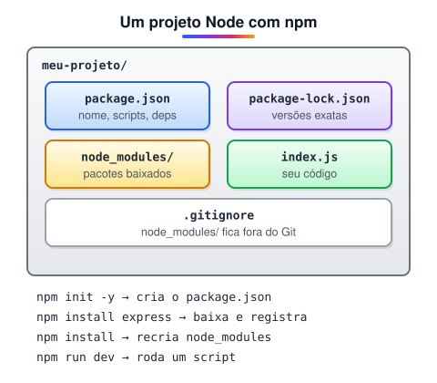

# npm e package.json (Adicionado pelo aluno para melhorar o estudo)

> 🗺️ **Nesta aula:** o npm, criar um projeto com `npm init`, instalar pacotes, a estrutura do `package.json`, scripts, versionamento semântico, `package-lock.json`, `npx` e cuidados de segurança.

## De onde paramos

Com o Node instalado, você já roda arquivos JavaScript. Para criar uma API, porém, vai precisar de bibliotecas como o Express. Quem baixa e organiza essas bibliotecas é o npm.

## O que é o npm

**O npm (Node Package Manager) instala bibliotecas feitas por outras pessoas e gerencia as dependências do projeto.** Ele já vem junto com o Node.js.



> 💡 **Analogia:** o `package.json` é a lista de compras do projeto ("Express, versão 4"); o npm é o supermercado que entrega tudo; a pasta `node_modules` é a despensa cheia; e o `package-lock.json` é a nota fiscal, com a marca e o lote exatos de cada item, para que qualquer pessoa consiga repetir a mesma compra.

## Começando um projeto

```bash
mkdir minha-api
cd minha-api
# cria o package.json com valores padrão
npm init -y
```

## Instalando pacotes

```bash
# dependência do projeto ("dependencies")
npm install express
# só para desenvolvimento ("devDependencies")
npm install -D nodemon
# remove
npm uninstall nodemon
# instala tudo do package.json (após clonar)
npm install
# mostra o que tem versão nova
npm outdated
```

## O `package.json`

```json
{
  "name": "minha-api",
  "version": "1.0.0",
  "type": "module",
  "scripts": {
    "start": "node src/server.js",
    "dev": "node --watch src/server.js",
    "test": "node --test"
  },
  "dependencies": {
    "express": "^4.21.0"
  },
  "devDependencies": {
    "nodemon": "^3.1.0"
  }
}
```

- `type: "module"` permite usar `import`/`export`.
- `scripts` são atalhos: `npm run dev`. `start` e `test` podem ser chamados sem o `run` (`npm start`, `npm test`).
- `node --watch` (Node 18.11+) reinicia o servidor a cada alteração, fazendo o papel do nodemon.

## Versões: o que significa `^4.21.0`

O npm usa **versionamento semântico**: `MAJOR.MINOR.PATCH`.

| Parte | Muda quando | Exemplo |
| --- | --- | --- |
| MAJOR | algo quebra a compatibilidade | 4 → 5 |
| MINOR | funcionalidade nova, compatível | 4.21 → 4.22 |
| PATCH | correção de bug | 4.21.0 → 4.21.1 |

- `^4.21.0` aceita qualquer `4.x.x` a partir de 4.21.0 (não sobe para 5).
- `~4.21.0` aceita só `4.21.x`.
- `4.21.0` fixa exatamente essa versão.

## `package-lock.json` e `node_modules`

- `node_modules/` guarda os pacotes instalados. É enorme e pode ser recriado com `npm install`, então **vai para o** `.gitignore`.
- `package-lock.json` registra a versão **exata** de cada pacote instalado. **Faça commit dele**: garante que todo mundo, e o servidor, instale as mesmas versões.
- Em servidores e CI, prefira `npm ci`: instala exatamente o que está no lock, mais rápido e sem alterá-lo.

## `npx`: rodar sem instalar

```bash
# executa um pacote sem instalá-lo globalmente
npx create-vite@latest meu-app
```

## Segurança

- `npm audit` lista vulnerabilidades conhecidas nas dependências; `npm audit fix` tenta corrigir.
- Antes de instalar um pacote, confira o nome (existem pacotes falsos com nomes parecidos), os downloads semanais e se ele ainda é mantido.

## Exercício

Crie um projeto, instale o pacote `dayjs` e escreva um script `hoje` no `package.json` que rode um arquivo mostrando a data atual no formato DD/MM/AAAA.

<details>
<summary>Ver resposta</summary>

```bash
npm init -y
npm install dayjs
```

```jsx
// hoje.js (com "type": "module" no package.json)
import dayjs from "dayjs";
console.log(dayjs().format("DD/MM/YYYY"));
```

```json
"scripts": {
  "hoje": "node hoje.js"
}
```

```bash
npm run hoje
```

</details>

## 🧠 Revisão rápida

**A pasta `node_modules` vai para o Git?**

Não. Ela fica no `.gitignore` e é recriada com `npm install`.

**E o `package-lock.json`?**

Vai, para garantir as mesmas versões em todas as máquinas.

**O que `^4.21.0` permite instalar?**

Qualquer versão 4.x a partir da 4.21.0, mas não a 5.

> ➡️ **Próximo passo:** mãos na massa em **Teste prático com o Node JS**.

## 📌 Resumo

| Item | Em uma frase |
| --- | --- |
| npm | gerenciador de pacotes do Node |
| `npm init -y` | cria o `package.json` |
| `npm install x` | baixa e registra uma dependência |
| `-D` | dependência só de desenvolvimento |
| `scripts` | atalhos com `npm run` |
| SemVer | MAJOR.MINOR.PATCH |
| `package-lock.json` | versões exatas; faça commit |
| `npx` | executa um pacote sem instalar |
