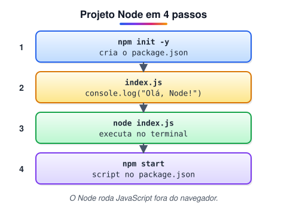

# 🧪 Teste prático com o Node.js

> 🗺️ **Nesta aula:** o primeiro projeto Node do zero: criar o `package.json` com `npm init`, escrever o arquivo principal, executar, criar scripts e ler e gravar um arquivo com o módulo `fs`.

## De onde paramos

Até aqui o Node foi só teoria. Neste projeto você vai vê-lo funcionar: um programa JavaScript que roda no seu terminal, sem navegador, e que consegue fazer o que a página não pode, como ler e gravar arquivos do computador. O projeto é pequeno de propósito. O objetivo é você fixar o ciclo que vai repetir em todo projeto Node: criar, configurar, executar, automatizar.

Você conhece o Node e o npm. Agora vamos juntar os dois num projeto mínimo, passo a passo.



> 💡 **Analogia:** criar um projeto Node é como abrir uma pequena empresa. O `npm init` faz o registro (o `package.json` é o contrato social, com nome, versão e responsável); o `index.js` é a sede; e os `scripts` são os atalhos do dia a dia, como "abrir a loja" (`npm start`).

## 1. Iniciar o projeto

O `package.json` é a ficha de identidade do projeto: nome, versão, ponto de entrada e as bibliotecas de que ele depende. Sem ele, o npm não sabe o que instalar nem como rodar o projeto. Quem pegar seu projeto no GitHub depois só precisa de `npm install` para ter tudo de volta. Se você não tem opinião sobre as perguntas, `npm init -y` aceita todas as sugestões e você ajusta o arquivo à mão quando precisar.

Crie uma pasta, abra o terminal nela e rode:

```bash
npm init
```

O npm faz algumas perguntas e gera o arquivo `package.json`:

| Pergunta | O que é |
| --- | --- |
| package name | nome do projeto (minúsculas, sem espaços) |
| version | versão inicial (sugere `1.0.0`) |
| description | descrição curta |
| entry point | arquivo principal (sugere `index.js`) |
| test command | comando executado por `npm test` |
| git repository | URL do repositório (pode ficar vazio) |
| keywords | palavras-chave para busca no npm |
| author | seu nome |
| license | licença (sugere `ISC`; `MIT` é muito comum) |

Para aceitar tudo no padrão e editar depois:

```bash
npm init -y
```

## 2. Criar o arquivo principal

Crie `index.js` (o mesmo nome que está em `"main"` no `package.json`):

```jsx
console.log("Uma vez Flamengo, sempre Flamengo!!!");
```

## 3. Executar

O Node lê o arquivo de cima para baixo, executa cada linha e termina. Você deve ver a frase no terminal e o prompt voltar. Se aparecer `Cannot find module`, o nome do arquivo ou a pasta do terminal estão errados: confira com `ls` onde você está. A forma `node .` usa o campo `main` do `package.json`, por isso os dois precisam combinar.

```bash
# executa o arquivo indicado
node index.js
# executa o "main" do package.json
node .
```

## 4. Criar scripts no package.json

Scripts são apelidos para comandos longos. Em vez de lembrar `node --watch index.js`, a equipe inteira roda `npm run dev`. Isso vale para qualquer comando: testar, compilar, formatar. Em projetos grandes o `package.json` vira o painel de controle: quem chega novo lê a seção `scripts` e já sabe o que pode ser feito. Dois nomes têm atalho: `npm start` e `npm test` dispensam o `run`.

```json
{
  "name": "meu-projeto",
  "version": "1.0.0",
  "main": "index.js",
  "scripts": {
    "start": "node index.js",
    "dev": "node --watch index.js"
  }
}
```

```bash
# roda "node index.js"
npm start
# reinicia sozinho a cada alteração (Node 18+)
npm run dev
```

## 5. Um passo além: ler e gravar arquivos

O programa grava `nota.txt` e depois lê o mesmo arquivo de volta. A palavra `await` faz o Node esperar a operação terminar antes de seguir para a próxima linha; sem ela, a leitura poderia começar antes de a gravação acabar e você leria um arquivo vazio. O segundo argumento, `"utf8"`, diz ao Node para devolver texto legível, e não bytes crus. Rode duas vezes: a segunda grava por cima da primeira, porque `writeFile` substitui o conteúdo.

O que o navegador não deixa fazer, o Node faz: acessar arquivos do computador.

```jsx
// index.js (com "type": "module" no package.json)
import { readFile, writeFile } from "node:fs/promises";

await writeFile("nota.txt", "Primeira nota\n");
const texto = await readFile("nota.txt", "utf8");
console.log(texto);  // Primeira nota
```

`fs/promises` devolve Promises, por isso usamos `await`: o assunto das próximas aulas.

> ⚠️ **Correção:** o arquivo foi criado como `main.js`, mas o `npm init` sugere `index.js` como entry point. Nesse caso, `node .` procura `index.js` e falha com **Cannot find module**. O arquivo e o `"main"` precisam ter o mesmo nome.

## Exercício

Crie um script que conte quantas linhas tem um arquivo `lista.txt` e mostre o resultado. Adicione o atalho `npm run contar`.

<details>
<summary>Ver resposta</summary>

```jsx
// contar.js
import { readFile } from "node:fs/promises";

const texto = await readFile("lista.txt", "utf8");
const linhas = texto.split("\n").filter(l => l.trim());
console.log(`${linhas.length} linhas`);
```

```json
"scripts": {
  "contar": "node contar.js"
}
```

O `filter` descarta linhas vazias, como a do fim do arquivo.

</details>

## 🧠 Revisão rápida

**O que `node .` executa?**

O arquivo indicado em `"main"` no `package.json`.

**Qual script pode ser chamado sem `run`?**

`start` (e `test`).

> ➡️ **Próximo passo:** a primeira forma de lidar com operações assíncronas: **Callback**.

## 📌 Resumo

| Passo | Em uma frase |
| --- | --- |
| `npm init` | cria o `package.json` |
| `"main"` | arquivo principal do projeto |
| `node index.js` | executa um arquivo |
| `npm start` | roda o script `start` |
| `node --watch` | reinicia a cada alteração |
| `fs/promises` | lê e grava arquivos |
