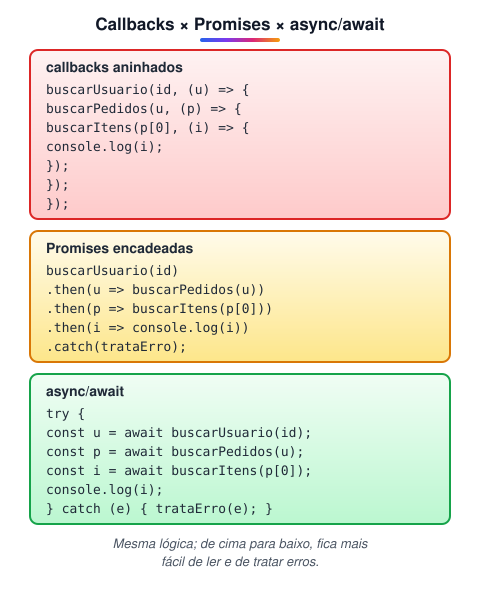

# Callback

> 🗺️ **Nesta aula:** o que é um callback, callbacks síncronos e assíncronos, a ordem de execução, o padrão "error-first" do Node e o problema do callback hell.

## De onde paramos

O event loop executa um callback quando uma operação termina. Vamos ver como escrever e usar esses callbacks.

## O que é um callback

**Um callback é uma função passada como argumento para outra função, para ser chamada depois.** "Depois" pode ser logo em seguida (callback síncrono) ou quando algo terminar, como um timer, uma requisição ou um clique (callback assíncrono).

> 💡 **Analogia:** um callback é como deixar seu telefone na recepção de uma oficina: "quando o carro ficar pronto, me liga". Você não fica plantado esperando; vai fazer outras coisas, e a oficina executa a ligação (o callback) quando o serviço termina.

```jsx
// síncrono: map chama a função para cada item, na hora
[1, 2, 3].map(n => n * 2);

// assíncrono: roda só quando o usuário clicar
botao.addEventListener("click", () => {
  console.log("clicou!");
});
```

## Exemplo assíncrono

```jsx
function fazerAlgoAssincrono(callback) {
  setTimeout(() => {
    // chamado 2 s depois
    callback("Resultado da operação");
  }, 2000);
}

function mostrarResultado(resultado) {
  console.log("O resultado é: " + resultado);
}

// passa a função, SEM parênteses
fazerAlgoAssincrono(mostrarResultado);
console.log("Isto aparece primeiro!");
```

Saída:

```
Isto aparece primeiro!
O resultado é: Resultado da operação  (2 s depois)
```

> ⚠️ Passe a **função**, e não o resultado dela: `fazerAlgo(mostrar)` ✅. Com `fazerAlgo(mostrar())` ❌, a função roda na hora e o que é passado é o retorno dela (`undefined`).

## Tratando erros: o padrão "error-first" do Node

Nas APIs antigas do Node, o callback recebe **o erro como primeiro argumento**:

```jsx
const fs = require("fs");

fs.readFile("dados.txt", "utf8", (erro, conteudo) => {
  if (erro) {
    console.error("Não deu para ler:", erro.message);
    return;
  }
  console.log(conteudo);
});
```

## Callback hell

Quando uma operação depende do resultado da anterior, os callbacks vão se aninhando e o código vira uma "pirâmide", difícil de ler e de tratar erros:



É por isso que existem as **Promises** e o **async/await**, os próximos tópicos. Callbacks continuam muito usados em eventos e em métodos de array, mas, para operações assíncronas em sequência, prefira Promises.

> ⚠️ **Correção:** a definição dizia que o callback é executado "após a conclusão de uma operação assíncrona", mas callbacks também podem ser **síncronos** (`map`, `forEach`).

## Exercício

Escreva uma função `esperar(ms, callback)` que chame o callback depois de `ms` milissegundos. Use-a para mostrar "um", depois de 1 s "dois" e depois de mais 1 s "três".

<details>
<summary>Ver resposta</summary>

```jsx
function esperar(ms, callback) {
  setTimeout(callback, ms);
}

console.log("um");
esperar(1000, () => {
  console.log("dois");
  esperar(1000, () => {
    console.log("três");
  });
});
```

Repare no aninhamento: com mais etapas, ele vira o callback hell.

</details>

## 🧠 Revisão rápida

**O que é um callback?**

Uma função passada como argumento para ser chamada depois.

**No padrão error-first, qual é o primeiro argumento do callback?**

O erro (ou `null` se deu certo).

**O que é callback hell?**

Callbacks aninhados em muitos níveis, difíceis de ler e de tratar erros.

> ➡️ **Próximo passo:** a solução para o aninhamento: **Promises**.

## 📌 Resumo

| Item | Em uma frase |
| --- | --- |
| Callback | função passada para ser chamada depois |
| Síncrono | chamado na hora (`map`) |
| Assíncrono | chamado quando algo termina (timer, rede) |
| Sem parênteses | passe a função, não o resultado |
| Error-first | `(erro, resultado) => {}` no Node |
| Callback hell | aninhamento excessivo |
