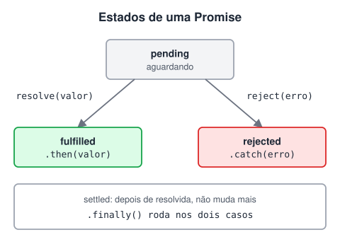

# Promises

> 🗺️ **Nesta aula:** o que é uma Promise e seus estados, como criar uma, consumir com `then`, `catch` e `finally`, encadear, rodar várias ao mesmo tempo e transformar um callback em Promise.

## De onde paramos

Callbacks aninhados viram uma pirâmide difícil de ler. As Promises resolvem isso: em vez de passar uma função "para depois", a operação devolve um objeto que representa o resultado futuro.

## O que é uma Promise

**Uma Promise é um objeto que representa um valor que ainda não existe, mas vai existir (ou falhar) no futuro.**



> 💡 **Analogia:** uma Promise é a senha que você recebe numa lanchonete. Na hora do pedido ela está "pendente"; quando o lanche fica pronto, a senha é chamada e cumprida (*fulfilled*); se acabou o pão, ela é rejeitada (*rejected*). Enquanto espera, você pode fazer outras coisas, e uma senha chamada nunca volta a ficar pendente.

| Estado | Significado | Como chega nele |
| --- | --- | --- |
| **pending** | em andamento | estado inicial |
| **fulfilled** | deu certo, tem um valor | o código chama `resolve(valor)` |
| **rejected** | deu errado, tem um motivo | o código chama `reject(erro)` ou lança um erro |

Depois de **settled** (cumprida ou rejeitada), a Promise **nunca mais muda** de estado.

## Criando uma Promise

```jsx
const minhaPromise = new Promise((resolve, reject) => {
  setTimeout(() => {
    const deuCerto = Math.random() > 0.3;
    if (deuCerto) {
      resolve("Operação concluída com sucesso!");
    } else {
      reject(new Error("Falhou :("));
    }
  }, 2000);
});
```

Na prática, você **cria** Promises pouco: a maioria das APIs já devolve uma (`fetch`, `fs/promises`, bibliotecas de banco de dados). O mais comum é **consumir**.

## Consumindo: `then`, `catch` e `finally`

```jsx
minhaPromise
  // se fulfilled
  .then((valor) => console.log(valor))
  // se rejected (ou erro em qualquer then)
  .catch((erro) => console.error(erro.message))
  // sempre
  .finally(() => console.log("acabou"));
```

### Encadeamento

Cada `.then()` devolve **uma nova Promise**: o que você retorna nele vira o valor do próximo `then`.

```jsx
fetch("https://api.github.com/users/octocat")
  // retorna outra Promise
  .then((resposta) => resposta.json())
  .then((usuario) => console.log(usuario.name))
  .catch((erro) => console.error("Erro:", erro));
```

> ⚠️ Esqueceu o `return` dentro de um `then` com chaves? O próximo `then` recebe `undefined`. `then(r => { r.json() })` ❌ · `then(r => r.json())` ✅

## Várias Promises ao mesmo tempo

```jsx
const p1 = fetch("/api/usuarios");
const p2 = fetch("/api/produtos");

// espera TODAS; rejeita se UMA falhar
Promise.all([p1, p2]);
// espera todas e informa o resultado de cada uma
Promise.allSettled([p1, p2]);
// a PRIMEIRA que terminar (sucesso ou erro)
Promise.race([p1, p2]);
// a primeira que der CERTO
Promise.any([p1, p2]);
```

`Promise.all` roda as operações **em paralelo**, o que é muito mais rápido do que fazer uma depois da outra quando elas não dependem entre si.

## Transformando callback em Promise

```jsx
// a função esperar da aula de callbacks, agora com Promise
function esperar(ms) {
  return new Promise((resolve) => setTimeout(resolve, ms));
}

esperar(1000)
  .then(() => console.log("1 s depois"))
  .then(() => esperar(1000))
  .then(() => console.log("2 s depois"));
```

O Node também tem `util.promisify`, que converte funções no padrão error-first.

## Atalhos

```jsx
// Promise já cumprida
Promise.resolve(42);
// Promise já rejeitada
Promise.reject(new Error("erro"));
```

> ⚠️ **Correções:** a aula dizia que, no estado fulfilled, "a Promise chama a função `resolve`". É o contrário: **o seu código chama** `resolve()`, e é isso que leva a Promise para fulfilled (o mesmo vale para `reject`). E `finally` é um método de instância (`promise.finally()`), não um método estático como `all` e `race`.

## Exercício

Usando a função `esperar` acima, faça uma função `sortear()` que, depois de 500 ms, resolva com um número de 1 a 6, ou rejeite com o erro "Dado caiu da mesa" em 10% das vezes. Consuma-a mostrando o número ou o erro.

<details>
<summary>Ver resposta</summary>

```jsx
function sortear() {
  return esperar(500).then(() => {
    if (Math.random() < 0.1) {
      throw new Error("Dado caiu da mesa");
    }
    return Math.floor(Math.random() * 6) + 1;
  });
}

sortear()
  .then((n) => console.log("Saiu", n))
  .catch((e) => console.log(e.message));
```

Um `throw` dentro de um `then` rejeita a Promise seguinte, que cai no `catch`.

</details>

## 🧠 Revisão rápida

**Quais são os estados de uma Promise?**

pending, fulfilled e rejected.

**O que um `.then()` devolve?**

Uma nova Promise, com o valor retornado dentro dele.

**Qual a diferença entre `Promise.all` e `Promise.allSettled`?**

`all` rejeita se uma falhar; `allSettled` espera todas e informa cada resultado.

> ➡️ **Próximo passo:** escrever Promises como se fosse código sequencial: **async/await**.

## 📌 Resumo

| Item | Em uma frase |
| --- | --- |
| Promise | valor futuro |
| `resolve` / `reject` | cumpre ou rejeita a Promise |
| `.then` | trata o sucesso e encadeia |
| `.catch` | trata qualquer erro da cadeia |
| `.finally` | roda nos dois casos |
| `Promise.all` | várias em paralelo |
| `new Promise` | transforma callback em Promise |
