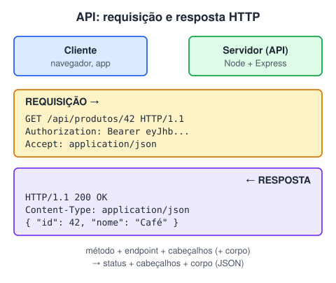

# Introdução API

> 🗺️ **Nesta aula:** o que é uma API, os tipos de API, a anatomia de uma requisição e de uma resposta HTTP, endpoints, autenticação, formatos, documentação e como consumir e testar uma API.

## De onde paramos

Você já usou `fetch` para buscar dados de servidores. Esses servidores oferecem **APIs**. Antes de criar a sua com Express, vamos entender o que é uma API e quais são as suas peças.

## O que é uma API

**API (Application Programming Interface) é um contrato que define como um programa pode pedir algo a outro e o que vai receber de volta.** Você não precisa saber como o outro sistema funciona por dentro: basta seguir o contrato.



> 💡 **Analogia:** uma API é o garçom de um restaurante. O cardápio é a documentação: diz o que dá para pedir e como. Você (o cliente) faz o pedido ao garçom (a requisição), ele leva à cozinha (o servidor) e volta com o prato (a resposta). Você nunca entra na cozinha nem precisa saber a receita; se pedir algo fora do cardápio, o garçom avisa que não tem (um erro 404).

## Tipos de API

| Tipo | Exemplo |
| --- | --- |
| **Web** (via HTTP/HTTPS) | API do GitHub, de CEP, de pagamento, de mapas |
| **De biblioteca / linguagem** | `Array.prototype.map`, a API do DOM |
| **Do sistema operacional** | acesso a arquivos, câmera, notificações |
| **Do navegador** (Web APIs) | `fetch`, `localStorage`, `Geolocation` |

No dia a dia, "API" quase sempre significa **API web**, e é o foco daqui em diante.

## Conceitos de uma API web

### Requisição e resposta

O cliente envia uma **requisição** com:

- **método** (`GET`, `POST`, `PUT`, `PATCH`, `DELETE`): o que fazer;
- **URL / endpoint**: com qual recurso;
- **cabeçalhos** (headers): metadados como autenticação e formato;
- **corpo** (body), quando há dados a enviar (`POST`, `PUT`, `PATCH`).

O servidor devolve uma **resposta** com um **código de status** (`200`, `404`, `500`...), cabeçalhos e um corpo, normalmente **JSON**.

### Endpoint

O endereço de um recurso: `https://api.exemplo.com/v1/posts/15`. Ele combina **URL base**, **versão** e **caminho** do recurso, além de **parâmetros de consulta** (`?pagina=2&limite=20`).

### Autenticação

Muitas APIs exigem identificar quem chama:

- **Chave de API** (`x-api-key: abc123`): simples, comum em APIs públicas.
- **Token Bearer / JWT** (`Authorization: Bearer eyJ...`): obtido no login.
- **OAuth 2.0**: o usuário autoriza o seu app a acessar a conta dele em outro serviço ("Entrar com Google").

> ⚠️ Chaves e tokens são **senhas**: nunca coloque no código do front-end nem envie para o GitHub. Guarde em variáveis de ambiente (`.env`) no servidor.

### Formatos

**JSON** domina hoje. Ainda existe XML em sistemas antigos (como o SOAP).

### Documentação

A documentação diz quais endpoints existem, parâmetros, exemplos e erros possíveis. Muitas usam o padrão **OpenAPI/Swagger**, que gera páginas interativas para testar as chamadas.

## Consumindo uma API com JavaScript

```jsx
const resposta = await fetch(
  "https://viacep.com.br/ws/01001000/json/"
);
const endereco = await resposta.json();
console.log(endereco.logradouro);  // "Praça da Sé"
```

Para testar sem código, use **Postman**, **Insomnia**, **Thunder Client** (extensão do VS Code) ou o próprio navegador, para requisições `GET`.

## Benefícios

- **Integração**: sistemas diferentes conversam (loja ↔ pagamento ↔ transportadora).
- **Reuso**: em vez de criar um sistema de mapas, use a API de um.
- **Separação**: o mesmo back-end atende site, app e parceiros.
- **Ecossistema**: terceiros criam produtos em cima da sua API.

> ⚠️ **Correção:** a aula dizia que "a requisição é feita em JSON ou XML e a resposta também é retornada no mesmo formato". Requisições `GET` normalmente **não têm corpo**, e o formato da resposta é definido pelo servidor (indicado no cabeçalho `Content-Type`), não necessariamente igual ao do envio.

## Exercício

Identifique as partes desta requisição: `GET https://api.loja.com/v2/produtos?categoria=cafe&limite=5`, com o cabeçalho `Authorization: Bearer abc`.

<details>
<summary>Ver resposta</summary>

| Parte | Valor |
| --- | --- |
| Método | `GET` |
| URL base | `https://api.loja.com` |
| Versão | `v2` |
| Recurso | `/produtos` |
| Parâmetros de consulta | `categoria=cafe` e `limite=5` |
| Autenticação | token Bearer no cabeçalho |
| Corpo | nenhum (GET) |

</details>

## 🧠 Revisão rápida

**O que é um endpoint?**

O endereço (URL) de um recurso da API.

**Onde guardar a chave de uma API?**

Em variáveis de ambiente no servidor, nunca no front-end nem no Git.

**Quais são as partes de uma resposta HTTP?**

Código de status, cabeçalhos e corpo.

> ➡️ **Próximo passo:** REST, métodos HTTP e códigos de status em **Tópicos complementares de API**.

## 📌 Resumo

| Item | Em uma frase |
| --- | --- |
| API | contrato entre programas |
| Requisição | método, URL, cabeçalhos e corpo |
| Resposta | status, cabeçalhos e corpo |
| Endpoint | endereço de um recurso |
| Autenticação | chave, token ou OAuth |
| JSON | formato mais comum |
| OpenAPI | padrão de documentação |
