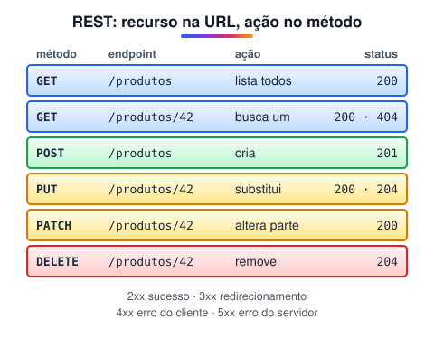

# Tópicos complementares de API

> 🗺️ **Nesta aula:** o estilo REST, idempotência, códigos de status, versionamento, rate limiting, webhooks, paginação, cache, CORS e monitoramento de APIs.

## De onde paramos

Você conhece as peças de uma requisição. Agora vamos ver as convenções que fazem uma API ser fácil de usar e de manter, a começar pelo REST.

## REST

**REST é um estilo de arquitetura para APIs web: cada recurso tem uma URL, e a ação é dada pelo método HTTP.** Uma API que segue essas regras é chamada de **RESTful**.



> 💡 **Analogia:** pense num arquivo de aço com gavetas etiquetadas. A etiqueta é a URL e diz **o quê** (`/produtos`, `/produtos/7`); o método HTTP diz **o que fazer** com aquilo: olhar (`GET`), pôr uma ficha nova (`POST`), trocar a ficha (`PUT`/`PATCH`) ou jogar fora (`DELETE`). Por isso a URL não precisa de verbos: a gaveta é sempre a mesma, só muda a ação.

Princípios principais:

- **Recursos com substantivos no plural** (`/produtos`, `/usuarios/7/pedidos`). Nada de verbos na URL, como `/criarProduto`.
- **Métodos HTTP com significado**: `GET` lê, `POST` cria, `PUT`/`PATCH` alteram, `DELETE` remove.
- **Sem estado (stateless)**: cada requisição traz tudo de que precisa (inclusive o token). O servidor não "lembra" da anterior.
- **Códigos de status corretos**: o cliente entende o resultado sem ler o corpo.

### Idempotência

Repetir uma requisição **idempotente** dá o mesmo resultado: `GET`, `PUT` e `DELETE` são idempotentes; `POST`, não (cada envio cria um registro novo). Isso importa quando a rede falha e o cliente tenta de novo.

### Códigos de status mais comuns

| Código | Significado |
| --- | --- |
| `200 OK` | sucesso |
| `201 Created` | recurso criado (resposta a um POST) |
| `204 No Content` | sucesso sem corpo (comum em DELETE) |
| `400 Bad Request` | dados inválidos |
| `401 Unauthorized` | não autenticado (falta o token ou é inválido) |
| `403 Forbidden` | autenticado, mas sem permissão |
| `404 Not Found` | recurso não existe |
| `409 Conflict` | conflito (e-mail já cadastrado) |
| `422 Unprocessable Entity` | validação falhou |
| `429 Too Many Requests` | passou do limite de requisições |
| `500 Internal Server Error` | erro no servidor |

## Versionamento

As APIs mudam, e quem já usa não pode quebrar. Formas comuns:

- **na URL**: `/api/v1/produtos` → `/api/v2/produtos` (a mais comum);
- **no cabeçalho**: `Accept: application/vnd.minhaapi.v2+json`.

Mudanças que **quebram** (remover um campo, mudar um tipo) exigem nova versão; acrescentar um campo opcional, não.

## Rate limiting

Limite de requisições por período (por IP, chave ou usuário), para proteger o servidor e evitar abuso. Ao estourar, a API responde `429`, geralmente com cabeçalhos dizendo quando tentar de novo (`Retry-After`, `X-RateLimit-Remaining`).

## Webhooks

Em vez de o seu sistema perguntar toda hora "o pagamento já caiu?" (*polling*), **a API avisa você**: você cadastra uma URL, e o serviço faz um `POST` nela quando o evento acontece. Valide a assinatura que vem no cabeçalho para garantir que a chamada é legítima.

## Paginação

Para não devolver 1 milhão de registros de uma vez:

```
# paginação por página (offset)
GET /produtos?pagina=2&limite=20
# por cursor (melhor para listas que mudam)
GET /produtos?depois=abc123&limite=20
```

A resposta costuma trazer o total ou o link da próxima página.

## Cache

Guardar respostas por um tempo, no navegador, em um CDN ou no servidor (Redis), para responder mais rápido e aliviar o banco. Cabeçalhos HTTP controlam isso: `Cache-Control: max-age=60`, `ETag`.

## CORS

Por segurança, o navegador **bloqueia** que uma página em `site-a.com` leia respostas de uma API em `api-b.com`, a menos que a API autorize com o cabeçalho `Access-Control-Allow-Origin`. É a causa do famoso erro "*blocked by CORS policy*". A correção é feita **no servidor** (no Express: o pacote `cors`), não no front-end.

## Monitoramento

Acompanhe **tempo de resposta**, **taxa de erros** (4xx/5xx) e **volume de uso**, com logs estruturados e ferramentas como Grafana, Datadog ou New Relic, para detectar problemas antes dos usuários.

## Exercício

Desenhe os endpoints REST de uma API de biblioteca com livros e empréstimos: listar livros, ver um livro, cadastrar livro, registrar um empréstimo de um livro e devolver. Diga o status de sucesso de cada um.

<details>
<summary>Ver resposta</summary>

| Ação | Método e rota | Status |
| --- | --- | --- |
| Listar livros | `GET /livros` | 200 |
| Ver um livro | `GET /livros/12` | 200 (ou 404) |
| Cadastrar livro | `POST /livros` | 201 |
| Emprestar | `POST /livros/12/emprestimos` | 201 |
| Devolver | `PATCH /emprestimos/40` | 200 |

Empréstimo vira um recurso próprio; não se usa `/emprestarLivro`, porque verbos ficam no método HTTP.

</details>

## 🧠 Revisão rápida

**Qual a diferença entre 401 e 403?**

401: não autenticado. 403: autenticado, mas sem permissão.

**`POST` é idempotente?**

Não. Cada envio cria um registro novo.

**Onde se corrige um erro de CORS?**

No servidor da API.

> ➡️ **Próximo passo:** hora de construir a sua: **Criando uma API com Express**.

## 📌 Resumo

| Item | Em uma frase |
| --- | --- |
| REST | recurso na URL, ação no método |
| Stateless | cada requisição é independente |
| Idempotência | repetir dá o mesmo resultado |
| Status | 2xx sucesso, 4xx cliente, 5xx servidor |
| Versionamento | `/v1`, `/v2` |
| Rate limiting | limite de chamadas; responde 429 |
| Webhook | a API avisa você |
| CORS | o servidor libera outras origens |
