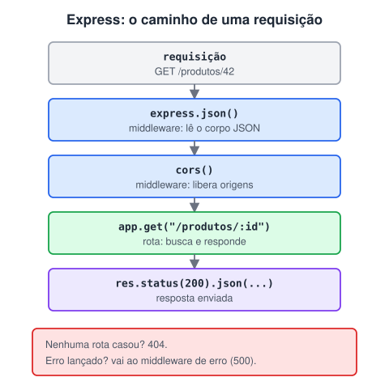

# Criando uma API com Express

> 🗺️ **Nesta aula:** construir uma API REST de tarefas com Express: preparar o projeto, criar as rotas do CRUD, ler parâmetros e corpo, usar middlewares, tratar erros e testar.

## De onde paramos

Você sabe o que é uma API REST e como consumi-la com `fetch`. Agora vamos do outro lado do balcão: criar o servidor que responde.

## O que vamos construir

Uma API REST de **tarefas** com as quatro operações básicas (CRUD), usando **Express**, o framework web mais popular do Node.

| Método | Rota | Faz |
| --- | --- | --- |
| GET | `/tarefas` | lista todas |
| GET | `/tarefas/:id` | busca uma |
| POST | `/tarefas` | cria |
| PUT | `/tarefas/:id` | atualiza |
| DELETE | `/tarefas/:id` | remove |

## Preparando

```bash
mkdir api-tarefas
cd api-tarefas
npm init -y
npm install express cors
npm pkg set type=module
npm pkg set scripts.dev="node --watch server.js"
```

## O caminho de uma requisição



## O servidor completo (`server.js`)

```jsx
import express from "express";
import cors from "cors";

const app = express();
// libera chamadas de outros sites (front-end)
app.use(cors());
// lê o corpo das requisições em JSON
app.use(express.json());

let tarefas = [
  { id: 1, titulo: "Estudar Express", feita: false },
];
let proximoId = 2;

// procura a tarefa pelo id da rota
const acharTarefa = (id) =>
  tarefas.find((t) => t.id === Number(id));

app.get("/tarefas", (req, res) => {
  res.json(tarefas);
});

app.get("/tarefas/:id", (req, res) => {
  const tarefa = acharTarefa(req.params.id);
  if (!tarefa) {
    return res.status(404).json({ erro: "Não encontrada" });
  }
  res.json(tarefa);
});

app.post("/tarefas", (req, res) => {
  const titulo = String(req.body.titulo ?? "").trim();
  if (!titulo) {
    return res.status(400).json({ erro: "Título obrigatório" });
  }
  const nova = { id: proximoId++, titulo, feita: false };
  tarefas.push(nova);
  res.status(201).json(nova);
});

app.put("/tarefas/:id", (req, res) => {
  const tarefa = acharTarefa(req.params.id);
  if (!tarefa) {
    return res.status(404).json({ erro: "Não encontrada" });
  }
  const { titulo, feita } = req.body;
  if (titulo !== undefined) {
    tarefa.titulo = String(titulo).trim();
  }
  if (feita !== undefined) {
    tarefa.feita = Boolean(feita);
  }
  res.json(tarefa);
});

app.delete("/tarefas/:id", (req, res) => {
  const antes = tarefas.length;
  tarefas = tarefas.filter(
    (t) => t.id !== Number(req.params.id)
  );
  if (tarefas.length === antes) {
    return res.status(404).json({ erro: "Não encontrada" });
  }
  res.status(204).end();
});

const PORTA = process.env.PORT ?? 3000;
app.listen(PORTA, () => {
  console.log(`API em http://localhost:${PORTA}`);
});
```

Rode com `npm run dev` e abra `http://localhost:3000/tarefas` no navegador.

## Entendendo as peças

- `req.params`: partes da rota (`/tarefas/:id` → `req.params.id`). Sempre chegam como **texto**, por isso o `Number(...)`.
- `req.query`: o que vem depois do `?` (`/tarefas?feita=true` → `req.query.feita`).
- `req.body`: o corpo enviado em POST e PUT. Só existe com `app.use(express.json())`.
- `res.status(código).json(dados)`: responde com status e JSON. Use o `return` para não tentar responder duas vezes.

## Middleware

Middleware é uma função que roda **antes** das rotas, por exemplo para registrar logs ou verificar login:

```jsx
app.use((req, res, next) => {
  console.log(new Date().toISOString(), req.method, req.url);
  // passa para o próximo; sem isso, a requisição trava
  next();
});
```

### Tratando erros e rotas inexistentes

Coloque estes dois middlewares **depois** de todas as rotas:

```jsx
// nenhuma rota casou
app.use((req, res) => {
  res.status(404).json({ erro: "Rota não encontrada" });
});

// erro lançado em alguma rota (4 parâmetros!)
app.use((err, req, res, next) => {
  console.error(err);
  res.status(500).json({ erro: "Erro interno" });
});
```

O Express reconhece o middleware de erro pelos **quatro** parâmetros. Nunca devolva o `err.stack` ao cliente: ele expõe detalhes internos.

## Testando a API

- **GET** direto no navegador.
- Para POST, PUT e DELETE use **Postman**, **Insomnia**, a extensão **Thunder Client** do VS Code ou o terminal:

```bash
curl -X POST http://localhost:3000/tarefas \
  -H "Content-Type: application/json" \
  -d '{"titulo":"Fazer o deploy"}'
```

## Próximos passos

- **Persistência:** aqui os dados ficam em memória e somem ao reiniciar. O passo seguinte é gravar em um banco (SQL, próximo módulo), usando parâmetros `?` nas consultas para evitar SQL Injection.
- **Organização:** separe as rotas em arquivos com `express.Router()`.
- **Configuração:** guarde senhas e URLs em variáveis de ambiente (arquivo `.env`, fora do Git).

## Exercício

Acrescente à API um filtro: `GET /tarefas?feita=true` deve devolver só as concluídas, e `?feita=false`, só as pendentes. Sem o parâmetro, continua devolvendo todas.

<details>
<summary>Ver resposta</summary>

```jsx
app.get("/tarefas", (req, res) => {
  const { feita } = req.query;
  if (feita === undefined) {
    return res.json(tarefas);
  }
  const quer = feita === "true";
  res.json(tarefas.filter((t) => t.feita === quer));
});
```

`req.query.feita` chega como texto (`"true"` ou `"false"`), por isso a comparação com a string.

</details>

## 🧠 Revisão rápida

**O que acontece sem `app.use(express.json())`?**

`req.body` fica `undefined` nas requisições com JSON.

**Por que usar `return` antes de `res.status(404)`?**

Para a função parar ali e não tentar enviar uma segunda resposta.

**Como o Express reconhece o middleware de erro?**

Pelos quatro parâmetros: `(err, req, res, next)`.

> ➡️ **Próximo passo:** fim do módulo de Node. Para guardar os dados de verdade, vamos aprender bancos de dados no **Módulo XI: SQL**.

## 📌 Resumo

| Item | Em uma frase |
| --- | --- |
| `express()` | cria a aplicação |
| `app.get/post/put/delete` | define uma rota |
| `req.params` | valores da rota (`:id`) |
| `req.query` | valores depois do `?` |
| `req.body` | corpo JSON (com `express.json()`) |
| `res.status().json()` | responde com status e JSON |
| Middleware | roda antes das rotas; chama `next()` |
| Middleware de erro | `(err, req, res, next)` no final |
