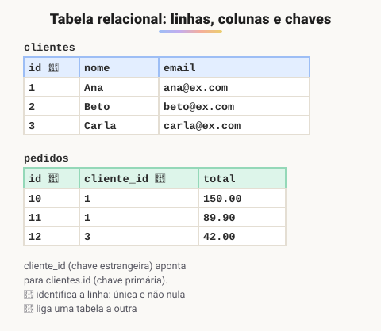
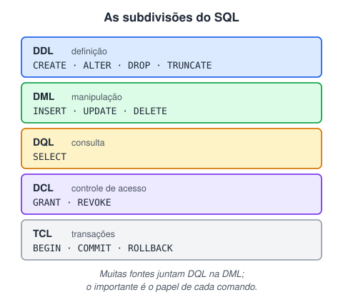

# Introdução ao SQL

> 🗺️ **Nesta aula:** o que é SQL, como funciona um banco de dados relacional (tabelas, linhas, colunas e chaves), as subdivisões da linguagem, os comandos essenciais, convenções e onde praticar.

## De onde paramos

A API de tarefas do módulo anterior guardava os dados num array, que some quando o servidor reinicia. Para guardar dados de forma permanente, organizada e segura, usamos um **banco de dados**, e a linguagem para conversar com ele é o SQL.

## O que é SQL

**SQL (Structured Query Language) é a linguagem padrão para criar, consultar e modificar bancos de dados relacionais.** É **declarativa**: você descreve **o que** quer ("os clientes de Recife, ordenados por nome") e o banco decide **como** buscar.

Os principais bancos relacionais (SGBDs) são **PostgreSQL**, **MySQL/MariaDB**, **SQL Server**, **Oracle** e **SQLite**. O SQL básico é igual em todos; cada um tem suas extensões e pequenas diferenças.

## Banco de dados relacional

Os dados ficam em **tabelas** (linhas e colunas), e as tabelas se ligam por **chaves**.



> 💡 **Analogia:** um banco relacional é como uma pasta de planilhas, uma aba para cada assunto. Na aba **clientes**, cada pessoa tem um número de cadastro único (a chave primária), como uma matrícula. Na aba **pedidos**, em vez de copiar nome e endereço em toda compra, a comanda anota só o número do cliente (a chave estrangeira). Para saber quem comprou, basta procurar esse número na outra aba.

- Cada **linha** é um registro (um cliente); cada **coluna** é um atributo (o nome).
- A **chave primária** identifica cada linha: é única e nunca nula.
- A **chave estrangeira** guarda a chave primária de outra tabela e cria a ligação.

## As subdivisões da linguagem



## Os comandos essenciais

```sql
-- DDL: estrutura
CREATE TABLE clientes (
  id    INT PRIMARY KEY AUTO_INCREMENT,
  nome  VARCHAR(100) NOT NULL,
  email VARCHAR(150) UNIQUE
);

ALTER TABLE clientes ADD COLUMN cidade VARCHAR(80);
-- apaga a tabela inteira (estrutura e dados)
DROP TABLE clientes;
```

```sql
-- DML: dados
INSERT INTO clientes (nome, email)
VALUES ('Ana', 'ana@ex.com');
UPDATE clientes SET cidade = 'Recife' WHERE id = 1;
DELETE FROM clientes WHERE id = 1;

-- DQL: consulta
SELECT nome, email
FROM clientes
WHERE cidade = 'Recife'
ORDER BY nome;
```

> ⚠️ `UPDATE` **e** `DELETE` **sem** `WHERE` **afetam TODAS as linhas da tabela.** Antes de rodar, teste o filtro com um `SELECT ... WHERE` igual e confira quantas linhas aparecem.

## Convenções

- Palavras-chave em MAIÚSCULAS (`SELECT`, `FROM`) e nomes em minúsculas com `_` (`data_pedido`). Não é obrigatório, mas facilita a leitura.
- Texto entre **aspas simples**: `'Recife'`.
- Comentários: `-- linha` ou `/* bloco */`.
- Cada instrução termina com `;`.

## Onde praticar

- Instalar MySQL ou PostgreSQL e usar um cliente visual: **DBeaver**, **MySQL Workbench**, **pgAdmin** ou **Beekeeper Studio**.
- Online, sem instalar nada: **DB Fiddle**, **SQLite Online** ou **SQLBolt** (tutorial interativo).

> ⚠️ **Ajustes:** SQL é uma **linguagem de consulta declarativa**, não uma "linguagem de programação" no sentido comum. E o `CREATE` não cria só tabelas: também cria bancos, índices, views e triggers.

## Exercício

Escreva os comandos para: (a) criar a tabela `produtos` com `id`, `nome` (obrigatório) e `preco`; (b) inserir dois produtos; (c) listar os produtos com preço acima de 20, do mais caro para o mais barato.

<details>
<summary>Ver resposta</summary>

```sql
CREATE TABLE produtos (
  id    INT PRIMARY KEY AUTO_INCREMENT,
  nome  VARCHAR(100) NOT NULL,
  preco DECIMAL(10, 2)
);

INSERT INTO produtos (nome, preco)
VALUES ('Café', 39.90), ('Chá', 19.90);

SELECT nome, preco
FROM produtos
WHERE preco > 20
ORDER BY preco DESC;
```

Para dinheiro, use `DECIMAL`, não `FLOAT` (veja a aula de tipos de dados).

</details>

## 🧠 Revisão rápida

**O que significa SQL ser declarativa?**

Você diz o que quer, e o banco decide como buscar.

**Qual a diferença entre chave primária e estrangeira?**

A primária identifica a linha; a estrangeira aponta para a primária de outra tabela.

**O que acontece com um `DELETE` sem `WHERE`?**

Apaga todas as linhas da tabela.

> ➡️ **Próximo passo:** antes de criar tabelas, é preciso saber como os dados se relacionam: **Cardinalidade**.

## 📌 Resumo

| Item | Em uma frase |
| --- | --- |
| SQL | linguagem declarativa de bancos relacionais |
| Tabela | linhas (registros) e colunas (atributos) |
| Chave primária | identifica cada linha |
| Chave estrangeira | liga uma tabela a outra |
| DDL | `CREATE`, `ALTER`, `DROP` |
| DML | `INSERT`, `UPDATE`, `DELETE` |
| DQL | `SELECT` |
| Sem `WHERE` | afeta a tabela inteira |
