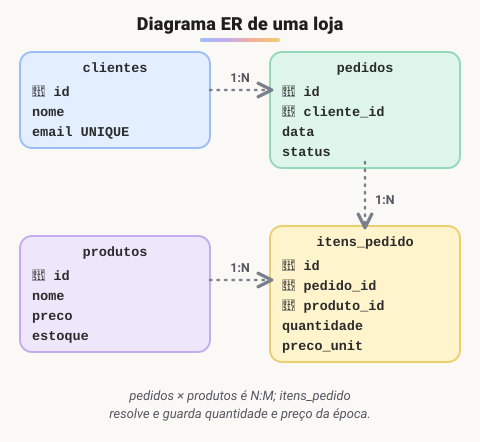

# Modelo entidade relacionamento (ER)

> 🗺️ **Nesta aula:** o Modelo Entidade-Relacionamento: entidades, tipos de atributos e relacionamentos, um diagrama completo de uma loja, as etapas conceitual, lógica e física, e as notações e ferramentas mais usadas.

## De onde paramos

Você sabe classificar relacionamentos (1:1, 1:N, N:M). Agora vamos juntar tudo num desenho do sistema inteiro, antes de escrever qualquer `CREATE TABLE`.

## O que é o modelo ER

**O Modelo Entidade-Relacionamento (ER), proposto por Peter Chen em 1976, é uma forma de desenhar os dados de um sistema antes de criar as tabelas.** Ele responde a três perguntas: **o que** vamos guardar (entidades), **quais informações** de cada coisa (atributos) e **como elas se ligam** (relacionamentos).

## Componentes

### Entidades

Algo do mundo real que precisa ser guardado: **Cliente**, **Produto**, **Pedido**. Cada ocorrência (a cliente "Ana") é uma instância, identificada por uma **chave primária**.

### Atributos

As características de uma entidade.

| Tipo | Exemplo |
| --- | --- |
| simples | `nome` |
| composto | `endereco` (rua, número, cidade) |
| multivalorado | `telefones` (vários) → no banco, vira outra tabela |
| derivado | `idade` (calculada a partir de `data_nascimento`) |
| identificador (chave) | `id`, `cpf` |

### Relacionamentos

A ligação entre entidades, sempre com uma **cardinalidade** (1:1, 1:N ou N:M): um cliente **faz** pedidos; um pedido **contém** produtos.

## Exemplo: uma loja

> 💡 **Analogia:** o diagrama ER é a **planta baixa** de uma casa. Antes de levantar paredes (criar tabelas), o arquiteto desenha os cômodos (entidades), o que vai em cada um (atributos) e as portas que ligam um cômodo ao outro (relacionamentos). Mudar a planta no papel custa uma borracha; mudar a casa pronta custa uma reforma, e com o banco é igual.

Repare que **cliente e produto não se ligam diretamente**. O cliente se liga ao pedido, e o pedido aos produtos, por meio de `itens_pedido`, que resolve o N:M e ainda guarda a quantidade e o preço no momento da compra.

## Do conceito às tabelas

1. **Modelo conceitual (ER/DER)**: as entidades e relacionamentos, sem tipos de dados. É para conversar com quem vai usar o sistema.
2. **Modelo lógico (relacional)**: as tabelas, colunas, chaves primárias e estrangeiras.
3. **Modelo físico**: o SQL real (`CREATE TABLE`), com tipos e índices do banco escolhido.

## Notações e ferramentas

- **Chen** (clássica): retângulos para entidades, losangos para relacionamentos e elipses para atributos.
- **Pé de galinha** (crow's foot), a mais usada no mercado: o "tridente" indica "muitos".
- Ferramentas: **dbdiagram.io** (desenha a partir de texto), **draw.io**, **MySQL Workbench**, **brModelo** (muito usado em faculdades no Brasil), **Lucidchart** e Visual Paradigm.

> ⚠️ **Correção:** o diagrama original ligava **Cliente diretamente a Produto**, como se houvesse uma chave entre eles. O correto é Cliente → Pedido → Itens do pedido ← Produto.

## Exercício

Modele uma clínica: pacientes marcam consultas com médicos; cada médico tem uma especialidade; uma consulta pode gerar várias receitas. Liste as entidades, os principais atributos e as cardinalidades.

Ver resposta (uma possibilidade)

| Entidade | Atributos |
| --- | --- |
| pacientes | 🔑 id, nome, data_nascimento |
| especialidades | 🔑 id, nome |
| medicos | 🔑 id, nome, crm, 🔗 especialidade_id |
| consultas | 🔑 id, 🔗 paciente_id, 🔗 medico_id, data_hora |
| receitas | 🔑 id, 🔗 consulta_id, descricao |

- especialidade 1:N médicos;
- paciente N:M médico, resolvido pela própria tabela `consultas`;
- consulta 1:N receitas.

A `idade` não é guardada: é derivada de `data_nascimento`.

## 🧠 Revisão rápida

**O que é um atributo multivalorado e como fica no banco?**

Um atributo com vários valores (telefones); vira uma tabela própria.

**Qual a diferença entre modelo conceitual e físico?**

O conceitual desenha entidades e relações; o físico é o SQL real com tipos e índices.

**O que indica o "pé de galinha"?**

O lado "muitos" do relacionamento.

> ➡️ **Próximo passo:** transformar o diagrama em tabelas: **Modelo relacional**.

## 📌 Resumo

| Item | Em uma frase |
| --- | --- |
| Entidade | algo a guardar (Cliente) |
| Atributo | característica da entidade |
| Relacionamento | ligação com cardinalidade |
| Conceitual | o desenho, sem tipos |
| Lógico | tabelas e chaves |
| Físico | o `CREATE TABLE` real |
| Pé de galinha | notação mais usada no mercado |
