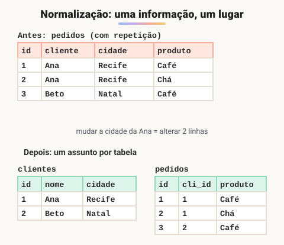

# Normalização de dados

> 🗺️ **Nesta aula:** o que é normalização, as anomalias que ela evita, a 1ª, 2ª e 3ª Formas Normais aplicadas passo a passo a uma tabela de pedidos, e quando desnormalizar de propósito.

## De onde paramos

Você sabe criar tabelas e ligá-las por chaves. Mas como decidir **quais** tabelas criar? A normalização é o método para chegar a um bom desenho.

## O que é normalização

**Normalização é o processo de organizar as tabelas para que cada informação fique guardada em um lugar só.** Isso evita **redundância** e as chamadas **anomalias**:

- **de atualização**: a cidade da Ana muda, mas está repetida em 50 pedidos, e um deles fica desatualizado;
- **de inserção**: não dá para cadastrar um produto que ainda não foi vendido;
- **de exclusão**: apagar o único pedido de um cliente apaga também os dados do cliente.

## Ponto de partida: uma tabela "planilha"

| pedido | cliente | cidade | produtos | precos |
| --- | --- | --- | --- | --- |
| 1 | Ana | Recife | café, chá | 39.90, 19.90 |
| 2 | Ana | Recife | café | 39.90 |
| 3 | Beto | Natal | bolo | 25.00 |

Problemas: listas dentro da célula, Ana e Recife repetidos e o preço do café repetido.

## 1ª Forma Normal (1FN): valores atômicos

Cada célula guarda **um único valor**, sem listas nem grupos repetidos. A lista de produtos vira uma linha por item:

| pedido | cliente | cidade | produto | preco |
| --- | --- | --- | --- | --- |
| 1 | Ana | Recife | café | 39.90 |
| 1 | Ana | Recife | chá | 19.90 |
| 2 | Ana | Recife | café | 39.90 |
| 3 | Beto | Natal | bolo | 25.00 |

## 2ª Forma Normal (2FN): depender da chave inteira

Está na 1FN e **nenhuma coluna depende só de parte da chave**. Aqui a chave é `(pedido, produto)`, mas `preco` depende só de `produto`, e `cliente` só de `pedido`. Separamos:

- `pedidos(id, cliente, cidade_cliente)`
- `produtos(id, nome, preco)`
- `itens_pedido(pedido_id, produto_id, quantidade)`

## 3ª Forma Normal (3FN): sem dependência entre colunas comuns

Está na 2FN e **nenhuma coluna depende de outra coluna que não seja a chave**. `cidade_cliente` depende do **cliente**, e não do pedido, então o cliente ganha a própria tabela:

- `clientes(id, nome, cidade)`
- `pedidos(id, cliente_id, data)`
- `produtos(id, nome, preco)`
- `itens_pedido(pedido_id, produto_id, quantidade, preco_unit)`

Resumo fácil de lembrar: cada coluna deve depender **"da chave, da chave inteira e de nada além da chave"**.

## Desnormalizar de propósito

Às vezes **repetir dados é a escolha certa**:

- `itens_pedido.preco_unit` guarda o preço **da época da compra**, porque, se o preço do produto mudar, o pedido antigo não pode mudar junto;
- relatórios e dashboards muito acessados podem usar tabelas resumo para evitar JOINs pesados.

A regra: **normalize primeiro**, até a 3FN, e desnormalize só com um motivo claro.

## Exercício

Normalize até a 3FN a tabela `matriculas(aluno, email_aluno, disciplina, professor, sala_professor)`, sabendo que cada disciplina tem um único professor e cada professor tem uma sala.

Ver resposta

- `alunos(id, nome, email)`
- `professores(id, nome, sala)`
- `disciplinas(id, nome, professor_id)`
- `matriculas(aluno_id, disciplina_id)`

O e-mail depende do aluno (parte da chave), por isso sai na 2FN. A sala depende do professor, que depende da disciplina: dependência transitiva, resolvida na 3FN.

## 🧠 Revisão rápida

**O que a 1FN exige?**

Valores atômicos: um valor por célula, sem listas.

**Qual problema a 3FN resolve?**

Colunas que dependem de outra coluna comum, e não da chave.

**Por que `preco_unit` fica repetido em `itens_pedido`?**

Para guardar o preço da época da compra, mesmo que o produto mude de preço.

> ➡️ **Próximo passo:** os comandos que criam e alteram essas estruturas: **Linguagem de definição de dados (DDL)**.

## 📌 Resumo

| Item | Em uma frase |
| --- | --- |
| Normalização | cada informação num lugar só |
| Anomalias | atualização, inserção e exclusão |
| 1FN | valores atômicos |
| 2FN | dependência da chave inteira |
| 3FN | nada além da chave |
| Desnormalizar | só com motivo claro (histórico, desempenho) |
