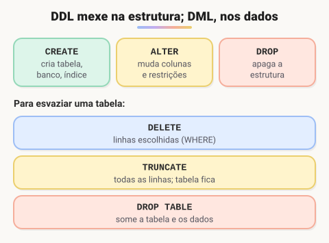

# Linguagem de definição de dados (DDL)

> 🗺️ **Nesta aula:** os comandos DDL (`CREATE`, `ALTER`, `DROP`, `TRUNCATE`, `RENAME`), como criar, alterar e apagar estruturas com segurança e a diferença entre `DELETE`, `TRUNCATE` e `DROP`.

## De onde paramos

Com as tabelas normalizadas no papel, é hora de criá-las no banco e saber alterá-las quando o sistema evoluir.

## O que é a DDL



> 💡 **Analogia:** pense numa estante de livros. A DDL cuida da **estante**: montar (`CREATE`), pôr ou tirar prateleiras (`ALTER`) e jogar a estante fora (`DROP`). A DML cuida dos **livros**: guardar, trocar e tirar alguns escolhidos (`DELETE ... WHERE`). O `TRUNCATE` fica no meio: esvazia todas as prateleiras de uma vez, mas a estante continua lá.

**DDL (Data Definition Language) é a parte do SQL que define a estrutura do banco: bancos, tabelas, colunas, índices, views e restrições.** Ela mexe no "esqueleto"; quem mexe nos dados é a DML.

| Comando | O que faz |
| --- | --- |
| `CREATE` | cria banco, tabela, índice, view, trigger |
| `ALTER` | altera a estrutura (colunas e restrições) |
| `DROP` | apaga o objeto inteiro (estrutura **e** dados) |
| `TRUNCATE` | esvazia a tabela e mantém a estrutura |
| `RENAME` | renomeia (MySQL: `RENAME TABLE a TO b`) |

## Criando

```sql
CREATE DATABASE loja;
-- MySQL (no PostgreSQL: \c loja)
USE loja;

CREATE TABLE clientes (
  id        INT PRIMARY KEY AUTO_INCREMENT,
  nome      VARCHAR(100) NOT NULL,
  email     VARCHAR(100) NOT NULL UNIQUE,
  criado_em TIMESTAMP DEFAULT CURRENT_TIMESTAMP
);

-- não dá erro se já existir
CREATE TABLE IF NOT EXISTS produtos (
  id    INT PRIMARY KEY AUTO_INCREMENT,
  nome  VARCHAR(100) NOT NULL,
  preco DECIMAL(10, 2) NOT NULL
);

CREATE INDEX idx_produtos_nome ON produtos(nome);
```

## Alterando

```sql
-- nova coluna
ALTER TABLE clientes ADD COLUMN data_nascimento DATE;
-- muda o tipo (MySQL)
ALTER TABLE clientes
  MODIFY COLUMN nome VARCHAR(150) NOT NULL;
-- renomeia
ALTER TABLE clientes
  RENAME COLUMN nome TO nome_completo;
-- remove
ALTER TABLE clientes DROP COLUMN data_nascimento;
-- nova restrição
ALTER TABLE clientes
  ADD CONSTRAINT ck_email CHECK (email LIKE '%@%');
```

## Apagando

```sql
-- apaga todas as linhas, rápido; a estrutura fica
TRUNCATE TABLE logs;
-- apaga a tabela inteira
DROP TABLE IF EXISTS logs;
-- apaga o banco inteiro!
DROP DATABASE loja;
```

> ⚠️ `DROP` e `TRUNCATE` **não têm "desfazer"** na maioria dos bancos (no MySQL, causam *commit* implícito e não entram em transação). Em produção, faça **backup** antes e prefira **migrations** versionadas (Flyway, Liquibase, Prisma, Knex) em vez de rodar DDL na mão.

## `DELETE` × `TRUNCATE` × `DROP`

|  | `DELETE FROM t` | `TRUNCATE TABLE t` | `DROP TABLE t` |
| --- | --- | --- | --- |
| Tipo | DML | DDL | DDL |
| Apaga | linhas (aceita `WHERE`) | todas as linhas | a tabela inteira |
| Estrutura | mantém | mantém | apaga |
| Reinicia o `AUTO_INCREMENT` | não | sim | — |
| Velocidade | linha a linha | muito rápido | muito rápido |

> ⚠️ **Correções:** `COMMIT` e `ROLLBACK` **não são DDL**: pertencem à **TCL**. E os exemplos originais usavam `//` como comentário, o que não existe em SQL; o correto é `--` ou `/* */`.

## Exercício

A tabela `produtos` precisa de: uma coluna `estoque` inteira com valor padrão 0, a garantia de que o estoque nunca seja negativo e a renomeação da tabela para `itens_catalogo`. Escreva os comandos.

<details>
<summary>Ver resposta</summary>

```sql
ALTER TABLE produtos
  ADD COLUMN estoque INT NOT NULL DEFAULT 0;

ALTER TABLE produtos
  ADD CONSTRAINT ck_estoque CHECK (estoque >= 0);

RENAME TABLE produtos TO itens_catalogo;
-- PostgreSQL:
-- ALTER TABLE produtos RENAME TO itens_catalogo;
```

</details>

## 🧠 Revisão rápida

**Qual a diferença entre `TRUNCATE` e `DROP`?**

`TRUNCATE` esvazia e mantém a tabela; `DROP` apaga a tabela.

**`DELETE` é DDL ou DML?**

DML: mexe nos dados, não na estrutura.

**Para que serve `IF NOT EXISTS`?**

Para não dar erro se o objeto já existir.

> ➡️ **Próximo passo:** com as tabelas criadas, vamos inserir, alterar e consultar dados: **Linguagem de Manipulação de Dados (DML)**.

## 📌 Resumo

| Comando | Em uma frase |
| --- | --- |
| `CREATE` | cria um objeto |
| `ALTER` | muda a estrutura |
| `DROP` | apaga o objeto e os dados |
| `TRUNCATE` | esvazia a tabela |
| `IF [NOT] EXISTS` | evita erro se (não) existir |
| Migrations | DDL versionada e revisável |
