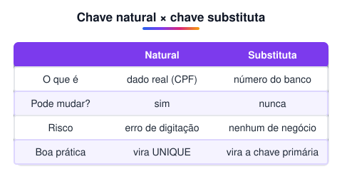
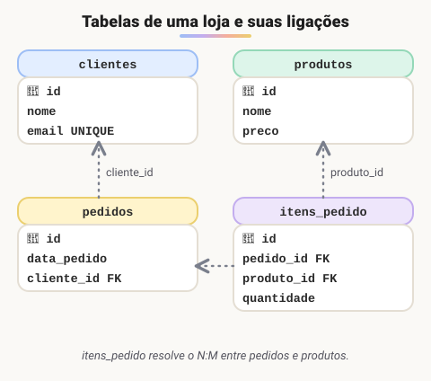

# Modelo relacional

> 🗺️ **Nesta aula:** o modelo relacional de Codd, seu vocabulário (relação, tupla, domínio, chaves), as restrições de integridade, chave natural × substituta e a criação das tabelas de uma loja na ordem certa.

## De onde paramos

O diagrama ER mostrou entidades e relacionamentos. Agora vamos passar para o **modelo lógico**: tabelas, colunas e chaves, prontas para virar SQL.

## O que é o modelo relacional

**O modelo relacional, proposto por Edgar F. Codd em 1970, organiza os dados em tabelas (relações) ligadas por chaves.** É a base do SQL e de bancos como PostgreSQL, MySQL, SQL Server e Oracle.

## Vocabulário

| Termo | Também chamado de | O que é |
| --- | --- | --- |
| **Tabela** | relação | dados sobre uma entidade (`clientes`) |
| **Registro** | linha, tupla | uma ocorrência (a cliente Ana) |
| **Atributo** | coluna, campo | uma característica, com um **tipo** |
| **Domínio** | — | os valores permitidos (ex.: idade ≥ 0) |
| **Chave primária (PK)** | — | identifica cada linha: **única e não nula** |
| **Chave estrangeira (FK)** | — | aponta para a PK de outra tabela |
| **Chave candidata** | — | coluna que poderia ser PK (`cpf`, `email`) |

## Integridade

O modelo relacional não é só uma forma de organizar tabelas: ele inclui **regras que mantêm os dados consistentes**. A integridade de entidade diz que toda linha precisa de uma chave primária única e nunca vazia, para que seja possível identificar cada registro sem dúvida. A integridade referencial diz que uma chave estrangeira só pode apontar para algo que **existe**: não dá para registrar um pedido para um cliente que não está cadastrado. Na prática, o banco recusa a operação que quebraria a regra, e você descobre o erro na hora, não meses depois em um relatório com números estranhos.

O banco garante a consistência com **restrições**:

- **de entidade**: toda tabela tem PK, sem valores nulos ou repetidos;
- **referencial**: uma FK só aceita valores que existem na tabela referenciada (não dá para criar pedido de um cliente inexistente);
- **de domínio**: tipo, `NOT NULL`, `CHECK`, `DEFAULT`.

## Chave natural × chave substituta

Toda tabela precisa de uma chave primária, e há duas escolhas. A **chave natural** é um dado que já existe no mundo real e é único, como o CPF ou o e-mail. Parece conveniente, mas dados reais mudam: a pessoa troca de e-mail, o CPF pode ser digitado errado, e como a chave é copiada em outras tabelas, corrigir um valor vira uma operação trabalhosa. A **chave substituta** é um número sem significado criado pelo próprio banco (`id` autoincrementado). Como não representa nada do mundo real, nunca precisa mudar. A prática mais comum é usar um `id` como chave primária e declarar o CPF ou e-mail como `UNIQUE`.



> 💡 **Analogia:** o CPF é como o nome escrito no crachá: precisa estar certo e, às vezes, muda; o número de matrícula é só um código interno que nunca precisa ser corrigido.

- **Natural**: um dado real que já é único (`cpf`). Problema: pode mudar ou ter formato complicado.
- **Substituta (surrogate)**: um número gerado só para identificar (`id AUTO_INCREMENT` ou UUID). É a escolha mais comum. Use `UNIQUE` nas naturais.

## Exemplo: montando as tabelas de uma loja



> 💡 **Analogia:** a chave estrangeira é o número da mesa anotado na comanda de um restaurante. O sistema do caixa só aceita a comanda se a mesa 12 existir de verdade (integridade referencial). E, para montar o salão, primeiro se colocam as mesas e só depois se distribuem as comandas: por isso as tabelas referenciadas são criadas antes das que apontam para elas.

A ordem importa: **crie primeiro as tabelas referenciadas** (que não dependem de ninguém) e depois as que têm chaves estrangeiras.

```sql
-- 1. Tabelas independentes
CREATE TABLE clientes (
  id    INT PRIMARY KEY AUTO_INCREMENT,
  nome  VARCHAR(100) NOT NULL,
  email VARCHAR(100) NOT NULL UNIQUE
);

CREATE TABLE produtos (
  id    INT PRIMARY KEY AUTO_INCREMENT,
  nome  VARCHAR(100) NOT NULL,
  preco DECIMAL(10, 2) NOT NULL CHECK (preco >= 0)
);
```

```sql
-- 2. Depende de clientes
CREATE TABLE pedidos (
  id          INT PRIMARY KEY AUTO_INCREMENT,
  data_pedido DATE NOT NULL,
  cliente_id  INT NOT NULL,
  FOREIGN KEY (cliente_id) REFERENCES clientes(id)
);

-- 3. Depende de pedidos e produtos (resolve o N:M)
CREATE TABLE itens_pedido (
  id         INT PRIMARY KEY AUTO_INCREMENT,
  pedido_id  INT NOT NULL,
  produto_id INT NOT NULL,
  quantidade INT NOT NULL CHECK (quantidade > 0),
  -- preço no momento da compra
  preco_unit DECIMAL(10, 2) NOT NULL,
  FOREIGN KEY (pedido_id) REFERENCES pedidos(id)
    ON DELETE CASCADE,
  FOREIGN KEY (produto_id) REFERENCES produtos(id)
);
```

`ON DELETE CASCADE` apaga os itens automaticamente quando o pedido é apagado. Sem ele, o banco **impede** apagar um pedido que tenha itens.

> ⚠️ **Correção:** o script original criava `Pedido` **antes** de `Cliente`, e `ItemPedido` antes de `Produto`. Como a chave estrangeira aponta para uma tabela que ainda não existe, o banco dá erro (*"Failed to open the referenced table"* no MySQL). A ordem agora respeita as dependências.

## Exercício

Por que este `INSERT` falha?

```sql
INSERT INTO pedidos (data_pedido, cliente_id)
VALUES ('2024-05-10', 999);
```

<details>
<summary>Ver resposta</summary>

Se não existe cliente com `id = 999`, a **integridade referencial** barra o comando: a chave estrangeira `cliente_id` só aceita valores que existem em `clientes.id`. É preciso cadastrar o cliente antes ou usar um id existente.

</details>

## 🧠 Revisão rápida

**O que é uma tupla?**

Uma linha (registro) da tabela.

**Por que criar as tabelas numa ordem específica?**

Porque a tabela referenciada por uma FK precisa existir antes.

**O que faz `ON DELETE CASCADE`?**

Apaga as linhas filhas junto com a linha pai.

> ➡️ **Próximo passo:** como evitar dados repetidos e inconsistentes: **Normalização de dados**.

## 📌 Resumo

| Item | Em uma frase |
| --- | --- |
| Modelo relacional | tabelas ligadas por chaves |
| Tupla | linha |
| Domínio | valores permitidos de uma coluna |
| Integridade referencial | FK só aponta para o que existe |
| Chave substituta | id gerado, a escolha mais comum |
| Ordem de criação | referenciadas primeiro |
| `ON DELETE CASCADE` | apaga os filhos junto |
