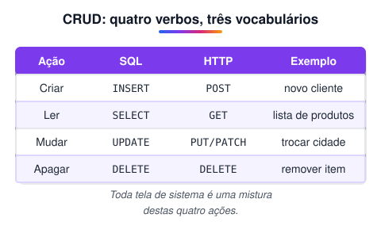
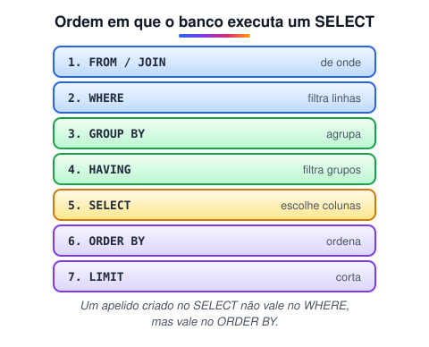

# Linguagem de Manipulação de Dados (DML)

> 🗺️ **Nesta aula:** inserir, atualizar, apagar e consultar dados com `INSERT`, `UPDATE`, `DELETE` e `SELECT`, os filtros do `WHERE`, hábitos de segurança e a ordem em que o banco executa uma consulta.

## De onde paramos

A DDL criou as tabelas vazias. Agora vamos preenchê-las e consultá-las: é aqui que o banco passa a ser útil.

## O que é a DML

Se a DDL é montar a estante, a DML é o uso diário dela. Quatro verbos cobrem quase tudo o que um sistema faz com um banco: criar um registro (`INSERT`), mudar um registro (`UPDATE`), remover um registro (`DELETE`) e ler registros (`SELECT`). Os desenvolvedores chamam isso de CRUD (create, read, update, delete), e quase toda tela de sistema, do cadastro de clientes ao carrinho de compras, é uma combinação dessas quatro operações.



> 💡 **Analogia:** é como a agenda de contatos do celular: adicionar um contato (`INSERT`), buscar (`SELECT`), editar (`UPDATE`) e excluir (`DELETE`).

**DML (Data Manipulation Language) são os comandos que mexem nos dados: inserir, atualizar, apagar e consultar.** A DDL define as tabelas; a DML preenche e usa.

## INSERT: inserir

Escrever as colunas no `INSERT` é um hábito que evita surpresas. Sem a lista, o banco assume a ordem das colunas na tabela, e se alguém adicionar uma coluna no meio, o seu comando passa a gravar valores no lugar errado. Com a lista, o comando continua certo. Note também que `id` não aparece: ele é `AUTO_INCREMENT`, e o banco escolhe o próximo número livre. Inserir várias linhas num único comando é mais rápido que vários comandos, porque o banco faz a viagem de ida e volta uma vez só.

```sql
-- uma linha (sempre liste as colunas:
-- é mais seguro se a tabela mudar)
INSERT INTO clientes (nome, email)
VALUES ('Ana', 'ana@ex.com');

-- várias linhas de uma vez
INSERT INTO clientes (nome, email) VALUES
  ('Beto',  'beto@ex.com'),
  ('Carla', 'carla@ex.com');

-- a partir de outra consulta
INSERT INTO clientes_arquivados (id, nome)
SELECT id, nome FROM clientes WHERE ativo = FALSE;
```

Colunas omitidas recebem o `DEFAULT` (ou `NULL`); o `id AUTO_INCREMENT` é gerado sozinho.

## UPDATE: atualizar

O `SET` diz o que muda e o `WHERE` diz em quem. No primeiro exemplo, só o cliente de `id = 1` muda de cidade. No segundo, `preco = preco * 1.10` lê o preço atual, multiplica e grava de volta, mas apenas para os livros. O valor à direita do igual é calculado linha por linha, com o preço de cada produto. Por exemplo, um livro de R$ 50,00 passa a R$ 55,00 e um de R$ 80,00 passa a R$ 88,00.

```sql
UPDATE clientes
SET cidade = 'Recife', ativo = TRUE
WHERE id = 1;

-- aumento de 10%
UPDATE produtos
SET preco = preco * 1.10
WHERE categoria = 'livros';
```

## DELETE: apagar

```sql
DELETE FROM clientes WHERE id = 3;
```

> ⚠️ **Sem** `WHERE`**,** `UPDATE` **e** `DELETE` **atingem TODAS as linhas.** Dois hábitos que salvam: (1) escreva primeiro um `SELECT * FROM tabela WHERE ...` com o mesmo filtro e confira as linhas; (2) rode dentro de uma transação (`BEGIN;`), confira e só então dê `COMMIT` (ou `ROLLBACK`). O MySQL Workbench já vem com o *safe update mode*, que bloqueia esses comandos sem `WHERE` com chave.

## SELECT: consultar

```sql
-- os 10 primeiros clientes ativos de Recife, por nome
SELECT nome, email
FROM clientes
WHERE cidade = 'Recife' AND ativo = TRUE
ORDER BY nome
LIMIT 10;
```

### Filtros do WHERE

O `WHERE` funciona como uma peneira: cada linha da tabela passa pela condição e só fica quem responde verdadeiro. Dá para combinar condições com `AND` (as duas precisam valer) e `OR` (basta uma). Quando misturar os dois, use parênteses: `A OR B AND C` não significa o que parece, porque o `AND` é resolvido primeiro. A pegadinha mais comum é o `NULL`. `NULL` significa "sem valor", e comparar qualquer coisa com ele usando `=` nunca dá verdadeiro. Por isso se escreve `IS NULL`.

| Operador | Exemplo |
| --- | --- |
| `=`, `<>`, `>`, `<`, `>=`, `<=` | `preco > 100` |
| `AND`, `OR`, `NOT` | `cidade = 'Recife' OR cidade = 'Natal'` |
| `IN` | `cidade IN ('Recife', 'Natal')` |
| `BETWEEN` | `preco BETWEEN 10 AND 50` (inclui as pontas) |
| `LIKE` | `nome LIKE 'A%'` (começa com A) · `'%silva%'` (contém) |
| `IS NULL` / `IS NOT NULL` | `email IS NULL` (**nunca** `= NULL`) |

Outros recursos: `SELECT DISTINCT cidade` (sem repetir), `AS` para apelidos (`preco * 0.9 AS preco_promo`) e `*` para todas as colunas (bom para explorar; evite em código de produção).

### A ordem real de execução



> 💡 **Analogia:** é como um bibliotecário montando uma pilha de livros para você. Primeiro ele vai à estante certa (`FROM`), separa só os livros que atendem ao pedido (`WHERE`), junta em grupos e descarta os grupos que não servem (`GROUP BY`, `HAVING`), anota as informações que você quer de cada um (`SELECT`), arruma a pilha (`ORDER BY`) e entrega só os primeiros (`LIMIT`). Você **fala** o `SELECT` primeiro, mas ele é **feito** quase no fim.

## Exercício

Com a tabela `produtos(id, nome, preco, categoria, estoque)`, escreva: (a) os produtos sem estoque da categoria "bebidas"; (b) um aumento de 5% nos preços de quem custa menos de 10; (c) a remoção dos produtos com nome começando por "TESTE".

<details>
<summary>Ver resposta</summary>

```sql
-- a)
SELECT nome
FROM produtos
WHERE categoria = 'bebidas' AND estoque = 0;

-- b)
UPDATE produtos
SET preco = preco * 1.05
WHERE preco < 10;

-- c) confira antes com SELECT!
SELECT * FROM produtos WHERE nome LIKE 'TESTE%';
DELETE FROM produtos WHERE nome LIKE 'TESTE%';
```

</details>

## 🧠 Revisão rápida

**Como testar se uma coluna está vazia?**

`coluna IS NULL`, nunca `= NULL`.

**O que `LIKE '%silva%'` encontra?**

Textos que contêm "silva" em qualquer posição.

**Por que um apelido do SELECT não funciona no WHERE?**

Porque o WHERE é executado antes do SELECT.

> ➡️ **Próximo passo:** buscar dados de várias tabelas ao mesmo tempo: **Junção de tabelas (JOIN)**.

## 📌 Resumo

| Comando | Em uma frase |
| --- | --- |
| `INSERT` | insere linhas |
| `UPDATE ... WHERE` | altera as linhas filtradas |
| `DELETE ... WHERE` | apaga as linhas filtradas |
| `SELECT` | consulta |
| `WHERE` | filtra linhas |
| `LIKE`, `IN`, `BETWEEN` | filtros comuns |
| `IS NULL` | testa ausência de valor |
