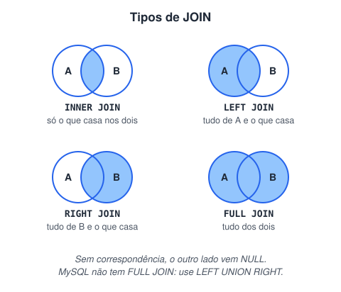

# Junção de tabelas (JOIN)

> 🗺️ **Nesta aula:** combinar tabelas com `INNER`, `LEFT`, `RIGHT` e `FULL JOIN`, achar registros sem par, juntar várias tabelas e boas práticas de JOIN.

## De onde paramos

Na normalização, os dados foram separados em várias tabelas. Para responder perguntas como "qual o nome do cliente de cada pedido?", precisamos juntá-las de novo na consulta.

## O que é um JOIN

**JOIN combina linhas de duas ou mais tabelas a partir de uma coluna em comum, normalmente a chave estrangeira.**



> 💡 **Analogia:** numa festa, você tem a lista de convidados e a pilha de presentes, cada um com um cartão dizendo quem deu. O **INNER JOIN** mostra só os convidados que trouxeram presente. O **LEFT JOIN** mostra todos os convidados, com ou sem presente (quem não trouxe aparece com o campo vazio). O **RIGHT JOIN** mostra todos os presentes, inclusive os sem cartão. E o **FULL JOIN** mostra tudo dos dois lados.

## Dados de exemplo

```
clientes          pedidos
id | nome         id | cliente_id | total
1  | Ana          10 | 1          | 150.00
2  | Beto         11 | 1          | 89.90
3  | Carla        12 | 3          | 42.00
                  13 | NULL       | 20.00
```

O pedido 13 não tem cliente, e o Beto não tem pedidos.

## INNER JOIN: só o que tem par

```sql
SELECT c.nome, p.id AS pedido, p.total
FROM clientes c
INNER JOIN pedidos p ON p.cliente_id = c.id;
```

| nome | pedido | total |
| --- | --- | --- |
| Ana | 10 | 150.00 |
| Ana | 11 | 89.90 |
| Carla | 12 | 42.00 |

Beto (sem pedidos) e o pedido 13 (sem cliente) **ficam de fora**. Escrever só `JOIN` é o mesmo que `INNER JOIN`.

## LEFT JOIN: tudo da esquerda

```sql
SELECT c.nome, p.id AS pedido
FROM clientes c
LEFT JOIN pedidos p ON p.cliente_id = c.id;
```

Inclui **Beto** com `pedido = NULL`. É muito útil para achar o que **não** tem par:

```sql
-- clientes que nunca compraram
SELECT c.nome
FROM clientes c
LEFT JOIN pedidos p ON p.cliente_id = c.id
WHERE p.id IS NULL;
```

## RIGHT JOIN: tudo da direita

O espelho do LEFT: inclui o **pedido 13** com `nome = NULL`. Na prática, quase sempre se inverte a ordem das tabelas e usa LEFT JOIN, que é mais fácil de ler.

## FULL OUTER JOIN: tudo dos dois lados

Inclui Beto **e** o pedido 13. PostgreSQL e SQL Server têm `FULL JOIN`; no **MySQL**, simule com `UNION`:

```sql
SELECT c.nome, p.id
FROM clientes c
LEFT JOIN pedidos p ON p.cliente_id = c.id
UNION
SELECT c.nome, p.id
FROM clientes c
RIGHT JOIN pedidos p ON p.cliente_id = c.id;
```

## Juntando várias tabelas

```sql
SELECT c.nome, pr.nome AS produto, ip.quantidade
FROM pedidos p
JOIN clientes     c  ON c.id = p.cliente_id
JOIN itens_pedido ip ON ip.pedido_id = p.id
JOIN produtos     pr ON pr.id = ip.produto_id
WHERE p.id = 10;
```

## Boas práticas

- Use **apelidos** curtos (`c`, `p`) e sempre qualifique as colunas (`c.nome`), para não haver ambiguidade quando as duas tabelas têm `id` ou `nome`.
- **Nunca esqueça o** `ON`: sem ele, o banco faz um produto cartesiano (`CROSS JOIN`), cruzando todas as linhas com todas.
- Coloque **índice** nas colunas de junção (as chaves estrangeiras).

> 💡 Um filtro sobre a tabela da direita no `WHERE` transforma o LEFT JOIN em INNER, porque descarta as linhas com NULL. Se a ideia é filtrar só os pares, coloque a condição no `ON`: `LEFT JOIN pedidos p ON p.cliente_id = c.id AND p.total > 100`.

## Exercício

Usando as tabelas acima, escreva: (a) o nome de cada cliente com a quantidade de pedidos, incluindo quem tem zero; (b) os pedidos que não têm cliente.

<details>
<summary>Ver resposta</summary>

```sql
-- a)
SELECT c.nome, COUNT(p.id) AS qtd_pedidos
FROM clientes c
LEFT JOIN pedidos p ON p.cliente_id = c.id
GROUP BY c.id, c.nome;
-- Ana 2, Beto 0, Carla 1

-- b)
SELECT p.id
FROM pedidos p
LEFT JOIN clientes c ON c.id = p.cliente_id
WHERE c.id IS NULL;
-- 13
```

`COUNT(p.id)` conta só valores não nulos, por isso o Beto aparece com 0 (com `COUNT(*)` apareceria 1).

</details>

## 🧠 Revisão rápida

**Qual JOIN mostra só os registros que têm par nos dois lados?**

`INNER JOIN`.

**Como achar clientes que nunca compraram?**

`LEFT JOIN` com `WHERE p.id IS NULL`.

**O que acontece se esquecer o `ON`?**

Um produto cartesiano: todas as linhas combinadas com todas.

> ➡️ **Próximo passo:** resumir os dados com contagens, somas e médias: **Agregação e ordenação**.

## 📌 Resumo

| JOIN | Em uma frase |
| --- | --- |
| `INNER` | só o que casa nos dois lados |
| `LEFT` | tudo da esquerda e o que casa |
| `RIGHT` | tudo da direita e o que casa |
| `FULL` | tudo dos dois lados |
| `LEFT ... IS NULL` | registros sem par |
| `ON` | a condição de junção; nunca esqueça |
| Apelidos | `c.nome` evita ambiguidade |
