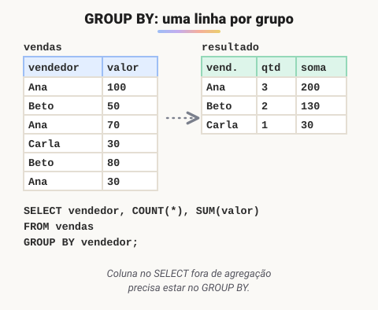

# Agregação e ordenação

> 🗺️ **Nesta aula:** funções de agregação (`COUNT`, `SUM`, `AVG`, `MAX`, `MIN`), agrupar com `GROUP BY`, filtrar grupos com `HAVING`, ordenar com `ORDER BY` e paginar com `LIMIT`.

## De onde paramos

Com JOINs você monta listas detalhadas. Mas relatórios costumam pedir resumos: total vendido por mês, quantidade de pedidos por cliente, ticket médio. É o papel da agregação.

## Funções de agregação

**Funções de agregação resumem muitas linhas em um único valor.**

| Função | O que faz | Detalhe |
| --- | --- | --- |
| `COUNT(*)` | conta linhas | conta todas, inclusive com NULL |
| `COUNT(coluna)` | conta valores **não nulos** | `COUNT(DISTINCT cidade)` conta valores diferentes |
| `SUM(coluna)` | soma | ignora NULL |
| `AVG(coluna)` | média | ignora NULL (não conta como zero!) |
| `MAX` / `MIN` | maior / menor | números, datas e texto |

```sql
SELECT
  SUM(valor) AS total_vendas,
  AVG(valor) AS media_vendas,
  COUNT(*)   AS total_pedidos,
  MAX(valor) AS maior_venda
FROM vendas;
```

## GROUP BY: agregar por grupo

Sem `GROUP BY`, a agregação resume a tabela inteira em **uma** linha. Com ele, o banco cria **uma linha por grupo**.



> 💡 **Analogia:** é como esvaziar um cofrinho na mesa. Primeiro você tira as moedas estrangeiras (`WHERE`, antes de agrupar). Depois separa as moedas em pilhas por valor (`GROUP BY`) e conta ou soma cada pilha (`COUNT`, `SUM`). Por fim, ignora as pilhas com menos de 5 moedas (`HAVING`, depois de agrupar). Cada pilha vira uma linha do resultado.

```sql
SELECT vendedor, COUNT(*) AS qtd, SUM(valor) AS total
FROM vendas
GROUP BY vendedor;
```

Regra: toda coluna do `SELECT` que **não** está dentro de uma função de agregação precisa estar no `GROUP BY`. Senão o banco não sabe qual valor mostrar (o PostgreSQL dá erro; o MySQL pode devolver um valor qualquer).

## WHERE × HAVING

- `WHERE` filtra **linhas**, **antes** de agrupar. Não aceita funções de agregação.
- `HAVING` filtra **grupos**, **depois** de agregar.

```sql
-- vendedores com mais de R$ 150 em vendas pagas
SELECT vendedor, SUM(valor) AS total
FROM vendas
-- 1º: só vendas pagas
WHERE status = 'pago'
-- 2º: agrupa
GROUP BY vendedor
-- 3º: só grupos com mais de 150
HAVING SUM(valor) > 150
-- 4º: ordena
ORDER BY total DESC;
```

## Ordenação: ORDER BY

```sql
-- decrescente
SELECT nome, idade FROM clientes ORDER BY idade DESC;
-- desempate pela 2ª coluna
SELECT nome, cidade FROM clientes ORDER BY cidade, nome;
-- top 5
SELECT nome, total FROM pedidos
ORDER BY total DESC LIMIT 5;
```

- O padrão é `ASC` (crescente).
- `ORDER BY` aceita apelidos do `SELECT` (`ORDER BY total`) e é **a única forma de garantir ordem**: sem ele, o banco devolve na ordem que quiser.
- Paginação: `LIMIT 10 OFFSET 20` (página 3, com 10 por página). No SQL Server, use `OFFSET ... FETCH`.

> ⚠️ **Correção:** `COUNT(coluna)` não conta "o número de linhas da coluna": ele conta só os valores **não nulos**. Para contar linhas, use `COUNT(*)`.

## Exercício

Na tabela `pedidos(id, cliente_id, data_pedido, total)`, escreva uma consulta que mostre, para cada cliente com pelo menos 3 pedidos, a quantidade de pedidos e o ticket médio, do maior ticket para o menor.

<details>
<summary>Ver resposta</summary>

```sql
SELECT
  cliente_id,
  COUNT(*)   AS qtd_pedidos,
  AVG(total) AS ticket_medio
FROM pedidos
GROUP BY cliente_id
HAVING COUNT(*) >= 3
ORDER BY ticket_medio DESC;
```

O filtro "pelo menos 3 pedidos" é sobre o grupo, por isso vai no `HAVING`, e não no `WHERE`.

</details>

## 🧠 Revisão rápida

**Qual a diferença entre `COUNT(*)` e `COUNT(email)`?**

`COUNT(*)` conta linhas; `COUNT(email)` conta só os e-mails não nulos.

**Quando usar `HAVING` em vez de `WHERE`?**

Quando o filtro usa uma agregação, como `SUM` ou `COUNT`.

**Sem `ORDER BY`, a ordem do resultado é garantida?**

Não.

> ➡️ **Próximo passo:** usar o resultado de uma consulta dentro de outra: **Subconsultas (subqueries)**.

## 📌 Resumo

| Item | Em uma frase |
| --- | --- |
| `COUNT/SUM/AVG/MAX/MIN` | resumem várias linhas |
| `GROUP BY` | uma linha por grupo |
| `WHERE` | filtra linhas antes de agrupar |
| `HAVING` | filtra grupos depois de agrupar |
| `ORDER BY` | a única garantia de ordem |
| `LIMIT ... OFFSET` | paginação |
