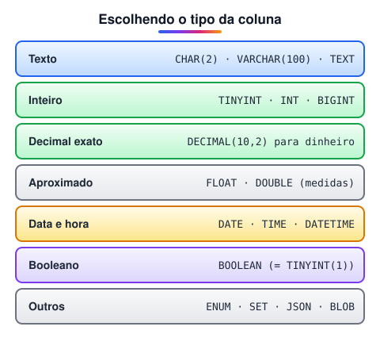

# Tipos de dados

> 🗺️ **Nesta aula:** os tipos de dados do MySQL para texto, números inteiros e decimais, data e hora, booleano, binário, `ENUM`, `SET` e `JSON`, e como escolher o tipo certo.

## De onde paramos

Nos `CREATE TABLE` apareceram `VARCHAR`, `INT`, `DECIMAL` e `DATE`. Escolher bem o tipo de cada coluna evita erros de arredondamento, desperdício de espaço e dados inválidos.

> 💡 Os tipos abaixo são os do **MySQL/MariaDB**. Os nomes e limites mudam um pouco em outros bancos: no PostgreSQL, por exemplo, existem `TEXT` sem limite, `SERIAL` e `BOOLEAN` de verdade.



## Texto

| Tipo | Descrição |
| --- | --- |
| `CHAR(n)` | tamanho **fixo** (completa com espaços), até 255 caracteres; bom para códigos fixos (UF) |
| `VARCHAR(n)` | tamanho **variável**, até `n` caracteres (limite de 65.535 bytes por linha) |
| `TINYTEXT` | até 255 bytes |
| `TEXT` | até 65.535 bytes (≈ 64 KB) |
| `MEDIUMTEXT` | até 16.777.215 bytes (≈ 16 MB) |
| `LONGTEXT` | até 4 GB |

Use `VARCHAR` para quase tudo (nome, e-mail) e `TEXT` para conteúdos longos (descrição, artigo). Com `utf8mb4`, cada caractere pode ocupar até 4 bytes, então o limite em **caracteres** fica menor que o em bytes.

## Números inteiros

| Tipo | Com sinal | Sem sinal (`UNSIGNED`) |
| --- | --- | --- |
| `TINYINT` | -128 a 127 | 0 a 255 |
| `SMALLINT` | -32.768 a 32.767 | 0 a 65.535 |
| `MEDIUMINT` | -8.388.608 a 8.388.607 | 0 a 16.777.215 |
| `INT` | -2.147.483.648 a 2.147.483.647 | 0 a 4.294.967.295 |
| `BIGINT` | ±9,2 × 10¹⁸ | 0 a 1,8 × 10¹⁹ |

## Números decimais

| Tipo | Descrição |
| --- | --- |
| `DECIMAL(m, d)` | ponto **fixo**, **exato**: `m` dígitos no total (até 65), `d` casas decimais. `DECIMAL(10,2)` vai até 99.999.999,99 |
| `FLOAT` | ponto flutuante de 4 bytes, aproximado (≈ 7 dígitos) |
| `DOUBLE` | ponto flutuante de 8 bytes, aproximado (≈ 15 dígitos) |

> ⚠️ **Dinheiro é sempre** `DECIMAL`, nunca `FLOAT`/`DOUBLE`. Pontos flutuantes são aproximados: `0.1 + 0.2` pode virar `0.30000000000000004`, e centavos somem em relatórios.

## Data e hora

| Tipo | Formato | Observação |
| --- | --- | --- |
| `DATE` | `'AAAA-MM-DD'` | só a data |
| `TIME` | `'HH:MM:SS'` | só a hora (ou uma duração) |
| `DATETIME` | `'AAAA-MM-DD HH:MM:SS'` | data e hora "como foi escrita", sem fuso |
| `TIMESTAMP` | `'AAAA-MM-DD HH:MM:SS'` | guardada em UTC; vai de 1970 a 2038 |
| `YEAR` | `AAAA` | só o ano |

## Booleano

No MySQL, `BOOLEAN` (ou `BOOL`) é apenas um apelido de `TINYINT(1)`: `TRUE` = 1 e `FALSE` = 0.

## Binário

| Tipo | Descrição |
| --- | --- |
| `BINARY(n)` / `VARBINARY(n)` | bytes de tamanho fixo / variável (hashes, UUID binário) |
| `TINYBLOB` · `BLOB` · `MEDIUMBLOB` · `LONGBLOB` | até 255 B · 64 KB · 16 MB · 4 GB |

Para imagens e arquivos, o mais comum é guardar o arquivo em um serviço de armazenamento (S3, Cloud Storage) e salvar no banco apenas a **URL ou o caminho**.

## ENUM, SET e JSON

```sql
-- UM valor da lista
status ENUM('pendente', 'pago', 'cancelado')
  DEFAULT 'pendente',
-- VÁRIOS valores da lista
dias SET('seg', 'ter', 'qua', 'qui', 'sex'),
-- documento JSON (MySQL 5.7+)
extras JSON
```

> ⚠️ **Correções:** o limite do `VARCHAR` é **65.535** bytes, não 65.353. A descrição de `DECIMAL` ("128 bits, 28-29 dígitos") era do tipo `decimal` do C#/.NET; no MySQL, `DECIMAL` aceita até **65 dígitos**. E `BOOLEAN` no MySQL é `TINYINT(1)`.

## Exercício

Escolha o tipo de cada coluna de uma tabela `usuarios`: id, nome, e-mail, UF, data de nascimento, saldo da carteira, aceitou os termos (sim/não), biografia longa e momento do cadastro.

<details>
<summary>Ver resposta</summary>

```sql
CREATE TABLE usuarios (
  id          INT UNSIGNED PRIMARY KEY AUTO_INCREMENT,
  nome        VARCHAR(100) NOT NULL,
  email       VARCHAR(150) NOT NULL UNIQUE,
  uf          CHAR(2),
  nascimento  DATE,
  saldo       DECIMAL(12, 2) NOT NULL DEFAULT 0,
  aceitou     BOOLEAN NOT NULL DEFAULT FALSE,
  biografia   TEXT,
  criado_em   TIMESTAMP DEFAULT CURRENT_TIMESTAMP
);
```

Destaques: `CHAR(2)` para UF (tamanho fixo), `DECIMAL` para dinheiro e `DATE`, não texto, para datas.

</details>

## 🧠 Revisão rápida

**Qual tipo usar para dinheiro?**

`DECIMAL`.

**Qual a diferença entre `CHAR` e `VARCHAR`?**

`CHAR` tem tamanho fixo; `VARCHAR`, variável.

**Como guardar uma foto de perfil?**

Num serviço de arquivos, salvando no banco só a URL.

> ➡️ **Próximo passo:** consultas salvas que funcionam como tabelas: **Views**.

## 📌 Resumo

| Tipo | Em uma frase |
| --- | --- |
| `VARCHAR` | texto curto e variável |
| `TEXT` | texto longo |
| `INT` / `BIGINT` | inteiros |
| `DECIMAL` | decimais exatos (dinheiro) |
| `FLOAT` / `DOUBLE` | decimais aproximados |
| `DATE` / `DATETIME` / `TIMESTAMP` | datas e horas |
| `BOOLEAN` | `TINYINT(1)` no MySQL |
| `ENUM` / `JSON` | lista fixa / documento |
