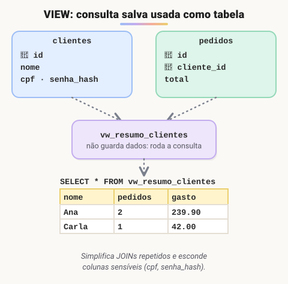

# Views

> 🗺️ **Nesta aula:** o que é uma view, como criar, usar, alterar e apagar, para que serve (simplificar, proteger e padronizar), quando dá para alterar dados por ela e o que é uma view materializada.

## De onde paramos

Algumas consultas, como "quanto cada cliente já gastou", se repetem em vários relatórios e envolvem JOIN e agregação. Em vez de reescrevê-las toda vez, dá para salvá-las no banco.

## O que é uma view

**Uma view é uma consulta** `SELECT` **salva no banco com um nome, que pode ser usada como se fosse uma tabela.** Ela não armazena dados: cada vez que você consulta a view, o banco executa a consulta por trás dela.



## Criando e usando

```sql
CREATE VIEW vw_resumo_clientes AS
SELECT c.nome,
       COUNT(p.id)  AS pedidos,
       SUM(p.total) AS gasto
FROM clientes c
JOIN pedidos p ON p.cliente_id = c.id
GROUP BY c.id, c.nome;

-- usa como uma tabela
SELECT * FROM vw_resumo_clientes
WHERE gasto > 100
ORDER BY gasto DESC;

-- altera ou apaga
CREATE OR REPLACE VIEW vw_resumo_clientes AS ...;
DROP VIEW vw_resumo_clientes;
```

## Para que servem

- **Simplificar**: um JOIN complicado é escrito uma vez e reaproveitado em vários relatórios.
- **Segurança**: o usuário recebe permissão só na view (`GRANT SELECT ON vw_... TO analista`), sem ver colunas sensíveis como `cpf` ou `senha_hash`.
- **Abstração**: se a estrutura das tabelas mudar, basta ajustar a view, e quem a usa não percebe.
- **Padronização**: todo mundo calcula "gasto do cliente" do mesmo jeito.

## Dá para alterar dados por uma view?

Só em **views simples** (uma tabela, sem `GROUP BY`, `DISTINCT`, agregações ou `UNION`). Nesse caso, `INSERT`/`UPDATE`/`DELETE` na view vão para a tabela original. Views com JOIN e agregação, como a do exemplo, são **somente leitura**.

`WITH CHECK OPTION` impede inserir pela view uma linha que ela própria não mostraria:

```sql
CREATE VIEW vw_produtos_ativos AS
SELECT * FROM produtos WHERE ativo = TRUE
-- bloqueia INSERT de produto inativo por esta view
WITH CHECK OPTION;
```

## View × view materializada

Uma view comum roda a consulta **toda vez**. Em consultas pesadas, o **PostgreSQL** e o **Oracle** oferecem a **view materializada** (`CREATE MATERIALIZED VIEW`), que **guarda o resultado** e é atualizada sob demanda (`REFRESH MATERIALIZED VIEW`). O MySQL não tem esse recurso nativo.

> ⚠️ **Correção:** a aula dizia que "as alterações feitas nos dados através de uma view são refletidas nas tabelas", como se isso valesse sempre. Só vale para views **atualizáveis** (simples, de uma tabela, sem agregação).

## Exercício

Crie uma view `vw_produtos_baratos` com nome e preço dos produtos abaixo de R$ 20 e consulte-a ordenando pelo preço.

<details>
<summary>Ver resposta</summary>

```sql
CREATE VIEW vw_produtos_baratos AS
SELECT nome, preco
FROM produtos
WHERE preco < 20;

SELECT * FROM vw_produtos_baratos
ORDER BY preco;
```

Como é uma view simples, de uma tabela só, ela também é atualizável.

</details>

## 🧠 Revisão rápida

**Uma view guarda dados?**

Não. Ela executa a consulta a cada uso (exceto a materializada).

**Como uma view ajuda na segurança?**

Dando acesso só à view, que esconde colunas sensíveis.

**Dá para fazer `UPDATE` numa view com `GROUP BY`?**

Não. Ela é somente leitura.

> ➡️ **Próximo passo:** regras que o próprio banco garante: **Restrições de atributo e de tabela**.

## 📌 Resumo

| Item | Em uma frase |
| --- | --- |
| View | consulta salva usada como tabela |
| `CREATE OR REPLACE VIEW` | cria ou altera |
| Segurança | expõe só as colunas permitidas |
| View atualizável | simples, de uma tabela |
| `WITH CHECK OPTION` | barra linhas fora do filtro |
| Materializada | guarda o resultado; precisa de refresh |
