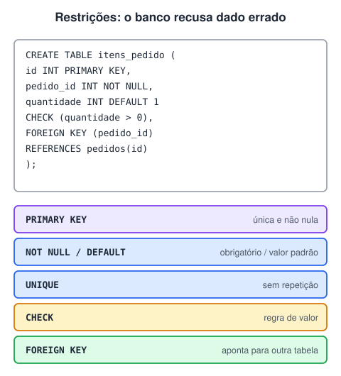

# Restrições de atributo e de tabela

> 🗺️ **Nesta aula:** as restrições que o banco garante (`NOT NULL`, `UNIQUE`, `PRIMARY KEY`, `FOREIGN KEY`, `CHECK`, `DEFAULT`), restrições de coluna e de tabela, ações de chave estrangeira e como adicioná-las depois.

## De onde paramos

Os tipos de dados limitam o formato de cada coluna. As restrições vão além: garantem regras como "o e-mail não se repete" ou "o salário é positivo", seja qual for o programa que grava os dados.

## Para que servem as restrições



**Restrições (constraints) são regras que o próprio banco garante: ele recusa qualquer** `INSERT`**,** `UPDATE` **ou** `DELETE` **que as viole.** Assim, os dados ficam corretos mesmo que o código da aplicação tenha um bug.

| Restrição | Garante |
| --- | --- |
| `NOT NULL` | a coluna sempre tem valor |
| `UNIQUE` | não há valores repetidos na coluna |
| `PRIMARY KEY` | `NOT NULL` e `UNIQUE`: identifica cada linha (uma por tabela) |
| `FOREIGN KEY` | o valor existe na tabela referenciada |
| `CHECK` | uma condição lógica é verdadeira |
| `DEFAULT` | valor automático quando nenhum é informado |

## De coluna × de tabela

Quase todas podem ser escritas **junto da coluna** ou **no fim da tabela**. A forma de tabela é obrigatória quando a regra envolve **mais de uma coluna** e permite **dar nome** à restrição, o que deixa as mensagens de erro muito mais claras.

## NOT NULL e DEFAULT

```sql
CREATE TABLE usuarios (
  id        INT PRIMARY KEY AUTO_INCREMENT,
  username  VARCHAR(50)  NOT NULL,
  email     VARCHAR(100) NOT NULL,
  ativo     BOOLEAN      NOT NULL DEFAULT TRUE,
  criado_em TIMESTAMP    DEFAULT CURRENT_TIMESTAMP
);
```

## UNIQUE

```sql
CREATE TABLE funcionarios (
  id     INT PRIMARY KEY,
  -- de coluna
  codigo VARCHAR(10) UNIQUE,
  cpf    CHAR(11),
  nome   VARCHAR(50),
  -- de tabela, com nome
  CONSTRAINT uq_funcionarios_cpf UNIQUE (cpf)
);
```

`UNIQUE` aceita `NULL` (e, na maioria dos bancos, vários `NULL`, porque `NULL` não é igual a `NULL`).

## PRIMARY KEY

```sql
-- de coluna
CREATE TABLE produtos (
  id    INT PRIMARY KEY,
  nome  VARCHAR(50),
  preco DECIMAL(10, 2)
);

-- de tabela: obrigatória para chave COMPOSTA
CREATE TABLE matriculas (
  aluno_id      INT,
  disciplina_id INT,
  PRIMARY KEY (aluno_id, disciplina_id)
);
```

## FOREIGN KEY

```sql
CREATE TABLE pedidos (
  id         INT PRIMARY KEY,
  cliente_id INT NOT NULL,
  data       DATE,
  CONSTRAINT fk_pedidos_cliente
    FOREIGN KEY (cliente_id) REFERENCES clientes(id)
    -- impede apagar cliente com pedidos (padrão)
    ON DELETE RESTRICT
    -- se o id do cliente mudar, atualiza aqui
    ON UPDATE CASCADE
);
```

| Ação | Efeito quando o "pai" é apagado ou alterado |
| --- | --- |
| `RESTRICT` / `NO ACTION` | bloqueia a operação |
| `CASCADE` | apaga ou atualiza os "filhos" junto |
| `SET NULL` | coloca `NULL` na chave estrangeira dos filhos |
| `SET DEFAULT` | coloca o valor padrão (pouco suportado no MySQL) |

A tabela referenciada (`clientes`) precisa existir **antes**.

## CHECK

```sql
CREATE TABLE funcionarios (
  id      INT PRIMARY KEY,
  nome    VARCHAR(50) NOT NULL,
  idade   INT,
  salario DECIMAL(10, 2),
  CONSTRAINT ck_idade   CHECK (idade >= 18),
  CONSTRAINT ck_salario CHECK (salario > 0)
);
```

> ⚠️ No **MySQL**, o `CHECK` só passou a ser respeitado a partir da versão **8.0.16**. Em versões anteriores, ele era aceito na sintaxe e **ignorado** em silêncio.

## Adicionando ou removendo depois

```sql
ALTER TABLE clientes
  ADD CONSTRAINT uq_clientes_email UNIQUE (email);
-- MySQL
ALTER TABLE pedidos DROP FOREIGN KEY fk_pedidos_cliente;
-- PostgreSQL / SQL Server
ALTER TABLE pedidos DROP CONSTRAINT fk_pedidos_cliente;
```

## Exercício

Crie a tabela `reservas` de um hotel com: id, quarto (obrigatório), data de entrada e de saída (obrigatórias, com a saída depois da entrada), número de hóspedes entre 1 e 4 e status com padrão "confirmada". Um mesmo quarto não pode ter duas reservas com a mesma data de entrada.

<details>
<summary>Ver resposta</summary>

```sql
CREATE TABLE reservas (
  id        INT PRIMARY KEY AUTO_INCREMENT,
  quarto    INT NOT NULL,
  entrada   DATE NOT NULL,
  saida     DATE NOT NULL,
  hospedes  INT NOT NULL,
  status    VARCHAR(20) NOT NULL DEFAULT 'confirmada',
  CONSTRAINT ck_datas CHECK (saida > entrada),
  CONSTRAINT ck_hospedes CHECK (hospedes BETWEEN 1 AND 4),
  CONSTRAINT uq_quarto_entrada UNIQUE (quarto, entrada)
);
```

As duas restrições de várias colunas (`ck_datas` e `uq_quarto_entrada`) precisam ser de tabela.

</details>

## 🧠 Revisão rápida

**O que uma PRIMARY KEY garante?**

Valores únicos e não nulos.

**O que faz `ON DELETE CASCADE`?**

Apaga os registros filhos quando o pai é apagado.

**Por que dar nome a uma restrição?**

Para que mensagens de erro digam qual regra foi violada e para poder removê-la depois.

> ➡️ **Próximo passo:** código que o banco executa sozinho a cada alteração: **Triggers**.

## 📌 Resumo

| Restrição | Em uma frase |
| --- | --- |
| `NOT NULL` | sempre tem valor |
| `UNIQUE` | sem repetição |
| `PRIMARY KEY` | única e não nula |
| `FOREIGN KEY` | aponta para algo que existe |
| `CHECK` | condição sempre verdadeira |
| `DEFAULT` | valor automático |
| `CONSTRAINT nome` | restrição nomeada, de tabela |
